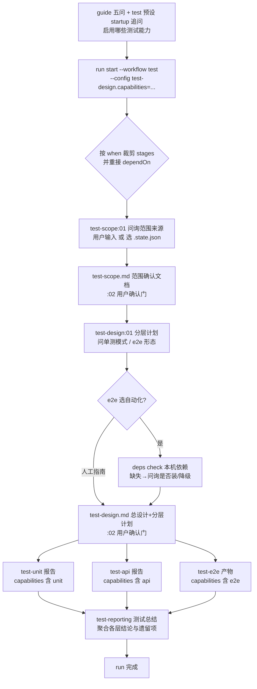

# 测试工作流与依赖检查能力 Plan

> revision: r2｜文档模式: single｜依据: spec.md（已确认，BQ-1 已写回）+ plan:02 门用户修改（采纳末端测试总结阶段）｜r1→r2 变化：新增 test-reporting 任务（链尾无条件阶段，聚合各层报告）

## 执行摘要

为 ddo-code-flow 新增独立测试工作流（`test` 预设：test-scope → test-design → 条件执行的 test-unit/test-api/test-e2e → 无条件的 test-reporting 汇总），并新增原子任务依赖检查能力（任务声明依赖 + `deps check` 命令 + 结果驱动的动态问询）。引擎侧三个小扩展：预设 stages 可声明 `when` 条件（run start 按旋钮值裁剪并重接依赖）、`run start --config` 运行级旋钮覆盖、guide mode 问为带 `startup` 声明的预设附数据驱动追问。交付含 1 预设、6 新原子任务、CLI/lib 扩展、仓库自测与 README 更新；既有预设与门协议零改动。

## 范围与非目标

| 事项 | 说明 | AI 索引 |
|---|---|---|
| 测试工作流预设 | `workflows/test.json`：范围设定 → 计划制定 → 三层分级执行（后三者条件裁剪）→ 测试总结 | FR-SCOPE-1/2、FR-PLAN-1..5、FR-EXEC-1..3 |
| 6 个新原子任务 | test-scope / test-design / test-unit / test-api / test-e2e / test-reporting（产物+契约+钩子） | 同上 + plan:02 门用户修改 |
| 引擎扩展 | `when` 条件裁剪、`--config` 旋钮覆盖、guide startup 追问 | FR-PLAN-2、AC-4 |
| 依赖检查能力 | config.json `dependencies` 声明 + `deps check` 命令 + 动态问询协议 | FR-DEP-1/2/3 |
| 仓库自测与文档 | tools/tests 新增用例 + README 工作流/命令清单 | 全部 AC |
| 非目标 | 不改既有预设语义与门协议；无数据库；不新增覆盖率门槛类验收项 | spec Non-goals |

## 现有设计与复用基线

| 能力 | 文件路径 | 符号 | 证据类型 | 采用方式 | 适用边界 | AI 索引 |
|---|---|---|---|---|---|---|
| 预设加载与 DAG 校验 | tools/lib/workflow.js | loadWorkflow/expandStages | Repository Fact | 扩展现有实现 | `when` 为可选字段，旧预设零影响 | DEC-B |
| 旋钮预填与三层合并 | tools/cli.js（runStart 预填段）、tools/lib/assemble.js | mergeConfig | Repository Fact | 扩展现有实现 | `--config` 在 defaults 预填后覆盖进 state.atomTasks | DEC-C |
| assemble/present 钩子 | tools/lib/assemble.js、tools/lib/gate.js；先例 atom-tasks/spec/spec.js | assemble({phase,state,...}) | Repository Fact | 复用现有实现 | test-*.js 注入上游产物与旋钮 ctx | DEC-F |
| 确认门四态选项 | tools/lib/workflow.js buildGate；先例 atom-tasks/test-plan/config.json | gate.options | Repository Fact | 复用现有实现 | test-scope:02、test-design:02 | DEC-F |
| 产出契约硬校验 | tools/lib/output-schema.js + _schema/output-schema.schema.json | validateArtifact | Repository Fact | 复用现有实现 | 条件 section 用「可选 + 必填启用清单」表达 | DEC-F |
| guide 条件追问先例 | tools/cli.js | guideWorktreeQuestion（followUps 数组） | Repository Fact | 扩展现有实现 | mode 问按预设 startup 声明附 followUp | DEC-D |
| 仓库测试形态 | tools/tests/*.test.js | node --test | Repository Fact | 复用现有实现 | 新增用例并入同一运行方式 | VA-1 |
| 依赖声明与检查 | tools/cli.js REGISTRY、atom-tasks/_schema/task-config.schema.json | 无 deps 命令、无 dependencies 字段 | Repository Fact | 新增实现 | 注册表现无该能力，任务 config 亦无此字段，全新增 | DEC-E |

## 整体架构与流程

参与方：用户（决议/问询）、宿主 agent（问询与执行）、CLI（状态与校验）、原子任务（协议载体）。改动只在预设、任务目录与 CLI/lib；执行内核状态机（相位推进/DAG/门）不变。

异常流：`.state.json` 缺失或多份 → 问询回落（改用户输入/列清单选定）；e2e 依赖缺失且用户不同意安装 → 提示改人工指南形态（非强制依赖语义）。

## 技术选型与方案对比

| 方案 | 来源 | 仓库适配性 | 代价与风险 | 状态 | 结论 | AI 索引 |
|---|---|---|---|---|---|---|
| A. `when` 条件 + run start 裁剪 | 初始 Plan | 复用 loadWorkflow/expandStages，物化前裁剪不破坏 D11 | 重接逻辑需测试覆盖 | accepted | 未启用阶段不进入本次流程（正合 AC-4） | DEC-B |
| B. 全阶段入链 + 跳过产物 | 初始 Plan | 无引擎改动 | 产物污染、违背 AC-4 | rejected | 否 | DEC-B |
| C. 组合预设（test-full/api-only…） | 初始 Plan | 无引擎改动 | 组合爆炸、旋钮不单一 | rejected | 否 | DEC-B |
| A. `run start --config` 运行级覆盖 | 初始 Plan | 顺接旋钮预填段 | 解析/校验新增 | accepted | 启动前定制旋钮的唯一通道 | DEC-C |
| B. 中途 `config set` 命令 | 初始 Plan | 需新增写 state 入口 | 裁剪时点必须先于物化；扩大 state 写面 | rejected | 否 | DEC-C |
| A. 预设 `startup` 声明驱动 guide 追问 | 初始 Plan | 同 guideWorktreeQuestion 数据驱动先例 | guide payload 增一字段 | accepted | 任意预设可声明启动追问，不硬编码 | DEC-D |
| B. guide 硬编码 test 分支 | 初始 Plan | 可行 | 违数据驱动先例，预设膨胀即硬编码堆积 | rejected | 否 | DEC-D |
| A. 任务 `dependencies` 声明 + `deps check` 命令 | 初始 Plan | REGISTRY 注册即文档源 | 新命令+schema 扩展 | accepted | 可枚举、可测、可被任意任务复用 | DEC-E |
| B. 依赖脚本内嵌各任务 prompt | 初始 Plan | 零引擎改动 | 不可枚举、不可统一询问 | rejected | 否 | DEC-E |
| A. e2e 统一产物 e2e-test-report.md（内容随形态） | 初始 Plan | 适配 output 单文件声明 | 两种内容形态共用骨架 | accepted | 避免 updates 多文件存在性校验挂单形态 | DEC-G |

## 数据模型设计

### 实体与字段

- `workflows/test.json`：`{name:"test", version, description, stages[7], startup}`；`startup = {question, multiSelect:true, options:[{name,desc}], mapToConfig:"test-design.capabilities"}`。链尾 test-reporting 无条件（`when` 不声明）：裁剪重接后天然依赖最后一个存活阶段；零执行层启用时产出「仅计划、无执行」形态总结。
- `stages[].when`（可选，引擎通用）：`{config:"<task>.<key>", includes:"<value>"}`——值为数组时判包含、标量时判相等。
- `config.dependencies[]`（可选，任务级）：`{id, desc, required:boolean, check:"checks/<file>.sh"（相对任务目录）, install?:string（安装指引）}`。
- `state.atomTasks.test-design.capabilities: string[]`，default `["unit","api","e2e"]`；`--config` 可覆盖。单一事实源：裁剪与计划生成同读此值。

### schema 与 DDL（如适用）

不适用：无数据库。结构契约落 `_schema/task-config.schema.json`（新增 dependencies 字段定义，严格校验）与各任务 `<task>.output.schema.json`。

### 状态与不变量

- `when` 求值仅发生于 run start 物化前；物化后 state.stages 自包含（既有 D11 不变量保持）。
- 裁剪保留偏序：被裁阶段的 dependOn 传递给其引用者，保留集内 DAG 无悬空、无环（复用 Kahn 校验）。
- `capabilities` 含某层 ⇔ 对应执行阶段在链（同源推导，无第二份状态）。
- `deps check` 只读（不写 state），逐项独立，单项失败不影响他项。

### 迁移、兼容与回滚

无持久数据迁移。`when`/`startup`/`dependencies` 均为可选字段，旧预设与旧任务零影响（task-config.schema additionalProperties 已放行，本次将其转正为受校验字段）。运行中 run 不受预设后续变更影响（状态已物化）。回滚 = revert 本分支 PR，无数据善后。

## API 接口设计

| 接口/入口 | 请求 | 响应 | 错误与幂等 | 复用标准 | 实现职责 | AI 索引 |
|---|---|---|---|---|---|---|
| run start（扩展） | 新 flag `--config <task>.<key>=<JSON>`，可重复 | 现有 JSON + atomTasks 生效值 | 任务不在链/key 未声明/JSON 非法 → exit 2；幂等：同键后者胜 | runStart 旋钮预填段 | 运行级旋钮覆盖 + 触发裁剪 | DEC-C |
| deps check（新命令） | `--state <path> [--task <name>\|--all]`，缺省=当前链全部 | `{checks:[{task,id,desc,required,supported,install}], summary}` | state/任务不存在 → exit 1；检查脚本报错= supported:false（结果型，不设命令错误码）；幂等只读 | REGISTRY 四通道/JSON stdout | 枚举声明并逐项执行 | DEC-E |
| guide（扩展） | 无新参数 | mode 问 options 增 test；followUps 增 startup 追问 + 映射 hint（选中集合 → `--config <mapToConfig>='[...]'`） | 预设无 startup 则不附（现状） | guideWorktreeQuestion 先例 | 数据驱动启动追问 | DEC-D |
| exec/validate/next/gate | 不变 | 不变 | 不变 | 现有协议 | 自动适用于新任务与 `when` 裁剪后的链 | — |

## 算法设计

1. **条件裁剪 + 依赖重接**（lib/workflow.js `pruneStages(preset, atomTasks)`）：解析每个 `when.config` 路径取旋钮值求布尔 → 删除 false 阶段 → 重接：保留阶段 dependOn 中被裁者替换为被裁者的 dependOn（迭代至不动点），去重去自指 → 复用 Kahn 环校验。不变量：保留集偏序不变；复杂度 O(V·E)，链规模下可忽略。
2. **--config 解析**（cli.js）：`<task>.<key>=<json>`；JSON.parse 失败回退字符串字面；校验 task ∈ preset.stages 且 key ∈ 该任务 configurable（防拼错 fail fast）；defaults 预填后应用，随后进入裁剪。
3. **deps check 枚举执行**（lib/deps.js）：目标集 = `--task` 指定或 state.stages 键全集；逐任务读 dependencies（无声明跳过）；`check` 脚本以任务目录为 cwd、bash 执行、60s 超时；exit 0 → supported:true。纯汇总输出。

## 文件变更计划

| 文件/目录 | 变更职责 | 复用或依赖 | AI 索引 |
|---|---|---|---|
| workflows/test.json | 新增 test 预设（stages + when + startup） | loadWorkflow 扩展 | DEC-B/D |
| atom-tasks/_schema/task-config.schema.json | 新增 dependencies 字段定义 | 既有 schema 模式 | DEC-E |
| atom-tasks/test-scope/（config/prompt/output.schema/test-scope.js） | 范围问询→test-scope.md→确认门；钩子注入 :02 待审文档 | spec.js 钩子先例 | FR-SCOPE-1/2 |
| atom-tasks/test-design/（config/prompt/output.schema/test-design.js） | 分层计划→test-design.md→确认门；@interact 强制问询；钩子注入 scope+capabilities | 同上 + INTERACT_RE | FR-PLAN-1..5 |
| atom-tasks/test-unit/（四件套） | 按计划执行单测（串行 1-3 条/批 或 并行）→ unit-test-report.md；钩子注入计划 | — | FR-EXEC-1 |
| atom-tasks/test-api/（四件套） | req/resp 验证与调通 → api-test-report.md | — | FR-EXEC-2 |
| atom-tasks/test-e2e/（四件套 + checks/*.sh + dependencies 声明） | 按形态执行 → e2e-test-report.md（人工指南/自动结果双形态骨架）；声明浏览器自动化依赖 | deps check | FR-EXEC-3、FR-DEP-* |
| tools/cli.js | --config 解析、runStart 裁剪接入、deps check 注册、guide followUp | REGISTRY 模式 | DEC-B/C/D/E |
| tools/lib/workflow.js | when 校验 + pruneStages | Kahn 复用 | DEC-B |
| tools/lib/deps.js | 依赖声明读取与逐项执行 | spawnSync | DEC-E |
| atom-tasks/test-reporting/（config/prompt/output.schema/test-reporting.js） | 链尾汇总：聚合 test-design 与各启用层报告 → test-reporting.md（结论/通过率/遗留项）；钩子注入各上游产物 | 依赖重接 | plan:02 门用户修改 |
| tools/tests/test-workflow.test.js、tools/tests/deps-check.test.js | 裁剪/覆盖/追问/检查/新任务结构/E2E 冒烟 | node --test | VA-* |
| README.md | 内置工作流清单、目录树、命令表补 test 与 deps check | — | — |

## 兼容、稳定性与回滚

| 关注点 | 适用性 | 设计/理由 | 回滚信号 | AI 索引 |
|---|---|---|---|---|
| 旧预设兼容 | 适用 | when/startup/dependencies 均可选，未声明走原路径 | 旧预设相关测试回归 | DEC-B |
| 既有 run 兼容 | 适用 | 状态物化自包含，不回读预设 | resume/start 测试回归 | D11 |
| guide 载荷增量 | 适用 | 仅新增 followUp 条目，既有消费方按需忽略 | guide 测试回归 | DEC-D |
| 跨平台脚本 | 本 skill 运行环境为 darwin/bash | checks 脚本以 bash 基线；非 POSIX 环境属非目标 | 手工冒烟失败 | DEC-E |
| 回滚策略 | 适用 | 单 PR 交付，revert 即回滚，无数据善后 | 全量测试失败 | — |

## Verification Anchor

| 需验证契约 | 可观察结果 | 证据位置 | AI 索引 |
|---|---|---|---|
| 引擎回归 | `node --test tools/tests/*.test.js` 全绿（含既有 134 用例） | tools/tests | VA-1 |
| 条件裁剪 | 临时目录冒烟：全能力链含 5 阶段；`--config test-design.capabilities='["unit"]'` 后链仅 test-scope/test-design/test-unit | test-workflow.test.js | VA-2、AC-4 |
| 启动追问 | guide payload 的 mode 问含 test 选项与 startup followUp 映射 hint | guide.test.js 增量 | VA-3、AC-4 |
| 依赖检查 | `deps check --task test-e2e` 输出逐项 supported/required/install 报告 | deps-check.test.js | VA-4、AC-11/12 |
| 产物契约 | 各新任务 validate 对缺 section 产物报错、对合规产物通过 | validate.test.js 增量 | VA-5、AC-1..10 |
| 端到端语义 | 本仓库自身以 test 工作流冒烟一次（scope 文档/分层计划/报告/总结结构可判读） | 冒烟 run 材料 | VA-6 |

## 开放问题与 Spec 对应

| 问题 | 确定答案或阻塞原因 | 解决位置 | AI 索引 |
|---|---|---|---|
| PD-1 检查形态/清单/时机 | config.dependencies 声明 + checks 脚本 + `deps check` 命令；时机=能力启用前（e2e 计划选型时） | 算法 3、test-e2e 任务 | DEC-E |
| PD-2 e2e 工具与文档结构 | 自动化=宿主浏览器自动化能力（checks 检测 playwright CLI/浏览器可执行）；产物统一 e2e-test-report.md 双形态骨架 | test-e2e 四件套 | DEC-G |
| PD-3 config 接入与注册 | `--config` 运行级覆盖 + 预设 startup 声明 + workflows/test.json 注册 | API 表、算法 1/2 | DEC-B/C/D |
| spec 全部 FR/AC | 无遗留阻塞——逐条映射见范围/文件/VA 表 | 本 plan 各表 | FR-*、AC-* |
| 末端测试总结阶段（spec 外增量） | 用户在 plan:02 门明确采纳；不与任何 FR/AC 冲突，聚合既有产物 | test-reporting 任务 + 链尾 | plan:02 门用户修改 |

## 风险与下游交接

- 风险：裁剪重接破坏既有链形态（缓解：Kahn 校验 + 专项用例）；e2e 自动化能力因宿主而异（缓解：dependencies 声明 required:false，缺失时问询降级人工指南）；deps 脚本逃逸面（缓解：脚本随 skill 分发、目录相对执行，与 CLI 同信任边界）。
- Tasking/Coding 读取范围：本 plan（single 模式，无分册）；按「文件变更计划」行拆分任务，引擎扩展（cli/lib/schema）先行，任务目录与预设随后，测试与 README 收尾。
- 事实失效处理：tools/cli.js、tools/lib/workflow.js、_schema 结构与本 plan 记载不符时，停止并报告，不自行改已批准契约。

## 用户确认

- ✅ **同意**：批准本 Plan，进入 Coding。
- ❌ **修改：<反馈>**：按反馈更新受影响条目，展示变化后重新确认。
- ❓ **提问：<问题>**：仅答疑，不改本 Plan。
- 📦 **归档**：列出可用模板（当前：`ddo.md`），不产出文档。
- 📦 **归档：ddo.md**：按模板生成 tech-design 归档产物。
