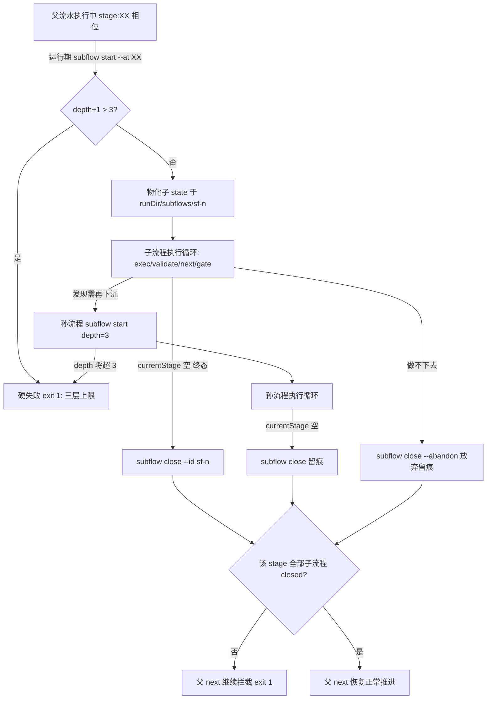

# 流水编排引擎升级 Plan

revision: 2 · 模式: single · 对应 spec: 流水编排引擎升级（已确认）

## 执行摘要

在现有 v2 确定性执行内核（tools/cli.js + tools/lib/*）上新增**子流程分层编排**：运行期 `subflow start` 在 `<runDir>/subflows/<id>/` 物化嵌套子 state，子流程按正常流水逻辑（exec/validate/next/gate）执行；父流程在全种子流程 closed 前被 `next` 拦截（阻塞式）；创建时按 depth 校验三层上限（总深度：父=1）。同时以 `docs/architecture.md` 固化**引导执行层/引擎层**两层定义与解耦契约，并更新 SKILL.md 执行循环协议。全部新增 state 字段可选，旧 .state.json 零迁移（AC-4）。本文档为 single 模式，完整内容即本文件。revision 2 修改：增补 .state.json 定义示例（数据模型设计）与 git-worktree 分支名转写规则修正（DEC-8，用户反馈）；当前运行分支已由 `feat/流水编排引擎升级` 重命名为 `feat/pipeline-engine-upgrade`。

## 范围与非目标

| 事项 | 说明 | AI 索引 |
|---|---|---|
| 子流程引擎能力 | subflow start/list/close 命令、嵌套子 state、阻塞式拦截、三层上限 | FR-1/2/3/5 |
| 两层定义拆分 | docs/architecture.md 固化引导执行层/引擎层职责边界与解耦契约 | FR-4 |
| 引导层物料更新 | SKILL.md 执行循环增子流程协议；README 能力简述 | FR-4/AC-3 |
| 回归保障 | 既有测试全绿 + 新增 subflow 测试 | AC-1/2/4 |
| 分支名转写规则修正 | git-worktree 任务：非 ASCII 标题转写英文 slug（用户反馈新增，超出 spec FR 集） | DEC-8 |
| 非目标 | 不做物理目录重构（BQ-3）；不改 workflows 预设格式（运行期选预设）；不做父/子并行推进（BQ-2 阻塞式）；不新增非功能需求 | — |

## 现有设计与复用基线

| 能力 | 文件路径 | 符号 | 证据类型 | 采用方式 | 适用边界 | AI 索引 |
|---|---|---|---|---|---|---|
| 状态契约与校验 | tools/lib/state.js | readState/writeState/assertState | Repository Fact | 扩展现有实现 | 增可选段 subflows/subflow，模式照 multiRepo 可选段（出现即校验，缺失=旧语义） | DEC-1/7 |
| DAG/相位推进 | tools/lib/workflow.js；tools/cli.js | readyStages/nextPhase/runNext | Repository Fact | 复用现有实现 | 子流程不改父 DAG 结构，仅在 runNext 前加推进许可拦截 | DEC-3 |
| run start 装配 | tools/cli.js:514 | runStart/loadWorkflow/expandStages | Repository Fact | 扩展现有实现 | subflow start 复用装配路径，分叉居所（runDir/subflows）与注册（不入 index） | DEC-2 |
| 门与交互留痕 | tools/lib/gate.js | openGates/presentPayload/isPresentationValid | Repository Fact | 复用现有实现 | 子 state 作为普通 state 直接复用，零改动 | DEC-1 |
| 全局索引 | tools/lib/index-registry.js | register/freshRunId | Repository Fact | 复用现有实现 | 子流程不注册 index（resume 仅面向顶层 run） | DEC-5 |
| 任务物料契约 | atom-tasks/_schema/task-config.schema.json | validateTaskConfig | Repository Fact | 复用现有实现 | 子流程内任务物料零改动 | DEC-1 |
| 生命周期收口 | tools/cli.js:143/200 | runFinish/runRollback | Repository Fact | 扩展现有实现 | 父 run finish 前校验无 active 子流程；rollback 不动 subflows 注册表（材料保留） | DEC-5 |
| 旋钮覆盖 | tools/cli.js:379 | applyConfigOverrides | Repository Fact | 复用现有实现 | subflow start 透传 --config | DEC-2 |
| 测试约定 | tools/tests/next.test.js | node:test + mkdtemp 沙箱 | Repository Fact | 复用现有实现 | 新测试沿用沙箱隔离约定 | AC-1/2/4 |
| 分层架构文档 | docs/（目录不存在） | — | Repository Fact | 新增实现 | 现无文档承载两层定义，新增 docs/architecture.md（现有能力不满足：无此文档） | DEC-6 |

## 整体架构与流程

### 分层总览

- **引擎层**（tools/cli.js + tools/lib/*）：确定性状态机、DAG/相位推进、门与留痕、产物校验、生命周期、子流程编排。只经 CLI 四通道契约（stdout=JSON/stderr/exit code/state 文件）对外；对物料的唯一知识=任务目录契约与预设契约。
- **引导执行层**（SKILL.md + atom-tasks/* + workflows/*.json）：宿主适配与调用契约、启动问询、执行循环协议、原子任务物料（prompt/config/present 钩子）、预设编排。只通过 CLI 命令面驱动引擎。

### 子流程主/异常流程



## 技术选型与方案对比

| 方案 | 来源 | 仓库适配性 | 代价与风险 | 状态 | 结论 | AI 索引 |
|---|---|---|---|---|---|---|
| 嵌套子 state（每子流程独立 .state.json 于 runDir/subflows/） | 初始 Plan | 完全复用既有命令面与 D11 自包含不变量；子流程=正常流水逻辑（BQ-1） | 新增 subflow 域命令与溯源段；双 state 文件由同一代理顺序驱动，无并发写者 | accepted | 采纳：状态自包含、旧 state 零迁移 | DEC-1 |
| 同 state 平铺子 stages | 初始 Plan | 单文件 | stageId 命名空间膨胀；门/回滚/断言语义全需改，回归面失控 | rejected | 否决 | DEC-1 |
| 独立顶层 run + index 关联 | 初始 Plan | 隔离彻底 | runDir 居所/归档/history 分裂，违背单 run 收口与阻塞式语义 | rejected | 否决 | DEC-1 |
| close 显式命令（vs next 内自动侦测子终态） | 初始 Plan | 显式留痕、无读放大、命令即文档 | 多一步命令；代理需知悉收口协议（SKILL.md 落实） | accepted | 采纳：close 校验终态后落 closed | DEC-3 |
| 三层上限仅在创建点校验 | 初始 Plan | 运行期创建的唯一闸口；assertState 复核 depth 合法域 | 无（静态校验无事可做——子流程运行期才存在） | accepted | 采纳 | DEC-4 |
| 两层以定义文档落地（不做物理重构） | 用户修订 BQ-3 | 现有结构已天然分层（SKILL/物料 vs tools） | 边界靠文档约束，无机器强制 | accepted | 采纳：docs/architecture.md + 注释收敛 | DEC-6 |
| git-worktree 分支名转写规则：非 ASCII 标题先转写英文 slug 再 kebab-case | 用户反馈（revision 2） | 现规则对 CJK 标题机械透传，产出中文分支名 | 转写依赖 agent 语义翻译，无机器字典 | accepted | 采纳：修订 atom-tasks/git-worktree/prompt.md 生成分支名步骤 | DEC-8 |

## 数据模型设计

### 实体与字段

- 父 state 增可选段 `subflows: SubflowEntry[]`（出现即非空数组）：`{ id: "sf-<n>", title, workflow, atStage, statePath(绝对，须位于本 runDir/subflows/ 下), status: "active"|"closed", startedAt, closedAt?, abandoned? }`；id 在 run 内唯一，n 取现有最大+1。
- 子 state 增可选段 `subflow: { depth: 2|3, parentStatePath, parentRunId, atStage, title }`；顶层 run 无该段（depth 视为 1）。
- `status` 枚举（5 值）不变：阻塞用 runNext 拦截表达，不引入新阶段状态。

**定义示例（新增段；其余字段与现状一致）**——父 state 片段：

```json
{
  "runId": "20261031-170400-b679",
  "title": "流水编排引擎升级：…",
  "currentStage": ["plan:01"],
  "stages": { "requirement": { "status": "done", "dependOn": [], "at": "…" }, "…": "…" },
  "atomTasks": {},
  "subflows": [
    {
      "id": "sf-1",
      "title": "调研 plan 阶段发现的 XX 细节",
      "workflow": "basic",
      "atStage": "plan",
      "statePath": "<runDir>/subflows/sf-1/.state.json",
      "status": "active",
      "startedAt": "2026-10-31T17:40:00.000+08:00"
    }
  ]
}
```

子 state 片段（runDir 落 `<父runDir>/subflows/sf-1/`）：

```json
{
  "runId": "20261031-170400-b679-sf1",
  "title": "调研 plan 阶段发现的 XX 细节",
  "currentStage": ["requirement:01"],
  "stages": { "requirement": { "status": "running", "dependOn": [], "at": "…" } },
  "dirs": { "projectRoot": "…", "runDir": "<父runDir>/subflows/sf-1", "tasksDir": "…" },
  "subflow": {
    "depth": 2,
    "parentStatePath": "<父 .state.json 绝对路径>",
    "parentRunId": "20261031-170400-b679",
    "atStage": "plan",
    "title": "调研 plan 阶段发现的 XX 细节"
  }
}
```

子 state 收口后其父侧条目变为 `"status": "closed"` 并附 `"closedAt"`（放弃时另附 `"abandoned": true`）；孙流程的子 state 同构，`depth: 3`。

### schema 与 DDL（如适用）

无数据库；state 即契约。schema 落点：`assertState` 增 `assertSubflows`/`assertSubflowMeta` 校验（可选段模式，同 multiRepo 先例）；`--state` 指向子 state 时 exec/validate/next/gate 照常工作。

### 状态与不变量

- I-S1：子 statePath 必须位于父 `dirs.runDir/subflows/` 内（防逃逸，复用 path.relative 检查）。
- I-S2：`atStage` 必须在父 `currentStage` 的 stage 集合内（创建时校验；父后续推进使 stage 离开 currentStage 不回溯改写——由阻塞拦截保证不会发生：active 子流程存在时父 next 恒拦截）。
- I-S3：close 仅当子 state `currentStage` 为空，或带 `--abandon`；closed 后不可再变。
- I-S4：`depth` ∈ [1,3]；子 state depth = 父 depth+1（父无 subflow 段视 depth=1）。
- I-S5：存在 `status==="active"` 条目时，父 `next` 与 `run finish` 均拦截（exit 1 + active 清单提示）。

### 迁移、兼容与回滚

全部新增字段可选：旧 .state.json（无 subflows/subflow 段）直接兼容，断言放行、行为不变；无数据迁移。回滚策略：代码回滚（git revert）即恢复旧语义，state 文件无需处理——子 state 是纯新增目录，遗留 subflows/ 目录可随 runDir 一并归档或删除。

## API 接口设计

| 接口/入口 | 请求 | 响应 | 错误与幂等 | 复用标准 | 实现职责 | AI 索引 |
|---|---|---|---|---|---|---|
|---|---|---|---|---|---|---|
| `subflow start` | `--state <父> --at <stageId> --title <t> [--workflow basic] [--type research] [--config k=v] [--tasks-dir]` | `{ subflowId, statePath, depth, workflow, currentStage, openedGates }` | --at 不在父 currentStage → exit 1；depth>3 → exit 1「三层上限」（AC-2）；statePath 已存在 → exit 1 | runStart 装配路径、四通道 | 物化子 state + 注册父 subflows | DEC-2 |
| `subflow list` | `--state <父>` | `{ subflows: [...] }` | 父无 subflows 段 → 空数组 | — | 只读清单（含各自 state 路径与状态） | DEC-2 |
| `subflow close` | `--state <父> --id <sf-n> [--abandon]` | `{ closed: {...} }` | id 不存在/已 closed → exit 1；子非终态且无 --abandon → exit 1 | — | 终态校验 + 落 closed/abandoned 留痕 | DEC-3 |
| `next`（扩展） | 同现状 | 同现状 + `blocked: "subflow-active"` 与 active 清单 | 存在 active 子流程 → exit 1 | runNext 拦截模式（同 gate-open 先例） | 阻塞式 FR-5 | DEC-3 |
| `run finish`（扩展） | 同现状 | 同现状 | 存在 active 子流程 → exit 1 提示先 close/abandon | runFinish 校验先例 | 收口完整性 | DEC-5 |
| `status`（扩展） | 同现状 | 增 `subflows` 摘要与子 state 可执行命令提示 | — | statusView | 断点恢复定位含子流程 | DEC-5 |
| 子 state 全命令面 | `--state <子statePath>` 的 exec/validate/next/gate present/interact/rollback | 同现状 | 同现状 | 零改动复用 | 子流程=正常流水逻辑 | DEC-1 |

命令面约定：stdout 恒 JSON，exit 0/1/2 同既有四通道契约。`run finish --state <子>` 拦截（提示改用 subflow close）；子流程只经 subflow start 创建，不经 run start。

## 算法设计

- **depth 计算与上限**：`depth(parent) = parent.subflow?.depth ?? 1`；`child = depth+1`；`> 3` 硬失败。复杂度 O(1)（溯源段直存，不回溯链）。
- **阻塞判定**：`activeSubflows(state) = (state.subflows||[]).filter(s => s.status==="active")`；runNext 与 runFinish 入口处非空即拦截。不变量：拦截发生在门检查之前（active 子流程优先于一切推进）。
- **close 终态校验**：读子 state，`currentStage.length === 0` 视为终态；`--abandon` 跳过终态校验但必经父 subflows 条目存在性检查。
- **推进许可**：子流程全部 closed 后父无任何特殊路径——readyStages/相位推进原样运行（子流程不进父 DAG）。
- **边界**：同一 stage 多条子流程（B、C 并列下沉）逐条创建/关闭；孙流程经同样的 subflow start（其父为子 state）。

## 文件变更计划

| 文件/目录 | 变更职责 | 复用或依赖 | AI 索引 |
|---|---|---|---|
| tools/lib/subflow.js（新增） | start/list/close 核心 + MAX_DEPTH=3 + 防逃逸/终态校验 | state.js、workflow.js、cli 装配路径 | DEC-1/2/3/4 |
| tools/lib/state.js | assertState 增可选段校验 assertSubflows/assertSubflowMeta | 现有可选段先例 | DEC-7 |
| tools/cli.js | 注册 subflow 域命令；runNext/runFinish 增拦截；statusView 增子流程提示 | lib/subflow、既有命令注册表 | DEC-2/3/5 |
| tools/tests/subflow.test.js（新增） | start/block/depth 拒绝/close/续推/finish 拦截/旧 state 兼容 | tests 沙箱约定 | AC-1/2/4 |
| docs/architecture.md（新增） | 引导执行层/引擎层定义、职责边界、解耦契约、子流程编排归属 | — | DEC-6/AC-3 |
| SKILL.md | 执行循环增子流程协议（下沉/阻塞/收口规则） | — | DEC-6/FR-4 |
| README.md | 子流程能力与两层结构简述 | — | AC-3 |
| atom-tasks/git-worktree/prompt.md | 分支名生成规则：非 ASCII 标题转写英文 slug（如「流水编排引擎升级」→ pipeline-engine-upgrade）后再截断加前缀 | — | DEC-8 |

## 兼容、稳定性与回滚

| 关注点 | 适用性 | 设计/理由 | 回滚信号 | AI 索引 |
|---|---|---|---|---|
| 旧 state 零迁移 | 适用 | 全可选段 + 枚举不变 | 旧测试（lifecycle/next/start 等）红 | DEC-7/AC-4 |
| 既有命令语义不变 | 适用 | 只新增域命令与拦截分支；拦截仅在 active 子流程存在时触发 | tools/tests 全量回归 | AC-4 |
| 收口完整性 | 适用 | 父 finish 拦截 active 子流程；归档 zip 含 subflows/ | delivery/zip 测试 | DEC-5 |
| 代码回滚 | 适用 | git revert 即恢复；subflows/ 目录纯新增无清理负担 | — | DEC-7 |

## Verification Anchor

| 需验证契约 | 可观察结果 | 证据位置 | AI 索引 |
|---|---|---|---|
| 子流程创建-阻塞-收口-续推 | start 返回 statePath；父 next 拦截（blocked:subflow-active）；close 后父 next 正常推进 | tools/tests/subflow.test.js | AC-1 |
| 三层上限 | 对 depth=3 的子 state 再 subflow start → exit 1 + 「三层上限」提示 | 同上（拒绝用例） | AC-2 |
| 两层定义可对照 | docs/architecture.md 含两层职责边界与解耦契约；SKILL.md 含子流程协议 | docs/architecture.md、SKILL.md | AC-3 |
| 既有能力回归 | node --test tools/tests/ 全绿（既有 154 例不破坏） | tools/tests/*.test.js | AC-4 |

## 开放问题与 Spec 对应

| 问题 | 确定答案或阻塞原因 | 解决位置 | AI 索引 |
|---|---|---|---|
| PD-1 状态与产物组织 | 嵌套子 state 于 runDir/subflows/sf-n，产物随子 runDir | 本文档 数据模型 | DEC-1 |
| PD-2 编排表达格式 | 不改预设格式；运行期 subflow start 选既有预设 | 本文档 API | DEC-2 |
| PD-3 上限校验时机 | 创建点校验 + assertState 复核 | 本文档 算法 | DEC-4 |
| PD-4 两层文件划分 | 引导层=SKILL.md+atom-tasks+workflows；引擎层=tools/；docs/architecture.md 固化 | 本文档 架构 | DEC-6 |
| PD-5 兼容策略 | 可选段零迁移 | 本文档 兼容 | DEC-7 |
| BQ-1/2/3 | 已由用户确认（spec 对齐变化摘要） | spec.md | FR-1/5/4 |
| 用户反馈：分支名为中文 | 现规则对 CJK 标题透传所致；已重命名当前分支为 feat/pipeline-engine-upgrade（state.git.branch 为启动时快照，不改写，交付时以 git 实况为准）；规则修正入本 plan | 本文档 DEC-8 | DEC-8 |
| 用户反馈：.state.json 定义示例 | 已补父/子 state 片段示例（新增段） | 本文档 数据模型设计 | DEC-1 |

## 风险与下游交接

- 风险：双 state 文件顺序驱动依赖代理协议遵从（缓解：SKILL.md 协议 + status 提示 + 拦截信息自含引导）；depth 溯源段被手改（缓解：assertState 域校验）；子流程 rollback 语义（明确：rollback 作用于各 state 自身，不动父注册表）。
- Tasking/Coding 读取范围：本 plan.md（single 模式无分册）+ spec.md；代码工作目录=本工作树。
- 事实失效处理：若 cli.js 命令注册结构或 state 契约与本文档描述不符（行号为 revision 1 时点），停止并报告，不自行改已批准契约。

## 用户确认

- ✅ **同意**：批准当前 plan，进入后续编排。
- ❌ **修改：<反馈>**：按反馈更新受影响条目，revision +1 后重新送审。
- ❓ **提问：<问题>**：只读答疑，不改变确认状态。
- 🗄 **归档**：列出 atom-tasks/plan/references/ 下可用模板名。
- 🗄 **归档：<模板名>**：按模板生成 tech-design 产物。
