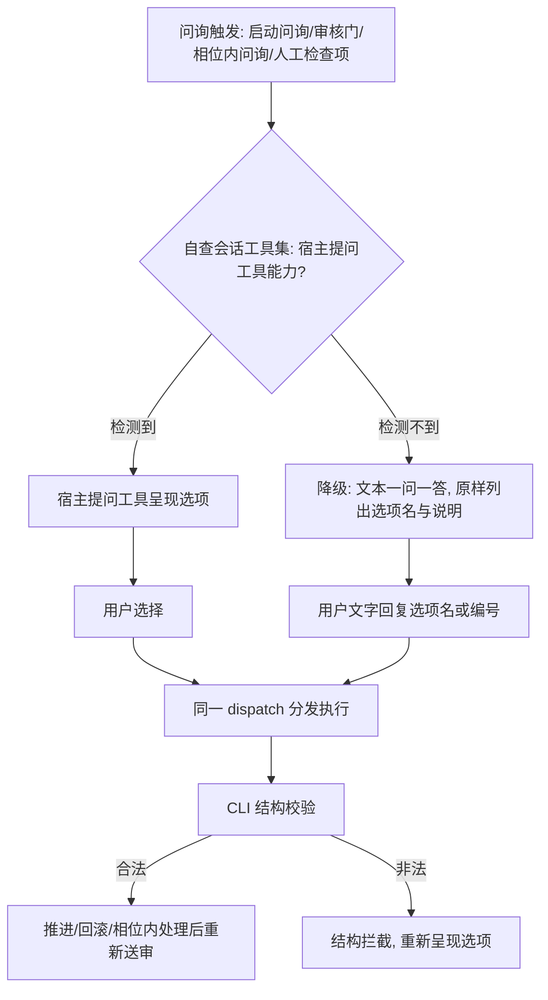

# 工具降级问询能力 技术计划

## 执行摘要

本 Plan（revision r1，文档模式 single，草稿约 7.0k 字符 ≤ 12000 阈值）将已确认 spec（能力检测驱动的问询降级）落为可执行改造：重写引擎单源交互硬约束文本（`tools/lib/assemble.js` 的 `L2_BLOCK`），为 `gate present` / `guide` / 依赖检查提示增补降级子句，在 `SKILL.md` 增加统一降级规则并修正两处无条件强制表述，对 12 个 `atom-tasks/*/prompt.md` 的问询强制句做同构改写，并核对相关测试断言。核心结论（DEC-1）：采用「单源权威 + 同构引用」——指令层规则集中写在引擎注入块，各处文本按同一句式改写，不改变 CLI 决议/推进/拦截机制（DEC-3）。目标覆盖 FR-DEG-1～5 与 AC-1～4。

## 范围与非目标

| 事项 | 说明 | AI 索引 |
|---|---|---|
| 引擎交互硬约束重写 | `L2_BLOCK` 由「必须使用宿主提问工具」改为「优先提问工具；检测不到能力则降级文本一问一答；决议同等效力；不得停滞」 | FR-DEG-1/3/5 |
| CLI 提示文本增补 | `gate present` hint、`guide` hint、依赖检查 hint 增补降级子句 | FR-DEG-1/5、AC-4 |
| SKILL.md 统一规则 | 新增一条全局降级规则；修正启动分流与人工审核步骤两处无条件强制句 | FR-DEG-1/3/5、AC-4 |
| 任务 prompt 同构改写 | 12 个含「宿主提问工具」强制句的 prompt.md 改为降级兼容句式 | FR-DEG-1、AC-1 |
| 测试核对 | 断言与新增文本的兼容性核对，必要时更新断言 | AC-1～4 |
| 非目标：机制不变 | 不改 CLI 决议/推进/门拦截（presentedAt/interact）、gate 选项语义、`@interact:required` 标注机制本身 | DEC-3 |
| 非目标：范围外 | 不新增提问工具；不改 `eval/` 历史记录；不动 `~/.claude/skills` 安装副本 | spec Non-goals |

## 现有设计与复用基线

| 能力 | 文件路径 | 符号 | 证据类型 | 采用方式 | 适用边界 | AI 索引 |
|---|---|---|---|---|---|---|
| exec 指令组装 + L2 交互强化 | tools/lib/assemble.js | `INTERACT_RE`、`L2_BLOCK`（L11）、`hardenInteraction()`（L63） | Repository Fact | 扩展现有实现 | 重写 L2_BLOCK 单点生效于所有含 `@interact:required` 的指令段 | DEC-1 |
| 门交互 payload 与 hint | tools/lib/gate.js | `presentPayload()`（hint L98 附近） | Repository Fact | 扩展现有实现 | 仅改 hint 字符串，保留「原样呈现」措辞（present.test.js:116 断言） | — |
| guide 问询序列输出 | tools/cli.js | guide 输出 hint（L955 附近） | Repository Fact | 扩展现有实现 | hint 增补降级子句；questions 结构不变 | AC-4 |
| 依赖检查提示 | tools/cli.js | deps summary hint（L415 附近） | Repository Fact | 扩现有实现 | 提示语改为兼容降级问询的表述 | — |
| 流程入口说明 | SKILL.md | 启动分流（L78）、人工审核步骤（L131） | Repository Fact | 扩展现有实现 | 全库唯一 agent 直读入口，承载统一规则 | FR-DEG-3 |
| 任务问询指令 | atom-tasks/{spec,plan,coding,reflection,test-scope,test-plan,test-design,test-unit,test-api,test-e2e,verification,deliver-pr}/prompt.md | `<!-- @interact:required tool=ask-user -->` 块与「必须调用宿主提问工具」句 | Repository Fact | 扩展现有实现 | test-unit/test-api/test-e2e 的问询句无 @interact 注入覆盖，须单独改写 | FR-DEG-1 |
| 输出文本断言 | tools/tests/delivery.test.js:209、present.test.js:116、guide.test.js:177 | 正则断言 | Repository Fact | 复用现有实现 | `/@interact\|宿主提问工具/`、`/原样呈现/`、`/mapToConfig/` 与增补文本兼容 | — |
| 宿主工具能力探测 | —（仓库无此能力） | — | Assumption | 新增实现 | 引擎无法感知宿主工具集，探测只能以指令文本要求 agent 自查会话工具集；有效性经 coding 后人工验收确认 | PD-2 |

## 整体架构与流程

改动只涉及「问询呈现层」的指令与提示文本，参与方与主/异常流程如下：

异常路径约束（写入指令文本）：检测不到能力时不得停滞、不得要求更换宿主、不得等待用户特例指令（FR-DEG-3）；普通文字（如「继续」）不构成决议，仅明确的选项答复有效。

## 技术选型与方案对比

| 方案 | 来源 | 仓库适配性 | 代价与风险 | 状态 | 结论 | AI 索引 |
|---|---|---|---|---|---|---|
| A. 分散追加：每个问询点文本各自补降级句 | 初始 Plan | 改动直观 | 同义句重复 20+ 处，措辞漂移，新增问询点易漏 | rejected | 不采用 | — |
| B. 单源权威 + 同构引用：引擎 L2_BLOCK 重写为规范语义；hint/SKILL.md/prompt 按同一句式改写 | 初始 Plan | 与既有 `@interact` 注入机制同构，exec 侧单点权威 | 需同步 12 个 prompt 并核对测试 | accepted | 采用 | DEC-1 |
| C. CLI 运行时探测宿主工具并条件输出 | 初始 Plan | — | CLI 无法感知宿主工具集；违背 spec 非目标（不改机制） | rejected | 不采用 | DEC-3 |

**DEC-1（accepted=B）**：降级规则的权威文本写在 `L2_BLOCK`（覆盖全部 exec 指令），SKILL.md 承载流程级同一规则（覆盖 exec 之外的启动分流），其余文本为同构引用。依据：注入机制已按 `@interact:required` 覆盖所有强交互相位；影响范围见文件变更计划；回退条件：单提交 git revert。
**DEC-2 降级文本格式**：不引入新协议——原样呈现选项名与说明，接受「选项名或编号」的文字答复，决议与工具方式同等效力、走同一 dispatch。
**DEC-3（rejected=C）**：不改动 gate 拦截与 interact 结构、不给 CLI 增加探测逻辑；规则保持指令层。

## 数据模型设计

### 实体与字段

不适用：本次不新增或修改任何实体、字段与数据结构；`.state.json`、config.json 结构不变。

### schema 与 DDL（如适用）

不适用：无 schema/DDL 变更。

### 状态与不变量

不适用：门状态（openedAt/presentedAt/interaction）与决议拦截不变量全部保持原语义。

### 迁移、兼容与回滚

不适用：无持久化数据迁移；回滚即 git revert 本次提交。

## API 接口设计

| 接口/入口 | 请求 | 响应 | 错误与幂等 | 复用标准 | 实现职责 | AI 索引 |
|---|---|---|---|---|---|---|
| exec（含 `@interact:required` 的指令） | 参数不变 | 注入块含：优先提问工具→自查能力→降级文本一问一答→决议同等效力→不得停滞 | 不变 | `hardenInteraction` 注入路径 | 重写 `L2_BLOCK` | FR-DEG-1/3/5 |
| gate present | 参数不变 | options 不变；hint 增补「无提问工具时降级为文本一问一答呈现同一选项」 | 拦截逻辑不变 | `presentPayload` | 修改 hint 字符串 | AC-1 |
| guide | 参数不变 | questions 不变；hint 增补降级指引 | 不变 | 现有 hint 组装 | 修改 hint 字符串 | AC-4 |
| deps-check hint | 内部调用 | 提示语改为「经宿主提问工具（无则降级文本问询）询问…」 | 不变 | 现有 summary | 修改字符串 | — |

本节指 CLI stdout 的文本契约：命令、参数、JSON 结构均不变，仅文本内容增补。

## 算法设计

不适用：降级规则为声明式指令文本，无算法、状态机或并发逻辑变更；不提供逐行实现（Coding 职责）。

## 文件变更计划

| 文件/目录 | 变更职责 | 复用或依赖 | AI 索引 |
|---|---|---|---|
| tools/lib/assemble.js | 重写 `L2_BLOCK` 为能力检测+降级语义（约 3 行内文本） | `hardenInteraction` 原路径 | DEC-1 |
| tools/lib/gate.js | `presentPayload` hint 增补降级子句（保留「原样呈现」） | 现有结构 | AC-1 |
| tools/cli.js | guide hint（~L955）与 deps hint（~L415）增补降级子句 | 现有字符串 | AC-4 |
| SKILL.md | 新增统一降级规则条目（调用契约或执行循环就近）；改 L78 启动分流、L131 审核步骤为降级兼容句式 | 现有章节结构 | FR-DEG-3、AC-4 |
| atom-tasks/（spec、plan、coding、reflection、test-scope、test-plan、test-design、test-unit、test-api、test-e2e、verification、deliver-pr）/prompt.md | 「必须调用宿主提问工具…不得以自由文本代替」同构改写为「优先宿主提问工具；检测不到该能力则降级为文本一问一答原样呈现选项；未获得用户明确答复不得推进」 | `@interact:required` 标注保持不变 | FR-DEG-1 |
| tools/tests/（delivery、present、guide 等） | 核对断言兼容性；受影响则同步更新断言 | 现有断言 | AC-1～4 |

## 兼容、稳定性与回滚

| 关注点 | 适用性 | 设计/理由 | 回滚信号 | AI 索引 |
|---|---|---|---|---|
| 有提问工具的宿主 | 适用 | 新文本仍以工具为首选路径，行为不变（AC-3） | 此类会话中出现文本问询 | FR-DEG-4 |
| 既有测试 | 适用 | 断言正则与增补文本兼容（delivery:209 匹配项保留、present:116 保留「原样呈现」） | `npm test` 失败 | — |
| 门拦截结构 | 不适用 | presentedAt/interact 校验与 dispatch 语义零改动（DEC-3） | — | — |
| 回滚 | 适用 | 文本类单主题改动，整提交 revert 即恢复 | 验收不通过 | DEC-1 |

## Verification Anchor

| 需验证契约 | 可观察结果 | 证据位置 | AI 索引 |
|---|---|---|---|
| 无工具宿主到达审核门不停滞，文本列出选项 | exec 指令注入块与 12 个 prompt 改写后内容 | tools/lib/assemble.js、atom-tasks/*/prompt.md | AC-1 |
| 文字决议同等效力 | dispatch 语义未变，hint 指明同等分发 | tools/lib/gate.js | AC-2 |
| 有工具宿主仍用工具 | 注入块首选路径为提问工具 | tools/lib/assemble.js | AC-3 |
| 启动问询可降级 | SKILL.md 启动分流句式 + guide hint | SKILL.md、tools/cli.js | AC-4 |
| 全量测试通过 | `npm test` 绿 | tools/tests/ | AC-1～4 |

## 开放问题与 Spec 对应

| 问题 | 确定答案或阻塞原因 | 解决位置 | AI 索引 |
|---|---|---|---|
| PD-1 降级规则落点 | 答案：`L2_BLOCK` 单源 + gate/guide/deps hint + SKILL.md 统一规则与两处句式修正 + 12 个任务 prompt 同构改写 | 本 Plan 文件变更计划 | DEC-1 |
| PD-2 判定表述与降级格式 | 答案：agent 自查当前会话工具集中是否存在提问类工具（如 AskUserQuestion）；降级格式=原样列出选项名与说明、接受选项名或编号的文字答复、决议同等效力走同一 dispatch | 本 Plan DEC-2 与整体架构图 | DEC-2 |

## 风险与下游交接

- **风险 1：12 个 prompt 改写措辞漂移。** 缓解：统一句式模板（见文件变更计划）；Coding 完成后以 `grep -rn '宿主提问工具' atom-tasks/ tools/ SKILL.md` 核对全覆盖、无遗漏旧句式。
- **风险 2：SKILL.md 与引擎文本语义漂移。** 缓解：两处均以 DEC-1/DEC-2 句式为准；skill-consistency.test.js 通过为底线。
- **风险 3：宿主无法真正探测工具集。** 缓解：措辞面向 agent 自查（PD-2 答案）；验收用无提问工具的会话实测（AC-1/AC-4）。
- **下游交接**：Tasking/Coding 从本 plan.md（single 模式，无分册）出发，按文件变更计划逐文件实施；文中行号为定位辅助，若与实际漂移以符号名（`L2_BLOCK`、`presentPayload` 等）grep 定位，事实失效时停止并报告，不自行改已批准契约。

## 用户确认

- ✅ **同意**：批准当前 Plan，进入后续编排。
- ❌ **修改：<反馈>**：按反馈更新 Plan，展示变化后重新确认。
- ❓ **提问：<问题>**：仅答疑，不改变确认状态。
- 📁 **归档**：列出可用模板名（当前：`ddo.md`）。
- 📁 **归档：<模板名>**：按模板生成 tech-design 归档产物。
