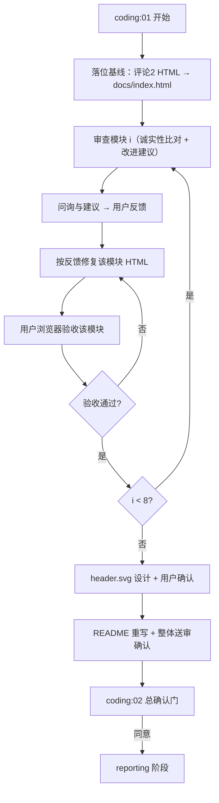

# Plan: docs 介绍页与 README 优化（issue #85）

> 基于 r1 已确认 spec（FR-DOCS-1 / FR-PAGE-2 / FR-LOOP-3 / FR-HONEST-4 / FR-README-5）生成的技术计划。文档模式：single；revision：r1。

---

## 执行摘要

本计划将 issue #85 的两份草稿落为仓库交付物：以评论 2 的 8 模块 HTML 为基线产出 `docs/index.html`，以评论 1 草稿为基线重写 `README.md`，并新建 README 引用的 `docs/header.svg`。全部事实性内容以仓库实测为准修正（已定位三处确定偏差：版本徽章 v2.2.1→v2.2、SOP 目录 `.run/`→`.ddo/runs/<type>/<runId>/`、SOP 产物名 `report.md`→`execution-report.md`；命令表缺 `deps check`）。coding 阶段在 coding:01 内执行 8 模块「问询建议→用户反馈→修复→验收」循环，随后做 header.svg 与 README，coding:02 为总确认门。

---

## 范围与非目标

| 事项 | 说明 | AI 索引 |
|---|---|---|
| 介绍页交付 | `docs/index.html`：评论 2 基线 + 逐模块事实修正与用户决议改进 | FR-DOCS-1、FR-PAGE-2 |
| 逐模块循环 | coding:01 内对 8 个模块依次问询-反馈-修复-验收 | FR-LOOP-3 |
| 诚实性修正 | 事实核对基准：`tools/cli.js --help`、`.ddo/runs/` 实测、git tag、atom-tasks 产物声明 | FR-HONEST-4 |
| README 优化 | 以评论 1 草稿为基线重组，事实修正后整体送审一次 | FR-README-5 |
| 横幅资源 | 新建 `docs/header.svg`（README 顶部引用） | FR-README-5 |
| 非目标 | 不改 `tools/`、`atom-tasks/`、`workflows/`；不部署站点；不引入构建链；不改视觉风格基线 | spec Non-goals |

---

## 现有设计与复用基线

| 能力 | 文件路径 | 符号 | 证据类型 | 采用方式 | 适用边界 | AI 索引 |
|---|---|---|---|---|---|---|
| 介绍页基线 HTML | `.ddo/runs/feat/20261107-185956-cecc/inputs/issue-85-html-v2-comment2.html`（源自 issue #85 评论 2） | 8 个 `.section`、SOP/MINI 演示脚本 | Repository Fact | 复用现有实现 | 直接作为 `docs/index.html` 起点，逐模块修正 | FR-PAGE-2 |
| README 改写草稿 | `.ddo/runs/feat/20261107-185956-cecc/inputs/issue-85-comments.txt`（评论 1） | 全文 | Repository Fact | 复用现有实现 | 作为 README 结构基线 + 事实修正 | FR-README-5 |
| 现行 README | `README.md` | 章节结构与事实表述 | Repository Fact | 复用现有实现 | 事实核对基准；草稿未覆盖的必要信息（如 `deps check`）从其回补 | FR-README-5 |
| CLI 命令注册表 | `tools/cli.js`（`--help` 实测） | 16 个命令 | Repository Fact | 复用现有实现 | 介绍页命令模块与 README 命令表须与其一致 | FR-HONEST-4 |
| run 目录结构 | `.ddo/runs/`（worktree 实测） | `<type>/<runId>/` | Repository Fact | 复用现有实现 | SOP 文件树修正依据 | FR-HONEST-4 |
| reporting 产物名 | `atom-tasks/reporting/config.json` | `output: execution-report.md` | Repository Fact | 复用现有实现 | SOP 文件树修正依据 | FR-HONEST-4 |
| coding 任务结构 | `atom-tasks/coding/config.json` | phase 01 action / 02 human gate | Repository Fact | 复用现有实现 | 循环在 01 内执行；02 为总门（同意/提问/修改） | FR-LOOP-3 |
| dogfooding 目录 | `.ddo/runs/feat/ddo-code-flow-v2/` | 目录存在 | Repository Fact | 不适用（引用事实） | 介绍页/README 该表述保持 | FR-HONEST-4 |

---

## 整体架构与流程

参与方：agent（审查、建议、修复）、用户（模块反馈与验收决议）、CLI（coding:02 确认门）。交付物为纯静态文档，无运行时组件。

模块顺序（文档序）：hero → 这是什么 → 特性 → 工作流 → 工作原理 → 命令参考 → SOP 演示 → 快速开始。

---

## 技术选型与方案对比

| 方案 | 来源 | 仓库适配性 | 代价与风险 | 状态 | 结论 | AI 索引 |
|---|---|---|---|---|---|---|
| 介绍页基线取评论 2 版 | 初始 Plan | 最新且为正文版超集演进 | 无 | accepted | 以评论 2 为基线，正文版仅作参考 | DEC-1 |
| 介绍页基线取 issue 正文版 | 初始 Plan | 较旧，缺 hero 双栏等改造 | 需重做评论 2 的改造取舍 | rejected | 不采用 | DEC-1 |
| 文件名 `docs/index.html` | 初始 Plan | 静态托管惯例名，浏览器直接打开即首页 | 无 | accepted | 定名 `docs/index.html`，单文件自包含 | DEC-2 |
| 文件名 `docs/intro.html` | 初始 Plan | 语义直观 | 未来若托管需改名或加跳转 | rejected | 不采用 | DEC-2 |
| header.svg 文字用系统字体 text 元素 | 初始 Plan | GitHub 以 `` 渲染 SVG，外部字体不加载，系统栈最稳 | 不同平台字形略有差异 | accepted | text + 系统字体栈（mono/sans 回退），不写死版本号 | DEC-3 |
| header.svg 文字转路径 | 初始 Plan | 跨平台像素一致 | 手工转路径成本高、难维护 | rejected | 不采用 | DEC-3 |
| README 整份一次送审 | 初始 Plan | spec 已确认 README 不逐节循环 | 单次反馈量大 | accepted | 重写后整体送审，用户可提节级修改意见 | DEC-4 |
| README 逐节循环送审 | 初始 Plan | 与 spec 解释项冲突 | 交互轮次多 | rejected | 不采用 | DEC-4 |

---

## 数据模型设计

### 实体与字段

不适用——纯静态文档交付，无数据实体。介绍页内嵌的 SOP/MINI 演示脚本常量（步骤数组、文件树数组、RUN_ID 示例）视为展示数据，随模块事实修正同步更新。

### schema 与 DDL（如适用）

不适用——无数据库变更。

### 状态与不变量

不变量：`docs/index.html` 除 Google Fonts CDN 外零外部依赖，可直接以 `file://` 打开；SOP/MINI 演示中的命令、门选项、目录名、产物名与 CLI 实际行为一致；README 引用的所有相对资源存在于仓库。

### 迁移、兼容与回滚

无迁移。回滚 = git 还原（交付全部位于 worktree 分支 `feat/docs-intro-page-readme-opt`，合并前可整体丢弃，不影响 main）。

---

## API 接口设计

| 接口/入口 | 请求 | 响应 | 错误与幂等 | 复用标准 | 实现职责 | AI 索引 |
|---|---|---|---|---|---|---|
| `docs/index.html`（浏览器入口） | — | 自包含 HTML+CSS+JS | — | — | 静态呈现，无服务端 | FR-DOCS-1 |

---

## 算法设计

不适用——无非平凡算法。SOP/MINI 为「数组 + setTimeout」线性时序演示，修正仅涉及内容常量与文案，不改变播放机制。

---

## 文件变更计划

| 文件/目录 | 变更职责 | 复用或依赖 | AI 索引 |
|---|---|---|---|
| `docs/index.html` | 新增：介绍页（评论 2 基线 + 8 模块循环修正） | inputs/issue-85-html-v2-comment2.html | FR-DOCS-1、FR-PAGE-2、FR-HONEST-4 |
| `docs/header.svg` | 新增：README 横幅（Neon Cyber 风格、系统字体、无版本号） | 风格对齐介绍页 THEME TOKENS | FR-README-5 |
| `README.md` | 重写：评论 1 草稿基线 + 事实修正 + 介绍页链接 | 现行 README、`tools/cli.js --help` | FR-README-5、FR-HONEST-4 |

---

## 兼容、稳定性与回滚

| 关注点 | 适用性 | 设计/理由 | 回滚信号 | AI 索引 |
|---|---|---|---|---|
| README 信息完整性 | 适用 | 草稿删减的内容不丢失关键契约（调用契约、安装、命令参考齐全；回补 `deps check`） | 审核发现关键信息缺失 | FR-README-5 |
| 介绍页离线可用 | 适用 | 字体 CDN 失败回退系统字体栈（草稿已设 fallback） | 断网打开布局崩坏 | FR-PAGE-2 |
| 版本时效 | 适用 | 徽章定 `v2.2`（最新 tag）；header.svg 不含版本号避免过期 | 新 tag 发布后徽章过时（后续维护项） | DEC-5 |
| 整体回滚 | 适用 | worktree 分支隔离，合并前可整体还原 | 用户驳回或 run 中止 | — |

---

## Verification Anchor

| 需验证契约 | 可观察结果 | 证据位置 | AI 索引 |
|---|---|---|---|
| 介绍页可打开、8 模块、翻页/导航/SOP 播放可用 | 浏览器（含 `file://`）打开验证 | 模块循环验收记录 | AC-1 |
| 每模块经问询-反馈-修复-验收循环 | 用户逐模块验收结论 | coding 阶段交互记录 | AC-2 |
| 事实一致性：版本=git tag v2.2、目录=`.ddo/runs/<type>/<runId>/`、产物名=execution-report.md、命令表含 deps check 且与 `--help` 一致 | 逐项比对通过 | spec/plan 修正清单 + 模块审查记录 | AC-3 |
| README 就位、引用资源存在、链接有效 | `docs/header.svg` 存在；相对链接可达 | README 审核 | AC-4 |

---

## 开放问题与 Spec 对应

| 问题 | 确定答案或阻塞原因 | 解决位置 | AI 索引 |
|---|---|---|---|
| PD-1 HTML 文件名与组织 | `docs/index.html` 单文件自包含（DEC-2） | 本 plan | PD-1 |
| PD-2 header.svg 设计 | Neon Cyber 风格、text + 系统字体栈、不含版本号（DEC-3） | 本 plan | PD-2 |
| PD-3 互链方式 | README 加「项目介绍页：docs/index.html」相对链接，单向（页面已有 GitHub 外链） | 本 plan | PD-3 |
| PD-4 循环编排 | coding:01 内：落位基线 → 8 模块循环 → header.svg → README；coding:02 总门（DEC-4） | 本 plan | PD-4 |
| PD-5 版本徽章 | `v2.2`（仓库最新 tag）（DEC-5） | 本 plan | PD-5 |

spec 全部开放问题已闭合，无遗留阻塞。

---

## 风险与下游交接

- **风险：草稿偏差未穷尽**——已定位三处确定偏差与一处缺失（v2.2.1、`.run/`、`report.md`、缺 `deps check`），其余需逐模块比对发现；缓解：每模块审查按「CLI `--help` ↔ 命令文案、`.ddo/runs` 实测 ↔ 目录/产物表述、SKILL.md/README ↔ 机制描述」三线核对。
- **风险：MINI/SOP 演示中的命令简写**（如 `node tools/cli.js` 省略绝对路径、`run start` 省略 `--title`）属演示简化与真实调用的差异；处理：模块问询时向用户说明并请决议（保留简化 / 改为完整示例）。
- **风险：模块循环交互轮次多**；缓解：每模块一次问询（含全部建议项，批量反馈）+ 一次验收。
- **下游交接**：coding 读取本 plan 全文 + `inputs/` 两份草稿基线；若 issue #85 出现更新草稿（基线失效），停止并请用户决议，不自行混用版本。
- reporting 阶段汇总各模块验收与修正清单。

---

## 用户确认

- 同意
- 修改：<反馈>
- 提问：<问题>
- 归档
- 归档：<模板名>
