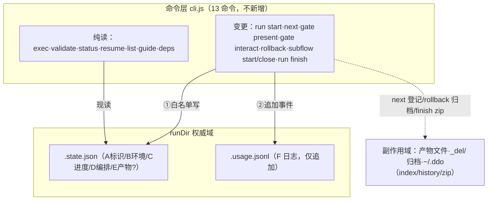

# State Schema v2 实施 Plan

> 依据：已确认 spec（run 20261113-190025-ac3b）与 issue #86 实施指导手册自足版 v1.1（requirement.md 全文照录，唯一实施依据）。本 plan 做实施编排与仓库事实锚定，契约细节以手册 §3–§10 为准。revision：R1（single 模式）。

## 执行摘要

目标是按手册完成 `.state.json` 结构规范化（schema v2）的全部代码实施：使用日志外置 `.usage.jsonl`、state 新增可选段（`schemaVersion`/`workflow`/`artifacts`/`gate.lastInteractedAt`）、门协议有界化（废弃 `interactions[]`）、产物登记 E 区与输出声明第三形态 `{files,dirs}`，并以测试与 dogfood 固化。实施按 P-1→P-2→P-3→P-4→P-5 串行推进、每期独立提交（DEC-P1）。关键锚定：P-4 声明校验触点经仓库核查重定位至 `atom-tasks/_schema/task-config.schema.json`（DEC-P2）；手册行号漂移处以「文件+符号」为准（复用基线表）。

## 范围与非目标

| 事项 | 说明 | AI 索引 |
|---|---|---|
| P-1 规范落盘 | 手册 §3+§4 固化为 `tools/STATE-SPEC.md`；`SKILL.md` 引用关系节增一行指向、删除重复结构自述 | FR-SPEC-1 |
| P-2 校验扩展+守卫 | `assertState` 四可选段加性扩展；`WRITER_ALLOWLIST` 表；`DDO_STATE_STRICT=1` 写后 deep-diff 守卫 | FR-STATE-2、FR-WLIST-3 |
| P-3 日志+门有界化 | 新建 `journal.js`；`isPresentationValid` 标量化（v1 折算）；cli.js/subflow.js 各写点接事件；`gate present --note` | FR-JRNL-4、FR-GATE-5 |
| P-4 产物登记+第三形态 | `{files,dirs}` 声明；`next` 登记快照；`rollback` 清除+整目录归档；`validate` 目录检查；视图暴露；plan config 改声明 | FR-ART-6、FR-SPLIT-7、FR-VIEW-8 |
| P-5 测试与固化 | 8 组用例（含 V-7 负向）+ dogfood 证据留档 | FR-TEST-11 |
| 非目标 | 不新增 CLI 命令；零迁移（不动存量 run/zip/runs.jsonl）；不改 `{updates}` 弱校验语义；不重构 gate/命令面；`.ddo` 居所改造（spec 门提问议题）不并入本 run | 见 spec Non-goals |

## 现有设计与复用基线

| 能力 | 文件路径 | 符号 | 证据类型 | 采用方式 | 适用边界 | AI 索引 |
|---|---|---|---|---|---|---|
| 原子写底座 | tools/lib/fsutil.js | `atomicWrite` | Repository Fact | 复用现有实现 | journal/state/zip 全部落盘统一走它（I-2） | RB-1 |
| state 读写校验 | tools/lib/state.js | `readState`/`writeState`/`assertState`/`assertGate` | Repository Fact | 扩展现有实现 | assertGate：interactions 校验改兼容忽略+新增 lastInteractedAt ISO 校验 | RB-2 |
| 呈现有效性 | tools/lib/gate.js | `isPresentationValid`/`epochOf` | Repository Fact | 扩展现有实现 | 改读标量；v1 折算=末元素 `at`；同刻按过期 | RB-3 |
| JSONL 追加先例 | tools/lib/history.js | `append` | Repository Fact | 复用现有实现 | journal.append 同构（读全文→补 LF→拼接→atomicWrite）；seq=现存最大+1 | RB-4 |
| 产物防逃逸 | tools/cli.js | `artifactPath` | Repository Fact | 复用现有实现 | E 区登记路径与 dirs 列举逐项过它（I-4） | RB-5 |
| 回滚归档 | tools/cli.js | `stageOutputFiles`/`nextDelDir` | Repository Fact | 扩展现有实现 | flatMap 增 dirs 分支；归档改整目录 `renameSync`（保留目录结构） | RB-6 |
| 任务 config 校验 | tools/lib/workflow.js | `validateTaskConfig`/`safeOutputFiles` | Repository Fact | 扩展现有实现 | safeOutputFiles 增 `files`/`dirs` 数组分支（路径规则同 string） | RB-7 |
| config schema | atom-tasks/_schema/task-config.schema.json | `properties.output.oneOf` | Repository Fact | 扩展现有实现 | 现仅 string/{updates} 两形态；须加第三形态（DEC-P2 重定位） | RB-8 |
| state 创建 | tools/cli.js | `runStart`（state 字面量） | Repository Fact | 扩展现有实现 | 增 `schemaVersion:2` 与 `workflow`；artifacts 为可选段不预建 | RB-9 |
| 推进/门/回滚/收尾 | tools/cli.js | `runNext`/`gatePresent`/`gateInteract`/`runRollback`/`runFinish` | Repository Fact | 扩展现有实现 | 各写点接 journal 事件；`gateInteract` 停写数组改标量；`runFinish` 的 `finished` 先于 zip | RB-10 |
| 子流程编排 | tools/lib/subflow.js | `subflowStart`/`subflowClose` | Repository Fact | 扩展现有实现 | 双侧 `subflow-started`/`subflow-closed`；写序按手册 §4.3.4 | RB-11 |
| 产物内容校验 | tools/lib/output-schema.js | `loadTaskSchema`/`validateArtifact` | Repository Fact | 不适用 | 消费产物内容 schema，与声明形态无交集，P-4 不改动（DEC-P2） | RB-12 |
| 测试骨架 | tools/tests/*.test.js | `node:test`+mkdtemp 沙箱+spawnSync | Repository Fact | 复用现有实现 | 新用例沿用同一隔离约定；运行 `node --test tools/tests/` | RB-13 |

## 整体架构与流程

主流程（变更型命令两步走）：读 state（现读不缓存）→ 按白名单写 state → 追加 `.usage.jsonl` 事件（`interacted` 先 state 后日志，其余反之）。异常流程：崩溃窗口→日志缺行→呈现判定偏保守（方向安全）；日志追加失败→stderr 警告不回滚 state。

## 技术选型与方案对比

| 方案 | 来源 | 仓库适配性 | 代价与风险 | 状态 | 结论 | AI 索引 |
|---|---|---|---|---|---|---|
| S-1 使用记录外置 `.usage.jsonl` | 用户修改（手册已批准） | 与 history.append 先例同构；zip 整目录天然覆盖 | 双写顺序纪律（§3.7 已定向保守） | accepted | 采纳 | DEC-0 |
| S-2/S-3/S-4'/S-5/S-6'（state 内隔离/就地压缩/独立 artifacts.json/validate 顺写/迁移脚本） | 用户修改（手册已否决） | — | — | rejected | 不采纳（理由见手册 §2） | DEC-0 |
| P-3∥P-4 并行实施 | 初始 Plan（手册允许 ∥） | 两期共享触点 cli.js（runNext/runRollback 双改） | 并行频繁冲突、review 交错 | rejected | 串行 P-3→P-4，每期独立 commit | DEC-P1 |
| 串行实施+每期独立提交 | 初始 Plan | 匹配「每期独立可回退、可独立 review」铁律 | 总时长略长 | accepted | 采纳 | DEC-P1 |
| P-4 声明校验触点重定位至 task-config.schema.json | 初始 Plan（仓库事实核查） | validateTaskConfig 经 workflow.js 读该 schema，oneOf 不放行第三形态则 plan config 改声明即 fail fast | 与手册触点清单字面不符（位置类重定位，非语义漂移） | accepted | 采纳；output-schema.js 判定不适用 | DEC-P2 |

## 数据模型设计

### 实体与字段

三个实体（契约=手册 §3，字段级定义以 STATE-SPEC.md 落盘为准）：①`.state.json` v2——六分区 14 顶层键；新增可选段 `schemaVersion`（integer∈[1,2]，仅 run start 写 2）、`workflow`（string）、`artifacts`（`{[stageId]: [{phase, recordedAt, trigger:"next", files:[{path,bytes,sha256}]}]}`）、`stages.*.gate.lastInteractedAt`（ISO 标量，覆盖式）；`gate.interactions[]` 废弃（读兼容忽略）。②`.usage.jsonl` 事件——`{seq, at, event, command?, stage?, phase?, option?, note?, detail?}`，event 枚举 11 种（run-started/presented/interacted/decision/advanced/activated/rollback/subflow-started/subflow-closed/artifacts-recorded/finished），seq 单调允许空洞。③输出声明第三形态——`{"files":[…], "dirs":[…]}`（files 必填、dirs 可选，路径规则同 string 形态）。

### schema 与 DDL（如适用）

无数据库。结构约束三载体：`atom-tasks/_schema/task-config.schema.json` 的 `output.oneOf` 增第三形态分支（RB-8）；`assertState`/`assertGate` 加性扩展四可选段（v1 缺段原样通过）；`tools/STATE-SPEC.md` 作为人读权威契约（P-1 落盘）。

### 状态与不变量

阶段状态机不变（pending→running|waiting-human→done；→pending；→failed）。硬约束=手册 §3.8 全集：I-1 单一事实源/I-2 原子写/I-3 写入方白名单（§4.4 表照抄）/I-4 防逃逸/I-5 门有界/I-6 版本单调/I-7 归档快照语义/I-8 可读序列化（2 空格+尾随换行，JSONL 豁免）/I-G1 呈现有效性（presentedAt>openedAt 且 >lastInteractedAt，同刻过期）/I-J1 日志不驱动控制流/I-E1..E3（登记时刻存在、只发生在 next、键⊆stages）/I-S1..S4 沿用。

### 迁移、兼容与回滚

零迁移（手册 §9.1）：v1 state 不补写版本号、沿 v1 语义走完；未知顶层键不拒绝。改造自身回退（§9.2）：P-2 守卫缺省关；P-3/P-4 回退=停写新段（state 仍合法），日志文件留存无害；回滚信号=STRICT 越权报警/呈现有效性误判/E 区与磁盘不一致。

## API 接口设计

| 接口/入口 | 请求 | 响应 | 错误与幂等 | 复用标准 | 实现职责 | AI 索引 |
|---|---|---|---|---|---|---|
| run start / subflow start | --title/--workflow/--type/--project 等（现状不变） | 现状+state 含 schemaVersion:2、workflow | 目录已存在抛错（现状）；重跑防碰撞不变 | RB-9/RB-11 | 创建日志文件+`run-started` 首事件（subflow 双侧，父日志随父 state 写） | API-1 |
| next | [--decision]（现状不变） | 现状+artifacts 登记摘要 | 门未关/呈现无效拦截（现状）；登记缺失不阻断 | RB-10/RB-5 | 相位推进时 E 区快照登记+`decision`/`advanced`/`activated`/`artifacts-recorded` 事件 | API-2 |
| gate present | 现状+可选 `--note <text>`（唯一参数扩展） | 现状 payload；hint 增 `--note` 提示行 | 无开门 exit 1（现状）；幂等=重复呈现覆盖 presentedAt | RB-10 | 写 presentedAt+`presented` 事件（note 只进日志不进 state，V-8） | API-3 |
| gate interact | --option [--note]（现状不变） | recorded（现状） | 未知选项/多门须 --stage（现状） | RB-10 | 停写 interactions[]；写 lastInteractedAt+`interacted` 事件（先 state 后日志） | API-4 |
| rollback | --stage [--reason]（现状不变） | 现状+archived 含整目录 | pending 拦截/呈现前置（现状）；_del 编号扫描幂等 | RB-6/RB-10 | 删 artifacts[reset] 条目；dirs 整目录入 _del；`rollback` 事件含 reason | API-5 |
| validate | --task [--phase]（现状不变） | validated（现状） | 缺失/结构错误 exit 1（现状）；**纯读契约不变** | RB-12 | dirs 声明增「目录存在且非空」检查；updates 弱校验不动（V-7） | API-6 |
| status / resume | 现状不变 | 视图+artifacts 摘要（各阶段条目数/文件数） | 现状 | RB-10 | 只读派生 artifacts 摘要字段 | API-7 |
| exec / list / guide / deps | 现状不变 | 现状 | 现状 | — | 零改动（纯读，R-4 核对项） | API-8 |
| run finish | --status [--no-archive]（现状不变） | 现状 | 幂等（现状①②） | RB-10 | `finished` 事件先于 zip；zip 含 .usage.jsonl（整目录天然） | API-9 |

## 算法设计

**A1 E 区登记快照（next 推进时）**：输入=output 声明+runDir。步骤：解析声明→文件集 F+目录集 D→F 逐项 artifactPath→D 逐目录列举现存文件（仅一层）并入→对全集算 {path,bytes,sha256}（Node crypto 单遍）→追加 `artifacts[stage]` 条目→`artifacts-recorded` 事件。不变量 I-E1..E3；缺失→空登记+stdout 提示不阻断；复杂度 O(产物字节数)。

**A2 呈现有效性标量化（gate.js）**：输入=gate 对象。判定 `presentedAt>openedAt` 且（存在时）`presentedAt>lastInteractedAt`，epochOf 数值比较、同刻过期。v1 兼容：读取时以 `interactions[]` 末元素 `at` 只读折算为标量（不回写）；空/非法按 never（保守拦截）。O(1)，不读日志。

**A3 日志追加与顺序（journal.js）**：append=读全文→补行尾 LF→拼接新行→atomicWrite；seq=现存最大+1。顺序：`interacted` 先写 state 标量成功再追加（崩溃→保守拦截方向）；其余事件 state 写成功后追加，失败 stderr 警告不回滚。复杂度 O(日志体积)，分文件按 run 隔离。

## 文件变更计划

| 文件/目录 | 变更职责 | 复用或依赖 | AI 索引 |
|---|---|---|---|
| tools/STATE-SPEC.md（新增） | 手册 §3+§4 逐节搬运固化（含全部表格与 JSON 示例）；覆盖 14 键/gate 7 字段/11 事件/白名单表 | requirement.md 手册全文 | FC-1 |
| SKILL.md | 引用关系节增一行指向 STATE-SPEC；删除重复结构自述 | — | FC-2 |
| tools/lib/state.js | assertState 四可选段+assertGate 兼容化；`WRITER_ALLOWLIST` 表+deep-diff 守卫（挂 DDO_STATE_STRICT=1） | RB-2 | FC-3 |
| tools/cli.js | 守卫挂点（命令出口统一包裹）；runStart 写 v2 字段+首事件；gatePresent --note；gateInteract 标量化；runNext 登记与事件；runRollback 清除与事件；runValidate dirs 检查；statusView/resume 摘要；runFinish 事件先于 zip | RB-5/6/9/10 | FC-4 |
| tools/lib/journal.js（新增） | `append(runDir, event)`（A3 语义）+seq 推导 | RB-1/RB-4 | FC-5 |
| tools/lib/gate.js | isPresentationValid 标量化+v1 折算；presentPayload hint 增 --note 提示行 | RB-3 | FC-6 |
| tools/lib/subflow.js | subflowStart/Close 双侧事件（写序 §4.3.4） | RB-11 | FC-7 |
| tools/lib/workflow.js | validateTaskConfig/safeOutputFiles 第三形态分支 | RB-7 | FC-8 |
| atom-tasks/_schema/task-config.schema.json | output oneOf 增 `{files,dirs}` 分支（DEC-P2 重定位触点） | RB-8 | FC-9 |
| atom-tasks/plan/config.json | 相位 01 output 改 `{"files":["plan.md"],"dirs":["plans"]}` | FC-8/9 | FC-10 |
| tools/tests/*.test.js | 新增 state-v2/journal/artifacts 用例+扩展 start/next/gate/present/validate/lifecycle/rollback 相关断言（8 组清单见手册 P-5） | RB-13 | FC-11 |

## 兼容、稳定性与回滚

| 关注点 | 适用性 | 设计/理由 | 回滚信号 | AI 索引 |
|---|---|---|---|---|
| v1 存量 state | 适用 | 可选段零迁移；interactions 只读折算；不补写版本号 | v1 run 走 status/resume 报错 | CM-1 |
| 命令面稳定 | 适用 | 13 命令不变；--note 唯一扩展；纯读命令零写入 | 任何命令新增/纯读写文件 | CM-2 |
| 双写崩溃窗口 | 适用 | 顺序规则定向保守（A3）；seq 空洞合法化 | 呈现有效性误判（拦截/放行异常） | CM-3 |
| E 区一致性 | 适用 | 登记证据=推进时刻存在+摘要；validate 不登记 | E 区与磁盘产物不一致 | CM-4 |
| CJK 分册文件名 | 适用 | 仅登记 path，不做名字约束（现状已存在） | hash/归档失败 | CM-5 |
| 并发会话 | 适用 | 单 runDir 单活跃会话使用契约+atomicWrite | 日志交错损坏 | CM-6 |

## Verification Anchor

| 需验证契约 | 可观察结果 | 证据位置 | AI 索引 |
|---|---|---|---|
| V-1 使用痕迹不进 state | 连续 `gate interact` ≥3 次后 .state.json 字节数不变 | dogfood runDir state 快照 | VA-1 |
| V-2 日志承接使用史 | .usage.jsonl 逐事件含 note 全文、seq 单调 | dogfood runDir/.usage.jsonl | VA-2 |
| V-3 门对象有界 | gate 序列化无 interactions 键、含 lastInteractedAt | dogfood state 快照 | VA-3 |
| V-4 回滚保留使用史 | rollback 后日志仍含此前全部 interacted；state gate 已删 | dogfood 日志+state+_del/ | VA-4 |
| V-5/V-6 E 区登记与 split 可见 | artifacts 条目含 path/bytes/sha256 且文件存在；plans/ 逐文件登记；回滚整目录入 _del | dogfood state 快照+_del/ | VA-5 |
| V-7 updates 弱校验不变（负向） | {updates} 相位 validate 仍仅查存在性 | 测试输出 | VA-6 |
| V-8 摘要留痕 | presented 事件含 note 全文；state 无该字段 | dogfood 日志+state | VA-7 |
| P-2 DoD | v2/v1 state 双通过校验；STRICT=1 越权写 stderr+exit 1 | 测试输出 | VA-8 |
| 零迁移兼容 | v1 存量 state（20261111-141756-f180）status/resume 走通；存量 zip/runs.jsonl 零改动 | 命令输出+git status | VA-9 |

## 开放问题与 Spec 对应

| 问题 | 确定答案或阻塞原因 | 解决位置 | AI 索引 |
|---|---|---|---|
| spec PD-1：P-3/P-4 串行还是并行 | 串行 P-3→P-4，每期独立 commit（共享触点 cli.js，并行冲突高；匹配「独立可回退」铁律） | 本表 DEC-P1；coding 按此编排 | Q-1 |
| 手册 P-4 触点 output-schema.js 与仓库事实矛盾 | 重定位至 task-config.schema.json（validateTaskConfig 读它校验 output 形态）；output-schema.js 消费产物内容 schema 无交集、不改动——位置类重定位，非语义漂移 | FC-9；STATE-SPEC §4.3.2 落盘时以重定位后为准 | Q-2 |
| spec 全部 FR | 无阻塞：手册已给字段级契约，本 plan 已锚定符号级落点 | 复用基线表+文件变更计划 | Q-3 |

## 风险与下游交接

- **风险与缓解**：①cli.js 多点改动（P-3/P-4 同文件）→串行+每期独立提交（DEC-P1）；②手册行号漂移→复用基线已符号锚定，coding 以符号重定位；③dogfood 依赖人工审核门交互→用测试沙箱 run 模拟（spawnSync），真实 dogfood 在 P-5 留档。
- **Coding 读取范围**：requirement.md（手册全文，唯一实施依据）+ 本 plan.md + 复用基线所列源文件；不读 plans/ 存档与 tech-design.md（手册声明降级为过程存档）。
- **事实失效处理**：符号不存在/语义不符→按「文件+符号」重定位并记录；gate 机制或命令面语义漂移→停止实施，回用户修订手册契约，不得自行改已批准契约。
- **提交策略**：P-1..P-5 每期一个 commit（可独立 review/回退），最终统一走交付收尾（PR 链另议）。

## 用户确认

- ✅ **同意**：批准当前 revision，进入后续编排。
- ❌ **修改：<反馈>**：反馈应用到新 revision 并重评估，展示变化摘要后重新送审。
- ❓ **提问：<问题>**：只答疑，不改文档、revision 与确认状态。
- 📦 **归档**：列出可用模板名（不产出文档）。
- 📦 **归档：<模板名>**：按 atom-tasks/plan/references/ 模板生成 tech-design 产物（不代表批准）。
