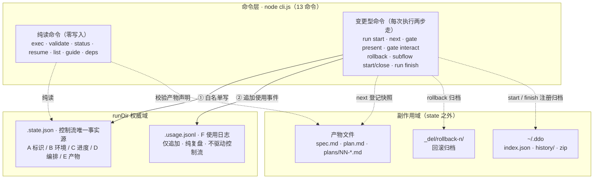

# 用户需求

> 用户触发此流水线的原始需求描述。

## 原始需求

https://github.com/Djhhhhhh/Ddo-Code-Flow/issues/86 根据这个issue，处理一下

### Issue Context：#86【Feature】.state.json 结构规范化

（以下为该 issue 正文全文照录——它是本次需求的完整载体：需求原文、字段级数据模型契约、13 命令读写规则、核心算法、SOP 示例、分期任务 P-1..P-5、验收锚点 V-1..V-8 与兼容回滚策略）

# 实施指导手册 — .state.json 结构规范化（schema v2）· 自足版

> **版本**：自足版 v1.1（2026-11-11）。run 20261111-141756-f180 已按 done 收口归档；本修订为归档后经用户批准的补充，finish zip 快照不含本修订。
> **定位**：本文件是本改造的**唯一必读实施依据**——单文件承载需求、成因、目标数据模型契约（字段级）、全部命令读写规则、核心算法、端到端 SOP 示例、分期任务（P-1..P-5）、验收锚点（V-1..V-8）与兼容回滚策略。实施 agent **无需**读取 plan.md、plans/ 分册 01-04 或 tech-design.md 即可完成全部实施工作；这些文件降级为讨论过程存档（仅溯源用）。
> **冲突处理**：本文件与仓库代码事实矛盾时，以「文件+符号」重定位为准（行号会漂移、符号为准）；若发生**语义**漂移（gate 机制重构、命令面变化），停止实施并回本文件修订契约，不得自行改已批准契约。

---

## 0. 需求与目标

**用户需求原文**：

> .state.json 结构规范化：现在存在问题，存在历史的使用记录往.state.json里面去进行续写，然后产物记录不完整（例如：plan阶段若产生了拆分，plans里面的文件未1正常记录）；本次为技术方案讨论，不需要实际修改对应的代码逻辑，在plan阶段就产出本次的完整的技术方案和改造方案即可；需要给出完整的.state.json结构化的规范和各个工具的规则。

前半句 = 两个要消除的问题（§1）；「不需要实际修改代码」约束的是**方案 run 本身**（已兑现）——本手册面向的**实施 run** 正是要执行这些代码变更。

**验收标准（AC）**：

| AC | 内容 | 承载 |
|---|---|---|
| AC-1 | 覆盖 `.state.json` 全部字段的 v2 规范（定义/层级/必填性/语义） | 本手册 §3 |
| AC-2 | 全部 13 个引擎命令的读写规则矩阵（读/写/时机/禁止），对照无遗漏 | 本手册 §4 |
| AC-3 | 两类问题各有成因分析与消除设计，V-1..V-8 可验证 | 本手册 §1/§8 |
| AC-4 | 完整技术方案+改造方案（P-1..P-5）+ 存量策略 | 本手册 §7/§9 |
| AC-5 | 方案 run 零代码变更 | 已兑现（本手册为交付物） |

**职责判据（用户确认，一切设计的出发点）**：**产物登记留 state**（下游阶段消费的控制流事实，对下面的阶段有用）；**历史操作记录外置 `.jsonl`**（保存中间过程信息、复盘用，不增加 `.state.json` 复杂度）。

---

## 1. 问题与成因（为什么改）

**问题一：历史使用记录续写进 `.state.json`**。实况样本：`.ddo/runs/feat/20261110-115700-df51/.state.json`（4882 B）中 `stages.plan.gate.interactions` 累积 6 条交互（多次「修改/提问」的 note 全文），随交互持续增长、无清理点。

写入路径核查（两条候选，一条排除）：
- **路径 A（确认存在，主成因）——run 内使用痕迹无界追加**：`gate interact` 将每次相位内交互**全文追加**进 `stages[<id>].gate.interactions[]`（tools/cli.js:851-855；校验放行该数组，tools/lib/state.js:201-209）。`--note` 的设计说明即「进 state 供审计」（tools/cli.js:1246）——**审计职责被放进了权威状态文件**。使用痕迹与控制流状态同层混居，state 随使用时长线性膨胀。
- **路径 B（核查后排除）——跨 run 历史串写**：`run start` 恒新建全新 state（tools/cli.js:550-568，无任何旧 run 读取）；`resume` 仅加载自身 statePath；跨 run 记录在 index.json / runs.jsonl（state 之外的独立文件）。新 run 继承旧 run 记录的机制**不存在**。
- **次生问题（同一枚硬币的另一面）**：①rollback 时 `delete state.stages[s].gate`（tools/cli.js:269-271）连同全部交互史一并销毁——「只增不删」与「一删全失」并存；②`presentedAt` 覆盖式单值（tools/cli.js:819）与 `interactions[]` 追加式数组不对称——协议只需「最后一次交互时刻」，全量数组是为审计而膨胀协议对象。

**问题二：产物记录不完整**。实况样本：同上 run `plans/` 目录存有 4 个分册（`01-数据模型契约.md` 16551 B 等），`.state.json` 无任何产物登记字段——分册对 state 完全不可见。

| # | 成因 | 证据 | 消除设计 | 锚点 |
|---|---|---|---|---|
| RC-1 | 职责混杂：单一文件同时承担「控制流权威状态」与「使用审计日志」，后者天生只增、前者要求有界稳定 | tools/cli.js:851-855、1246 | 使用痕迹全部移入 `<runDir>/.usage.jsonl`（仅追加），state 仅存控制流必需标量 | V-1/V-2 |
| RC-2 | 协议对象无界：`gate` 内嵌无界数组（interactions），违反协议状态最小化 | state.js:201-209 | `gate` 有界化：`interactions[]` 废弃，改 `lastInteractedAt` 标量；呈现有效性判定改读标量 | V-3 |
| RC-3 | 销毁面过宽：回滚「干净重做」通过整删 gate 对象实现，波及应保留的审计事实 | cli.js:269-271 | rollback 只删协议对象，交互史在日志天然保留（「续写有据、销毁有界」） | V-4 |
| RC-4 | state 无产物区：现行 schema 不含产物登记；产物只以任务 config 的 output **声明**形式存在（静态、state 外、单文件导向） | — | state 新增 `artifacts` 可选段：逐阶段逐相位登记 path/bytes/sha256 | V-5 |
| RC-5 | split 分册逃逸声明：plan 相位 01 output 仅声明 `"plan.md"`（atom-tasks/plan/config.json:10），`plans/NN-*.md` 不在声明内 → validate 只校验 plan.md（cli.js:362-368）、next 无从登记、state 无处记录——**用户所指「plans 未正常记录」的直接成因** | config.json:10 | output 声明第三形态 `{"files":[…],"dirs":["plans"]}`；next 登记目录内全部分册；validate 增「目录存在且非空」检查；rollback 归档清单同步扩展 | V-6 |
| RC-6 | updates 声明弱校验：`{updates:[…]}` 相位 validate 仅查文件存在不查内容（cli.js:367 只对字符串声明走 schema 校验）——**有意设计**（只写回相位无独立产物），固化不改 | cli.js:367 | 边界固化进规范（§4.3.1），不改变弱校验语义 | V-7（负向） |

---

## 2. 目标架构（改成什么样）



- **读路径**：纯读命令只读 `.state.json`（exec 组装指令、validate 校验产物声明、status/resume/list/guide/deps 输出视图），零写入（R-4）。
- **写路径（两步走）**：变更型命令每次执行 ① 按白名单写 state 对应分区（I-3），② 向 `.usage.jsonl` 追加事件；唯一例外 `interacted` 先写 state 标量再追加日志（崩溃窗口方向保守，§3.7）。
- **副作用域**：产物文件由 agent 写入 runDir；`next` 读取产物计算 E 区登记快照；`rollback` 将失效产物移入 `_del/`；`run start`/`run finish` 维护 `~/.ddo` 下 index 与 history 归档（独立文件域，R-6）。

**技术决策（已批准，S-1..S-6）**：

| 方案 | 内容 | 状态 | 理由 |
|---|---|---|---|
| S-1 | 使用记录分离为 `.usage.jsonl`（外置日志） | **accepted** | 与 history.js runs.jsonl 先例同构；zip 整目录归档天然覆盖；代价=双写顺序纪律（§3.7 已定） |
| S-2 | 使用记录留在 state 内隔离为 `history` 顶层段 | rejected | state 仍随使用膨胀；不解决 RC-1 本质 |
| S-3 | 交互史就地压缩（门关闭时聚合） | rejected | 丢失逐条审计粒度；rollback 销毁问题仍在 |
| S-4'（原 S-4 对立面） | 产物登记放独立 `.artifacts.json` | rejected | 违背「state 是唯一事实源」；多一文件双写 |
| S-5 | 产物登记由 validate 顺写 | rejected | 破坏 validate 纯读契约（R-4）；校验器职责蔓延 |
| S-6' | 存量 state 一次性迁移脚本 | rejected | 违反仓库零迁移先例；破坏归档一致性、收益近零 → 采用**零迁移**（§9） |

**命令面约束**：**不新增任何 CLI 命令**；产物登记搭 `next` 便车；唯一参数扩展 = `gate present --note`（§4.3.5）。

---

## 3. v2 数据模型完整规范（字段级）

> v1 = 现行结构（无 schemaVersion 标记）；v2 = 本节定义的目标结构。v2 对 v1 只做**加性演进**：新增段均为可选段，v1 state 无需迁移即可被 v2 内核读写（零迁移先例：`git.multiRepo`、`subflows`，见 tools/lib/state.js:40-42）。
> （呈现约定：本文档内 JSON 示例块一律按 `JSON.stringify(x, null, 2)` 形态展开——与引擎序列化格式对齐，见 I-8；行内短引用不受此约束。）

### 3.0 六分区总览

state 顶层按职责分为六区。分区是**规范概念**（JSON 无物理分栏），每区有唯一写入方集合与生命周期：

| 区 | 职责 | 字段（顶层键） | 生命周期 | 变更方 |
|---|---|---|---|---|
| A 标识区 | run 身份，创建后不可变 | `runId` `title` `startedAt` `schemaVersion` `ephemeral?` `workflow?` | 创建时定稿 | 仅 run start / subflow start（创建） |
| B 环境区 | 运行环境与旋钮，创建后不可变 | `git` `dirs` `atomTasks` | 创建时定稿 | 仅 run start / subflow start（创建） |
| C 进度区 | 权威机器状态（控制流唯一事实源） | `currentStage` `stages`（含 `gate` 协议子对象） | 随推进变更 | next / gate present / gate interact / rollback / run finish |
| D 编排区 | 子流程注册与溯源 | `subflows?` `subflow?` | 运行期变更 | subflow start / subflow close |
| E 产物区 | 各阶段产物文件登记（当前有效集） | `artifacts?` | 相位推进时追加/回滚时清除 | next / rollback |
| F 使用日志区 | 使用痕迹（**移出 state**） | —（独立文件 `.usage.jsonl`） | 仅追加 | 全部变更型命令 |

**核心原则**：state 只承载「驱动控制流所必需的当前事实」；使用历史（F 区）全部移入同级追加式日志文件，任何命令不得从日志读取控制流依据（不变量 I-J1）。

### 3.1 A 标识区

| 字段 | 类型 | 必填 | 缺省 | 写入方 | 语义与约束 |
|---|---|---|---|---|---|
| `runId` | string | 是 | — | run start | 顶层 run 匹配 `^\d{8}-\d{6}-[0-9a-f]{4}$`；子流程为 `<父runId>-sf-<n>`。创建后不可变。 |
| `title` | string | 是 | — | run start | 一句话标题，非空。进 state 与 history。 |
| `startedAt` | string | 是 | — | run start | ISO 8601 本地时间带时区偏移（tools/cli.js:33-42 nowIso）。创建后不可变。 |
| `schemaVersion` | integer | v2 是（v1 缺失视为 1） | 2 | run start | 结构代际标记，合法域 `[1, 2]`。缺失 = v1（存量零迁移）。只增不改。 |
| `ephemeral` | boolean | 否 | false（缺失） | run start | 临时模式标记；true 时 finish 走删除分支。创建后不可变。 |
| `workflow` | string | 否（v2 建议必填） | — | run start | 物化的预设名（如 `basic`）。v1 无此字段（run start 返回值有、state 未存——补齐缺口）。 |

### 3.2 B 环境区

| 字段 | 类型 | 必填 | 写入方 | 语义与约束 |
|---|---|---|---|---|
| `git` | object | 是 | run start | 单仓库：`mainBranch`/`branch`/`worktreePath`（可缺省推断链）；multi：`multiRepo:true` + `container` + `repos[]`（role/name/repoPath/worktreePath/branch/mainBranch，主仓库首位，worktreePath 全局唯一）。校验同 state.js:56-85。创建后不可变。 |
| `dirs` | object | 是 | run start | `projectRoot`/`runDir` 绝对路径且 runDir ⊆ projectRoot（ephemeral 例外放行）；`tasksDir?` 绝对路径——**解析优先级**：`--tasks-dir` flag > `state.dirs.tasksDir` > skillRoot 缺省（tools/cli.js:82-85 tasksDirFor），规范固化该三级取值；`projects?` multi 同序清单。创建后不可变。 |
| `atomTasks` | object | 是（可为空对象） | run start / subflow start | `<task>.<key> → value` 运行级旋钮（defaults 预填 + `--config` 覆盖后的终值）。创建后冻结。 |

### 3.3 C 进度区（权威状态）

**`currentStage`**：`string[]`，必填；元素形如 `<task>:<phase>`，phase 两位数字。语义：**当前位置清单**（执行循环的驱动器）；空数组 = run 已收束（finish 清空；zip 归档保留清空前快照——有意分歧，见 I-7）。

**`stages`**：`object<task, stageEntry>`，必填；由预设物化（tools/lib/workflow.js:206-217），物化后自包含、不回指预设文件。`stageEntry`：

| 字段 | 类型 | 必填 | 语义 |
|---|---|---|---|
| `status` | enum | 是 | `pending` / `running` / `waiting-human` / `done` / `failed`（五值收敛，state.js:10）。状态机见 §3.8 前。 |
| `dependOn` | string[] | 是 | DAG 依赖（物化自预设）。不可变。 |
| `at` | ISO string | 是 | **最后触碰时刻**：该阶段最近一次 status 变更或 gate 写入的时刻（每次覆盖，非历史）。v2 明确其为「最后触碰」语义，不承担审计职责（审计在 F 区）。 |
| `gate` | object | 否 | 确认门协议对象（仅 human 相位）。见下。 |

**`gate` 协议对象（v2 有界化）**：

| 字段 | 类型 | 必填 | 语义 |
|---|---|---|---|
| `phase` | string | 是 | 两位相位 id，`^\d{2}$`。 |
| `openedAt` | ISO | 是 | 开门时刻。 |
| `options` | object[] | 是 | 静态声明选项三元组 `{name, desc, action}`（action 白名单：`next --decision <n>` / `rollback --stage <id>` / `run finish --status <s>` / `in-phase`）。**长度有界**：来自任务声明或标准二元兜底，不随使用增长。 |
| `presentedAt` | ISO | 否 | 最近一次呈现时刻（覆盖式）。 |
| `lastInteractedAt` | ISO | 否（v2 新增） | 最近一次相位内交互时刻（覆盖式标量）。**取代 v1 的 `interactions[]` 数组**：呈现有效性判定只需「最后一次交互时刻」，不需要全量交互史。 |
| `decision` | string | 否 | 推进型决议名（门关闭时写）。 |
| `closedAt` | ISO | 否 | 门关闭时刻。 |

- **v1 字段 `interactions[]` 废弃**：v2 写入方不得再写入；v2 读取方不得依赖（兼容读取：存在则忽略）。全量交互史迁往 F 区日志。
- **`lastInteractedAt` 的性质**：它是**协议必需标量**而非历史记录——呈现有效性判定（I-G1）需要「最后一次交互时刻」这一控制流事实，与 `presentedAt` 同类。以一个标量取代 v1 的无界数组，state 复杂度**净减**；历史操作记录全部外置 F 区，不因此回流 state。
- 呈现有效性（I-G1，改造 tools/lib/gate.js:119-131）：`presentedAt > openedAt` 且 `presentedAt > lastInteractedAt`（存在时）。判定只依赖 state 内标量，不读日志。

**阶段状态机（现状固化，v2 无变更）**：`pending →(激活)→ running|waiting-human →(相位耗尽)→ done`；`→(回滚)→ pending`；`→(失败终态)→ failed`。激活条件：dependOn 全 done（DAG 就绪，workflow.js:237-241）。

### 3.4 D 编排区

沿用现行结构（tools/lib/state.js:87-151 校验即规范）：`subflows[]`（父侧注册表：id `sf-<n>` 全 run 唯一 / title / workflow / atStage / statePath ⊆ `<runDir>/subflows/` / status `active|closed` / startedAt / closedAt? / abandoned?）与 `subflow`（子侧溯源：depth ∈ [2,3] / parentStatePath / parentRunId / atStage / title）。v2 无结构变更，仅纳入本规范管辖。

### 3.5 E 产物区（v2 新增）

```json
"artifacts": {
  "spec": [
    {
      "phase": "01",
      "recordedAt": "…",
      "trigger": "next",
      "files": [
        {
          "path": "spec.md",
          "bytes": 4380,
          "sha256": "…"
        }
      ]
    }
  ],
  "plan": [
    {
      "phase": "01",
      "recordedAt": "…",
      "trigger": "next",
      "files": [
        {
          "path": "plan.md",
          "bytes": 6120,
          "sha256": "…"
        },
        {
          "path": "plans/01-数据模型契约.md",
          "bytes": 9800,
          "sha256": "…"
        }
      ]
    }
  ]
}
```

| 要素 | 规则 |
|---|---|
| 键 | stageId；值为该阶段**已完成的 action/updates 相位登记条目数组**（按推进顺序追加）。 |
| 条目 | `{phase, recordedAt, trigger, files[]}`；`trigger` 恒为 `next`（登记时机=相位推进，§4.3.1）。 |
| `files[].path` | runDir 内相对路径，禁绝对路径与 `..`（复用 artifactPath 防逃逸，tools/cli.js:58-66）。**split 分册文件以 `plans/NN-*.md` 前缀路径逐一登记**。 |
| `files[].bytes` / `sha256` | 登记时刻的文件大小与 SHA-256（Node crypto，读入即算）。粒度（PD-2）：路径 + 大小 + 内容摘要，足够支持完整性与下游失效判定，成本可控。 |
| 语义 | **当前有效集**：rollback 重置某阶段时删除该键下对应条目（重做后重新登记）；历史轨迹在 F 区日志（`artifacts-recorded` 事件），不在 state 保存全史。 |
| 不变式 | I-E1：条目内 file 必须在登记时刻真实存在；I-E2：登记只发生在 `next`（validate 保持纯读）；I-E3：键 ⊆ `stages` 的键。 |

### 3.6 完整 state 顶层键清单（v2 权威定界）

`runId` · `title` · `startedAt` · `schemaVersion` · `ephemeral?` · `workflow?` · `git` · `dirs` · `atomTasks` · `currentStage` · `stages` · `subflows?` · `subflow?` · `artifacts?`

（? = 可选段。除上述外不得新增顶层键；扩展先入本规范再入实现。）

### 3.7 F 使用日志区：`.usage.jsonl`（v2 新增）

**定位**：使用日志是**纯复盘材料**——保存运行中间过程信息（交互、决议、推进、回滚、产物登记事件），供事后复盘与审计消费；它不被任何控制流读取（I-J1），因此**不增加 `.state.json` 的复杂度**。与之对照，产物登记（E 区）因被下游阶段消费而留在 state。

- 位置：与 `.state.json` 同级（`<runDir>/.usage.jsonl`）；子流程各自独立一份。随 runDir 整目录进入 finish zip 归档；ephemeral 随目录删除。
- 形态：JSON Lines，仅追加，一行一事件（下为事件对象结构示意；文件内序列化为单行——JSONL 正常形态，豁免 I-8）：

```json
{
  "seq": 7,
  "at": "2026-11-11T15:02:11.482+08:00",
  "event": "interacted",
  "command": "gate interact",
  "stage": "spec",
  "phase": "02",
  "option": "修改",
  "note": "反馈：…"
}
```

| 字段 | 规则 |
|---|---|
| `seq` | 文件内单调递增正整数，从 1 起；**允许空洞**（崩溃窗口语义，见下）。 |
| `event` | 枚举 11 种：`run-started` / `presented` / `interacted` / `decision` / `advanced` / `activated` / `rollback` / `subflow-started` / `subflow-closed` / `artifacts-recorded` / `finished`。 |
| `command` / `stage` / `phase` / `option` / `note` / `detail` | 按事件适用性可选。**note 按事件承载**：`interacted` = 用户交互反馈全文（现行 `--note`，v1 进 state、v2 只进日志）；`presented` = agent 执行摘要（`gate present --note`，§4.3.5）；`rollback` = reason。note 推荐两段式人可读格式——**做了什么（动作/变更清单）＋为什么/结论（理由与影响）**；自由文本，不承诺结构化（纯复盘用途）。 |

**追加顺序规则（崩溃一致性）**：
- 涉及门新鲜度镜像的事件（`interacted`）：**先写 state（`lastInteractedAt`）成功，再追加日志**。崩溃于两写之间 → 镜像已新、日志缺行 → 呈现判定偏保守（要求重新呈现），方向安全。
- 纯审计事件（`decision`/`advanced`/…）：**state 写成功后追加**；追加失败输出 stderr 警告、不回滚已提交的状态变更（审计尽力而为，控制流一致性优先）。
- `seq` 空洞即上述崩溃窗口的合法产物，消费方不得假设连续。
- 回滚不再销毁使用史：v1 中 rollback `delete stages[s].gate` 连同交互史一并删除；v2 交互史在日志中天然保留，回滚只清协议对象。

### 3.8 全局不变量（硬约束清单，实现落点=assertState 扩展 + 测试）

- **I-1 单一事实源**：控制流判定只读 state；`.usage.jsonl` 永不参与控制流。
- **I-2 原子写**：所有 state 写入经 atomicWrite（tools/lib/fsutil.js）；读写模型=现读不缓存（四通道契约）。
- **I-3 写入方白名单**：每个命令只允许写其声明字段集（矩阵见 §4.2、表见 §4.4）；exec/validate/status/resume/guide/list/deps 为纯读命令。
- **I-4 产物防逃逸**：E 区与产物归档路径必须 runDir 内相对（复用 artifactPath）。
- **I-5 门对象有界**：`gate` 除 `options`（声明期定长）外不得含数组字段；`interactions` 禁止再写入。
- **I-6 版本单调**：`schemaVersion` 只增；读取方容忍低版本（可选段零迁移）；未知顶层键不拒绝（前向兼容，assertState 现行为保持）。
- **I-7 归档快照语义**：finish 先 zip 后清 `currentStage`——zip 内为收束前快照、活文件为收束后状态，此分歧为既定设计，规范予以固化而非「修复」。
- **I-8 可读序列化**：引擎写入的独立 JSON 文件（`.state.json`、`~/.ddo/index.json`）统一 2 空格缩进 + 尾随换行——现行实现已然（tools/lib/state.js:17、tools/lib/index-registry.js:44/54），规范固化、零代码改动；JSONL 文件（runs.jsonl、`.usage.jsonl`）一行一事件为其正常形态，不适用本条。
- **I-G1 呈现有效性**：见 §3.3。
- **I-J1 日志不驱动控制流**：见 §3.0 核心原则（I-1 的日志向专项表述）。
- **I-E1..E3 产物登记**：见 §3.5。
- **I-S1..S4 子流程**：沿用现行（statePath 防逃逸 / closed 必附 closedAt / depth ∈ [2,3] / id 全 run 唯一）。

---

## 4. 工具读写规则（全部 13 命令）

### 4.1 通用规则（先于矩阵，适用于所有命令）

- **R-1 现读不缓存**：每次命令执行重新 `readState` + `assertState`（tools/lib/state.js:12-14），无内存缓存——并发会话以最后一次写为准。
- **R-2 原子写**：state 变更仅经 `writeState`（atomicWrite），禁止局部 patch、禁止手工编辑。
- **R-3 白名单纪律**：命令只允许写矩阵声明的字段；实现载体为 `state.js` 内的 `WRITER_ALLOWLIST` 表 + 测试快照断言（改造项 P-2；缺省不增加运行时开销，`DDO_STATE_STRICT=1` 时开启写后比对守卫）。
- **R-4 纯读命令零写入**：exec / validate / status / resume / list / guide / deps check 不得写 state 与日志（发现即 bug）。
- **R-5 日志随写**：变更型命令在 state 写成功后按 §3.7 顺序规则追加 `.usage.jsonl`。
- **R-6 外部副作用边界**：index（~/.ddo/index.json）、history（~/.ddo/history/runs.jsonl 与 zip）、runDir 产物文件、`_del/` 归档目录均**不是 state 字段**，其写入时机在 §4.2 矩阵逐命令注明，防止与 state 写入次序混淆。

### 4.2 矩阵总表（覆盖 tools/cli.js REGISTRY 全部 13 命令，tools/cli.js:1112-1299，无遗漏）

| 命令 | 读 | 写 state | 写日志（事件） | 外部副作用 |
|---|---|---|---|---|
| `run start` | workflow 预设、任务 config、index（freshRunId 防碰撞） | **创建** A+B+C+E 空骨架+`schemaVersion:2`+`workflow`（全字段初始物化，tools/cli.js:550-567） | `run-started`（创建日志文件+首事件） | mkdir runDir；index.register |
| `exec` | state、任务 config/prompt、output schema | — | — | — |
| `validate` | state、任务 config、产物文件 | — | — | — |
| `next` | state、任务 config（相位/门声明）、产物文件（E 区登记快照） | `currentStage`、`stages[].status/at`、`gate.decision/closedAt`、`artifacts`（相位推进时登记） | `decision`、`advanced`、`activated`、`artifacts-recorded` | — |
| `gate present` | state、任务 config、present 钩子 | `gate.presentedAt`；隐式门物化（`gate` 整对象补全） | `presented`（可含 `--note` agent 执行摘要，§4.3.5） | — |
| `gate interact` | state、任务 config、present 钩子 | `gate.lastInteractedAt`（v2；v1 写 `interactions[]` 追加） | `interacted`（含 note 全文） | — |
| `rollback` | state、任务 config（output 声明）、`_del/` 扫描 | `stages[reset].status='pending'/at`、**删除** `gate`、**删除** `artifacts[reset]` 条目、`currentStage=[target:01]` | `rollback`（含 reason） | 产物移动至 `_del/rollback-<n>/`（次序：先归档文件再写 state） |
| `status` | state、任务 config | — | — | — |
| `resume` | index、state | — | — | — |
| `list tasks` / `list workflows` | 任务/预设目录 | — | — | — |
| `guide` | 预设、任务 config、index | — | — | — |
| `subflow start` | 父 state、预设、任务 config | 子 state **创建**（同 run start 形态+`subflow` 溯源段）；父 `subflows[]` 追加 | 双侧 `subflow-started`（父日志先，随父 state 写） | mkdir `<runDir>/subflows/sf-n/` |
| `subflow close` | 父 state、子 state（终态校验） | 父 `subflows[id].status='closed'`+`closedAt`(+`abandoned`) | `subflow-closed` | — |
| `run finish` | state、runDir | `currentStage=[]`（仅非空时写，tools/cli.js:213-216） | `finished`（**先于 zip**：日志随 runDir 进归档） | ①zip 归档 ②history.append ③index.unregister ④（ephemeral：删 runDir 替代①②） |

### 4.3 关键写入时机细则

#### 4.3.1 E 区（artifacts）登记——仅发生在 `next`

- **触发点**：`next` 将某 action 相位推进（相位内 or 阶段收尾）时，对该相位声明的 output 做存在性快照登记：
  - 字符串声明（如 plan 相位 01 的 `"plan.md"`）→ 登记该文件 + **声明的产物目录**（见 4.3.2）下现存文件；
  - `{updates:[…]}` 声明（human 相位，如 plan 相位 02）→ 在 `next --decision` 关门时按同规则登记。
- **为什么不在 validate**：validate 是纯读校验器（R-4；现行实现 tools/cli.js:336-380 即零写入）——「校验通过」与「登记事实」解耦：登记证据=推进时刻文件存在+摘要，而非校验结论。**不新增命令、不改 validate 契约**，登记搭 `next` 便车。
- **失败语义**：声明文件在推进时缺失 → 登记空 files 并在 stdout 提示（不阻断推进——阻断职责在 validate，位置协议已在 SKILL.md 执行循环中约束「校验成功后才推进」）。

#### 4.3.2 split 分册目录的声明扩展（解决 plans/ 不可见）

- 任务 config 的 output 声明新增目录形态：`{"files": ["plan.md"], "dirs": ["plans"]}`（与现行 `string` / `{updates:[…]}` 并列，第三形态）。
- `plan` 任务相位 01 改声明为上述形态 → `next` 登记 `plan.md` + `plans/` 下全部现存分册（逐文件 path/bytes/sha256）；validate 对 `dirs` 做「目录存在且非空」检查（split 时），分册内容契约仍由 plan.md 的 Parts Manifest 承载（engine 不解析 manifest 内容，只登记文件集）。
- `stageOutputFiles`（rollback 归档清单推导，tools/cli.js:88-96）同步扩展：`dirs` 声明在回滚时整目录移入 `_del/rollback-<n>/`。

#### 4.3.3 finish 次序（固化现行 + 日志插入点）

`run-started … finished 日志追加 → ① zip（含 state+日志+产物）→ ② history.append → ③ index.unregister → ④ currentStage 清空写回`。①② 幂等、崩溃重跑即恢复（现行语义）；`finished` 日志先于 zip 保证归档完整；④ 最后写使活文件呈现收束后形态（I-7）。

#### 4.3.4 subflow 双 state 写序

`subflow start`：先物化子 state（子目录+子日志首事件），后写父 state（注册表追加）——崩溃窗口内子 state 存在但父未注册=孤儿目录，重跑同 id 目录已存在即报错，人工清理；不产生父侧脏注册（保守方向）。`subflow close`：只写父 state。

#### 4.3.5 agent 执行摘要留痕（对现有工具的扩展，不新增命令）

- `gate present` 增可选参数 `--note <text>`：agent 呈现送审时附「本轮执行摘要」；引擎写入 `presented` 事件的 `note` 字段（两段式建议见 §3.7）——**note 不进 state**（呈现有效性仍只看 `presentedAt` 标量，I-G1 不变），职责判据保持。
- 提示注入点（单点）：`gate present` 输出 payload 的 `hint` 文本增补一行「呈现时可附 `--note` 两段式执行摘要（做了什么+结论）」——agent 在提交时刻被提示，无需在 exec 指令做条件注入。
- 边界：无 human 相位的阶段（如 reporting 类收尾阶段）无呈现时刻，其过程记录仍由产物文档 + E 区登记（`artifacts-recorded`）承载；`interacted`（用户反馈）与 `presented`（agent 摘要）的 note 语义分离，复盘时按 `event` 区分。

### 4.4 `WRITER_ALLOWLIST` 定义（R-3 的实现契约，P-2 落点）

```js
// tools/lib/state.js
const WRITER_ALLOWLIST = {
  'run start':      ['*create*'],                                  // 全量创建（A/B/C/E 空骨架）
  'next':           ['currentStage', 'stages', 'artifacts'],
  'gate present':   ['stages.*.gate.presentedAt', 'stages.*.gate'],// 隐式门物化限 gate 整对象
  'gate interact':  ['stages.*.gate.lastInteractedAt'],
  'rollback':       ['currentStage', 'stages', 'artifacts'],
  'subflow start':  ['*create*child*', 'subflows'],                // 子创建+父注册
  'subflow close':  ['subflows'],
  'run finish':     ['currentStage'],
  // 未列出者（exec/validate/status/resume/list/guide/deps check）= 纯读，白名单为空集
};
```

守卫语义：`DDO_STATE_STRICT=1` 时，命令结束前对 state 做 deep-diff，越白名单的变更 → stderr 报告 + exit 1（开发/测试守卫）；缺省关闭（零运行时成本）。测试快照断言（P-5）以同一张表驱动，规范与测试同源。

### 4.5 禁止事项汇总（负面清单）

- 任何命令不得写 A 区（标识）与 B 区（环境）——创建后冻结；唯一例外是创建动作本身。
- 任何命令不得从 `.usage.jsonl` 读取控制流依据（呈现有效性只看 state 标量，I-G1）。
- 任何命令不得在 state 中新增 §3.6 清单之外的顶层键。
- agent/宿主不得手工编辑 `.state.json`（SKILL.md 既有红线，纳入规范）；`--reason` 只进日志不进 state（现行 rollback 语义保持）。
- v2 写入方不得再写 `gate.interactions[]`（I-5）；读取方兼容忽略。
- validate 不得因登记职责而获得写入权（R-4，防职责蔓延）。

---

## 5. 核心算法（3 个）

### 5.1 E 区登记快照（next 相位推进时）

- 输入：phase 的 output 声明（string / `{updates}` / `{files,dirs}` 第三形态）、runDir。
- 步骤：①解析声明 → 文件集 F 与目录集 D；②`F` 逐项 `artifactPath` 防逃逸；③`D` 逐目录列举现存文件（仅一层，`plans/` 语义）并入 F'；④对 F∪F' 计算 `{path, bytes, sha256}`；⑤写入 `artifacts[stage]` 追加条目；⑥追加 `artifacts-recorded` 日志事件。
- 不变量：登记时刻文件必须存在（缺失→空登记+提示，不阻断）；复杂度 O(产物字节数)（SHA-256 单遍）；边界：目录缺失/为空 → split 声明下提示；路径防逃逸复用 artifactPath。
- 回滚对称：`rollback` 对 reset 集内 stage **删除** `artifacts[stage]`（当前有效集语义，历史在日志）。

### 5.2 呈现有效性判定改造（isPresentationValid，tools/lib/gate.js:119-131）

- 输入：gate 协议对象（含 `lastInteractedAt?` 标量）。
- 判定：`presentedAt > openedAt` 且（`lastInteractedAt` 存在时）`presentedAt > lastInteractedAt`；数值化比较沿用 epochOf（tools/lib/gate.js:109-113），同刻按过期（保守方向保持）。
- 与 v1 差异：判定源从 `interactions[]` 遍历改为单标量比较——O(1)，且控制流不依赖日志（I-G1）。**v1 state（有 interactions 无标量）兼容路径**：读取时以数组末元素 `at` 折算为标量参与判定（只读折算，不回写）；数组空或时刻非法 → 按 never 处理（保守拦截方向）。

### 5.3 日志追加与顺序规则

- append 语义：读全文→补行尾 LF→拼接新行→atomicWrite（同 history.append 先例，tools/lib/history.js:16-26）；seq=现存最大 seq+1。
- 顺序：`interacted` 先写 state 标量再追加日志（崩溃→保守拦截）；其余事件 state 成功后追加（失败→stderr 警告不回滚）。复杂度 O(日志体积)（与 history.jsonl 同级，可接受；分文件按 run 隔离，不全局膨胀）。

---

## 6. 端到端 SOP 示例（变更后行为基准）

场景：basic 预设 run「修复登录跳转」，走 spec 阶段一个完整循环（action 相位 01 → human 相位 02 → 决议），含一次「修改」交互与一个驳回回滚分支。时间为示意；每步给出「命令 → state delta（仅变化字段）→ `.usage.jsonl` 追加行」。

### 6.1 主线

**Step 0｜run start**

```text
node cli.js run start --title "修复登录跳转" --workflow basic
```

- state（创建）：A+B+C+E 空骨架；`schemaVersion: 2`、`workflow: "basic"`、`currentStage: ["spec:01"]`
- 日志 seq 1：

```json
{
  "seq": 1,
  "at": "2026-11-12T10:00:00.000+08:00",
  "event": "run-started",
  "command": "run start",
  "stage": "spec",
  "phase": "01"
}
```

**Step 1–3｜执行循环（纯读 + 产物）**：`exec`（取指令）→ agent 写 `spec.md` → `validate`（validated: true）。state 与日志零变化（R-4）。

**Step 4｜next（相位推进，门开）**

```text
node cli.js next --state <runDir>/.state.json
```

- state delta：`currentStage: ["spec:01"] → ["spec:02"]`；`stages.spec.gate = { "phase": "02", "openedAt": "T10:03", "options": [同意,驳回,修改,提问] }`；`artifacts.spec` 追加条目 `{ "phase": "01", "recordedAt": "T10:03", "trigger": "next", "files": [{ "path": "spec.md", "bytes": 4380, "sha256": "…" }] }`
- 日志 seq 2–3：`advanced`（spec:01→spec:02）、`artifacts-recorded`（phase 01，files 1）

**Step 5｜gate present --note（agent 执行摘要）**

```text
node cli.js gate present --state <runDir>/.state.json --note "做了什么：完成 spec.md（对齐需求，产出 FR/AC/PD）；为什么：按 basic 预设 spec:01 契约。结论：待审。"
```

- state delta：仅 `gate.presentedAt = "T10:05"`
- 日志 seq 4：`presented`，note=上述两段式摘要
- payload `hint` 含「呈现时可附 --note 两段式执行摘要」提示——引擎侧单点注入（§4.3.5）

**Step 6｜用户反馈「修改」→ gate interact**

```text
node cli.js gate interact --state <runDir>/.state.json --option 修改 --note "AC-2 边界不清，补充异常路径"
```

- state delta：仅 `gate.lastInteractedAt = "T10:08"`（一个标量；呈现自此过期）
- 日志 seq 5：`interacted`，note=用户反馈全文

**Step 7｜agent 应用反馈 → 重新校验与呈现**：agent 修订 `spec.md` → `validate`（纯读）→ 重新 `gate present --note "做了什么：按反馈补 AC-2 异常路径 3 条；结论：待审"`。state delta：仅 `presentedAt = "T10:12"`；日志 seq 6：`presented`。

**Step 8｜用户同意 → next --decision**

```text
node cli.js next --state <runDir>/.state.json --decision 同意
```

- state delta：`gate.decision = "同意"`、`gate.closedAt = "T10:15"`；`currentStage: ["spec:02"] → ["plan:01"]`；`stages.plan.status: "pending" → "running"`；若相位 02 声明 `{updates:[…]}` → `artifacts.spec` 追加相位 02 条目
- 日志 seq 7–10：`decision`、`advanced`（spec 收尾）、`activated`（plan）、`artifacts-recorded`（phase 02，如声明 updates）

### 6.2 分支：驳回（rollback）

```text
node cli.js rollback --state <runDir>/.state.json --stage spec --reason "方案方向不符，回炉"
```

- 前置：门开且呈现有效（否则 exit 1）
- 执行序：①产物归档 `spec.md → _del/rollback-1/`（split 阶段则含 `plans/` 整目录）②state：`stages.spec.status → "pending"`、**删除 gate 整对象**、**删除 artifacts.spec 条目**、`currentStage: ["spec:01"]` ③日志 seq n：`rollback`，note=reason
- **seq 1..n-1 全部保留**——使用史不随回滚销毁（V-4）

### 6.3 收尾：run finish

```text
node cli.js run finish --state <runDir>/.state.json --status done
```

- 日志：`finished`（**先于 zip**）
- 副作用：①zip（state+`.usage.jsonl`+产物+`_del/`）②history.append ③index.unregister ④`currentStage: []`（I-7）

### 6.4 复盘消费示意

```text
jq -r 'select(.event=="presented" or .event=="interacted") | [.seq,.at,.event,.note] | @tsv' .usage.jsonl
```

一行命令还原「谁在何时说了什么/做了什么」；与 state E 区当前集对照（`artifacts-recorded` 事件 vs `artifacts` 段）可还原产物全史。

**锚点对照**：本示例即 V-1..V-8 联合走查——Step 6 只写一个标量（V-1/V-3）、note 全文在日志（V-2）、回滚保留日志（V-4）、E 区逐相位登记（V-5/V-6）、presented 含摘要（V-8）。

---

## 7. 分期实施任务（P-1 → P-2 →（P-3 ∥ P-4）→ P-5）

> 实施铁律：只改下列文件触点；**不写迁移脚本、不动任何存量 run/zip/runs.jsonl**（零迁移，§9）。每期独立可回退（§9.2），一个可独立 review 的交付。

### P-1 规范落盘（文档期，零行为变更）

- **文件触点**：`tools/STATE-SPEC.md`（新建）、`SKILL.md`
- **改动要点**：①将本手册 §3（数据模型契约）+ §4（工具读写规则）固化为 `tools/STATE-SPEC.md` 单一权威文档（实施时以本手册为源，逐节搬运，含全部表格与 JSON 示例）；②SKILL.md「引用关系」节增一行指向 STATE-SPEC（引用不自述，删除 SKILL.md 中重复的结构描述）。
- **DoD**：STATE-SPEC 覆盖 14 个顶层键清单、gate 7 字段、11 种日志事件、白名单表；SKILL.md 无结构自述残留。
- **回退**：删除文档即可，零运行时影响。
- **锚点**：PD-3。

### P-2 state.js 校验扩展 + 白名单守卫

- **文件触点**：`tools/lib/state.js`、`tools/cli.js`
- **改动要点**：①`assertState` 加性扩展——`schemaVersion?`（integer ∈[1,2]）、`workflow?`（string）、`artifacts?`（结构按本手册 §3.5：键⊆stages 键、条目 `{phase,recordedAt,trigger:"next",files[{path,bytes,sha256}]}`）、`stages.*.gate.lastInteractedAt?`（ISO）；②定义 `WRITER_ALLOWLIST` 表（照抄 §4.4）；③写后 deep-diff 守卫挂 `DDO_STATE_STRICT=1`（缺省关，越权→stderr+exit 1）；④v1 兼容路径保持（无 schemaVersion 的 state 按现行校验通过）。
- **DoD**：v2 形态 state 通过校验；任一 v1 存量 state 原样通过；STRICT=1 越权写被拦截（测试）。
- **回退**：守卫缺省关闭；新校验仅作用于新字段。
- **锚点**：I-3/I-6。

### P-3 使用日志区（journal）+ 门协议有界化

- **文件触点**：`tools/lib/journal.js`（新建）、`tools/lib/gate.js`、`tools/cli.js`、`tools/lib/subflow.js`
- **改动要点**：①`journal.js`：`append(runDir, event)` 按本手册 §5.3 语义实现（读全文→补行尾 LF→拼接→atomicWrite；seq=现存最大+1）；②`isPresentationValid`（tools/lib/gate.js:119-131）按 §5.2 改读 `lastInteractedAt` 标量（epochOf 数值比较，同刻按过期；v1 折算=取 `interactions[]` 末元素 `at` 只读折算，异常按 never）；③cli.js 各写点接入：`run start`（创建日志+`run-started`）、`gate present`（`presentedAt`+`presented` 事件；**新增 `--note` 可选参数**，payload `hint` 增补提示文案，见 §4.3.5）、`gate interact`（**停写 interactions[]**，改写 `lastInteractedAt` 标量+`interacted` 事件含 note 全文，先 state 后日志）、`next`（`decision`/`advanced`/`activated`）、`rollback`（`rollback` 事件含 reason）、`run finish`（`finished` **先于 zip**）、`subflow start/close`（双侧 `subflow-started`/`subflow-closed`，写序见 §4.3.4）。
- **DoD**：V-1/V-2/V-3/V-4/V-8 全绿（§8）。
- **回退**：停止写新事件与标量，恢复 v1 写入路径（state 结构双向兼容）。
- **锚点**：S-1/RC-1/RC-2/RC-3。

### P-4 产物登记区（E 区）+ 声明第三形态

- **文件触点**：`tools/cli.js`、`tools/lib/workflow.js`、`tools/lib/output-schema.js`、`atom-tasks/plan/config.json`
- **改动要点**：①`workflow.js` `validateTaskConfig` 支持 output 第三形态 `{"files":[…],"dirs":[…]}`（files 必填、dirs 可选；路径校验同 string 形态防逃逸）；②`next` 推进时按 §5.1 登记快照；声明文件缺失→空登记+stdout 提示、**不阻断**；③`rollback`：删除 `artifacts[reset]` 条目；`stageOutputFiles`（tools/cli.js:88-96）扩展 dirs→整目录移入 `_del/rollback-<n>/`；④`validate` 对 dirs 声明增「目录存在且非空」检查（保持纯读）；⑤`status`/`resume` 视图暴露 artifacts 摘要；⑥`atom-tasks/plan/config.json` 相位 01 output 改 `{"files":["plan.md"],"dirs":["plans"]}`。
- **DoD**：V-5/V-6/V-7 全绿（V-7 为负向锚点：`{updates}` 相位仍仅查存在性，不得顺手加强）。
- **回退**：停写 E 区；plan config 声明回退 string 形态。
- **锚点**：RC-4/RC-5。

### P-5 测试与固化

- **文件触点**：`tools/tests/*.test.js`
- **用例清单**：①白名单快照断言（每命令一组，§4.4 表同源驱动）；②`interacted` 双写崩溃窗口（state 成功/日志失败→呈现判定保守拦截）；③E 区登记与回滚清除（`_del/` 归档对账）；④v1 容错（无 schemaVersion、含 interactions 的旧 state 读写走通）；⑤dirs 声明：plans/ 逐文件登记+整目录回滚归档；⑥V-7 负向；⑦V-8（presented 含 note、state 无对应字段）；⑧**dogfood**：新建 run 对照本手册 §6 SOP 逐步核对 state delta 与日志行。
- **DoD**：全部用例绿；dogfood run 的 V-1..V-8 证据（state 快照+日志文件）留档。
- **锚点**：AC-3。

---

## 8. 验收锚点对照表（V-1..V-8，实施完成后逐条核对）

| 锚点 | 验证契约 | 具体检查方法 |
|---|---|---|
| V-1 | 使用痕迹不进 state | dogfood run 中连续 `gate interact` ≥3 次后，`.state.json` 字节数不变（仅标量覆盖） |
| V-2 | 日志承接使用史 | `.usage.jsonl` 逐事件含 note 全文、seq 单调（允许空洞） |
| V-3 | 门对象有界 | state 序列化后 gate 无 `interactions` 键、含 `lastInteractedAt` |
| V-4 | 回滚保留使用史 | `rollback` 后日志仍含此前全部 `interacted` 事件；state 中 gate 已删 |
| V-5 | E 区登记 | `next` 推进后 `artifacts[task]` 条目含 path/bytes/sha256 且文件真实存在 |
| V-6 | split 分册可见 | split 模式 plan：`plans/` 全部分册逐文件登记；validate 目录检查通过；回滚后整目录入 `_del/` |
| V-7 | updates 弱校验不变 | `{updates}` 相位 validate 仍仅查文件存在性（负向） |
| V-8 | agent 执行摘要留痕 | `gate present --note "…"` 后日志 `presented` 事件含 note 全文；state 无该字段 |

**实施后 dogfood 自检清单**：①新建 run（含人工审核阶段的工作流），完整走一轮 spec→plan，对照 §6 SOP 每步核对 state delta 与日志追加行；②任一确认门做 2 次「修改」交互 → 核对 V-1/V-3；③执行一次 `rollback` → 核对 V-4 与 `_del/` 归档；④split 模式生成 plans/ 分册 → 核对 V-5/V-6；⑤`gate present --note` 一次 → 核对 V-8；⑥用 v1 存量 state（如 run 20261111-141756-f180 的 .state.json，含 9 条 interactions 的 plan 门）走 `status`/`resume` → 核对零迁移兼容。

---

## 9. 存量兼容与回滚策略

### 9.1 存量处理（零迁移）

| 存量对象 | 策略 | 依据 |
|---|---|---|
| 已归档 zip 与 runs.jsonl | **不动**（历史快照，含 v1 interactions 形态，合法） | I-7 归档快照语义 |
| 运行中/未收束 v1 state | **零迁移**：无 `schemaVersion` 视为 v1，沿 v1 语义走完（新段全可选，v2 内核兼容读写；`interactions[]` 兼容忽略） | 仓库零迁移先例（state.js:28,40-42 注释确立的可选段模式） |
| v1 run 的后续写 | 允许混态推进（不补写 schemaVersion；一旦 run start 于 v2 内核则整 run 为 v2） | run 创建时定稿 A 区；避免半迁移态 |
| index/history 外部文件 | 不动 | 独立文件域（R-6） |

### 9.2 改造自身的兼容、稳定性与回滚

- **加性演进**：v2 全部新字段为可选段/新文件，旧状态零迁移；未知顶层键不拒绝（assertState 现行为）——双向兼容。
- **逐期回退**：P-3/P-4 各自独立；回退=停止写新段（state 仍合法），已写日志文件留存无害；P-2 守卫缺省关闭，回退零成本。
- **回滚信号**：改造后 dogfood run 出现 ①state 写入越白名单报警（STRICT 模式）②呈现有效性误判（用户决议被意外拦截/放行）③E 区登记与磁盘产物不一致——任一出现即回退对应期。
- **风险与缓解**：双写窗口崩溃（缓解：顺序规则已定向保守 + seq 空洞合法化）；日志文件被并发会话交错追加（缓解：单 runDir 单活跃会话的使用契约 + append 原子性由 atomicWrite 保证）；分册文件名含 CJK 的跨平台 hash/归档（现状已存在，非本次引入，仅登记 path 不做名字约束）。

---

## 10. 红线速查（违反任何一条即返工）

| # | 红线 | 依据 |
|---|---|---|
| 1 | `validate` 永不写任何文件（纯读校验器）；产物登记只发生在 `next` | R-4 |
| 2 | **不新增 CLI 命令**；唯一参数扩展 = `gate present --note <text>`（摘要进 `presented` 日志事件，**不进 state**） | §4.3.5 |
| 3 | 每个命令只准写 `WRITER_ALLOWLIST` 声明的字段（§4.4） | I-3 |
| 4 | `gate.interactions[]` 停止写入；读取兼容忽略（v1 state 存在则按末元素 `at` 只读折算，异常按 never） | I-5 / §5.2 |
| 5 | E 区路径与归档路径必须 runDir 内相对、禁 `..`/绝对——复用 `artifactPath`（tools/cli.js:58-66） | I-4 |
| 6 | 独立 JSON 文件（.state.json、index.json）保持 2 空格缩进+尾随换行（现行行为，勿改坏）；JSONL 一行一事件豁免 | I-8 |
| 7 | 零迁移：`schemaVersion` 缺失=v1，沿 v1 语义走完；未知顶层键不拒绝；不补写版本号 | I-6 / §9.1 |
| 8 | 控制流判定永不读 `.usage.jsonl`（呈现有效性只看 state 标量） | I-1 / I-G1 / I-J1 |
| 9 | `interacted` 事件先写 state 标量、后追加日志（崩溃方向=保守拦截）；其余事件 state 成功后追加，失败仅 stderr 警告不回滚；seq 允许空洞 | §3.7 |
| 10 | `schemaVersion: 2` 只在 run start 创建时写入；A/B 区创建后冻结；不写 §3.6 清单之外的顶层键 | §3.1/§3.2/§3.6 |

---

*本手册自足版 v1.1 归档自 Plan R7 分册 01-04 全量契约合并（用户批准「单文件指导全部工作」修订，2026-11-11）。Plan revision 变更后需重新合并修订本手册。AI 索引：FR-STATE-1/TOOLS-2/HIST-3/ART-4/DELIV-5/NOCODE-6/MIGR-7、AC-1..AC-5、S-1..S-6、PD-1..PD-5、RC-1..RC-6、P-1..P-5、V-1..V-8、I-1..I-8/I-G1/I-J1/I-E1..E3/I-S1..S4、R-1..R-6。*


## 需求摘要

按 issue #86 自足版实施手册完成 .state.json 结构规范化（schema v2）的全部代码改造：使用日志外置 .usage.jsonl、产物登记 artifacts 区、门协议有界化与输出声明第三形态，分 P-1..P-5 五期落地并通过 V-1..V-8 验收锚点。
