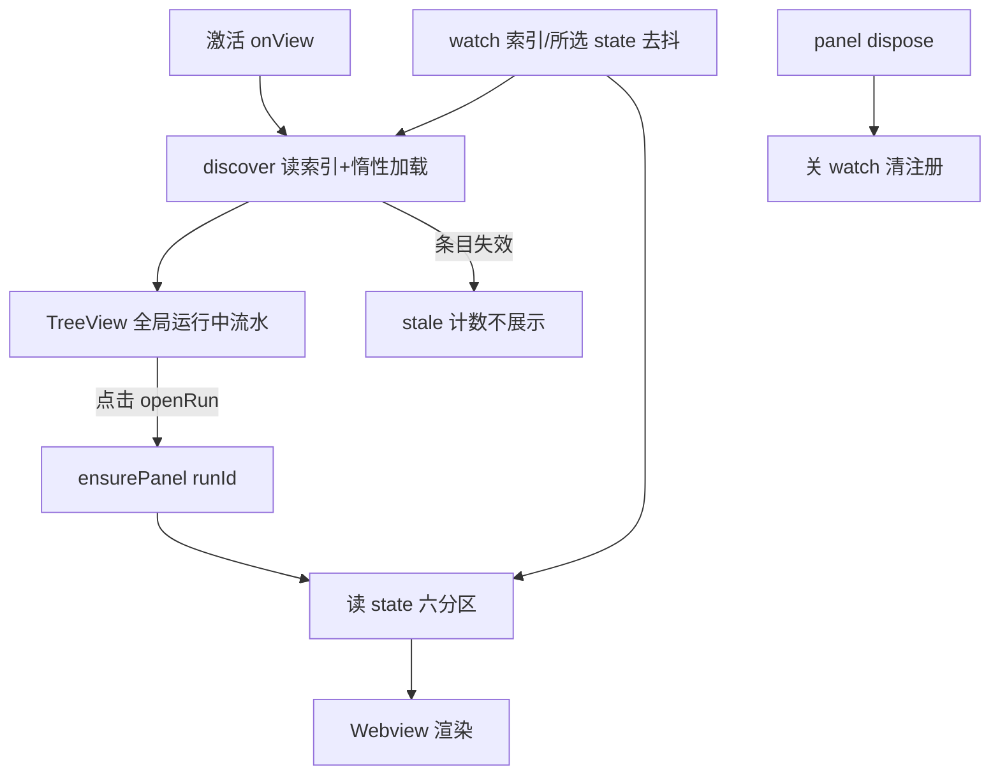

# VS Code 流水查看插件 技术方案（Plan）

> revision：R1 · mode：split · 生成于 2026-11-15 · 上游：spec.md（已批准；BQ-1 = 全局所有项目的运行中 run）· 本入口文档为唯一确认入口，详细设计见 Parts Manifest 所列分册

## 执行摘要

目标：在仓库新增 `plugin/` 独立工程，交付零依赖纯 JavaScript 的 VS Code 插件——活动栏容器（图标复用 docs 节点链 SVG）内 TreeView 列出**全局运行中**流水（数据面直读 `~/.ddo/index.json` + 各 `.state.json` 惰性加载，同构引擎判定语义），点击条目在右侧 WebviewPanel 按 state 六分区展示流水信息；图表按映射表快照复用 `docs/index.html` 的 SVG 与颜色（webview 内联原文 + 图标文件最小颜色表达，计算色一致）。范围仅查看不控制、不改 docs、不做主题化。关键结论：spec 四项 PD 全部落定（DEC-1..4），无遗留阻塞。文档模式：split（完整草稿 LF 规范化 Unicode code point 合计 15030 > 12000 阈值），入口=本文件，分册 2 份；revision R1 待确认。

## 范围与非目标

| 事项 | 说明 | AI 索引 |
|---|---|---|
| plugin 目录 | 新增 `plugin/` 承载扩展全部工程代码，不动仓库既有文件 | FR-PLUGIN-1 |
| SVG 完全复用 | 全部自定义图表按映射表快照自 docs/index.html，结构与计算色一致，禁手绘新图 | FR-ICON-1 |
| 全局存活流水导航 | TreeView 列出全局运行中 run（索引+惰性校验，stale 不展示，待收束仍展示） | FR-NAV-1 |
| 流水信息视图 | Webview 六分区信息版面（初始设计见 Part 02，coding 阶段可调） | FR-INFO-1 |
| 非目标 | 不做流程控制（只读）；不改 docs/index.html；不做主题化/多配色；不展示非运行中流水与历史管理 | spec Non-goals |

## 现有设计与复用基线

| 能力 | 文件路径 | 符号 | 证据类型 | 采用方式 | 适用边界 | AI 索引 |
|---|---|---|---|---|---|---|
| 全局 run 索引 `~/.ddo/index.json` | tools/cli.js；tools/lib/index-registry.js | register L663 / unregister L251,273 | Repository Fact | 复用现有实现 | 插件只读消费；索引=未收口全集（含待收束） | RB-1 |
| 「运行中」判定语义（惰性加载，失效=stale 计数） | tools/cli.js | tryLoadState L1132 / runResume L1158 / resumeRow L1210 | Repository Fact | 复用语义 | 插件侧重读同构最小校验子集（Part 01 §1） | RB-2 |
| state 六分区数据模型 schema v2 | tools/STATE-SPEC.md | §3.0–3.6 | Repository Fact | 复用现有实现 | 视图按六分区组织；F 区独立日志仅提示路径 | RB-3 |
| SVG 资产与颜色依赖（6 处 svg；--ink/--cyan/.host-ic；深色单形态） | docs/index.html | L41,44,560,567–570,807–819,1166–1193 | Repository Fact | 复用现有实现 | 快照复制；archWires（L955）为 JS 运行时绘制不纳入 | RB-4 |
| 仓库工程基线（无 package.json/TS/构建链） | 仓库根目录 | — | Repository Fact | 新增实现 | 现无前端/TS 基线可复用，plugin/ 独立零依赖工程 | RB-5 |

## 整体架构与流程

参与方：VS Code 宿主（激活/视图/面板）↘ 插件（extension.js 编排；runDiscovery.js 数据面；stateView.js+webviewHtml.js 渲染面）↘ 只读数据源（`~/.ddo/index.json` + 各 run `.state.json`）。边界：插件零写入，state 写方唯一为引擎 CLI。

异常流程（索引缺失→空态；state 失效→stale 跳过；openRun 时失效→提示并刷新）详见 Part 01 §4。

## 技术选型与方案对比

| 方案 | 来源 | 仓库适配性 | 代价与风险 | 状态 | 结论 | AI 索引 |
|---|---|---|---|---|---|---|
| 纯 JavaScript、零运行时依赖、无构建 | 初始 Plan（PD-1） | 高：仓库无 TS 基线（RB-5），main 直指源码 F5 即用 | 放弃类型检查；以 JSDoc 注释补偿 | accepted | 采用；后续可增量迁 TS 不影响契约 | DEC-1 |
| TypeScript + esbuild 打包 | 初始 Plan（PD-1） | 低：引入构建链与 node_modules/lock，红线禁改 .gitignore | 工程复杂度先于需求 | rejected | 不采用 | DEC-1 |
| 左 TreeView + 右 WebviewPanel | 初始 Plan（PD-2） | 高：原生侧栏集成+懒激活，Webview 保真渲染 | 双机制协同（panel 注册表/watcher） | accepted | 采用 | DEC-2 |
| 双 TreeView（导航+详情） | 初始 Plan（PD-2） | 中 | 六分区信息量与 SVG 保真受限 | rejected | 不采用 | DEC-2 |
| 直读索引+state（最小同构校验） | 初始 Plan（PD-3） | 高：无 skillRoot 路径耦合、无进程开销 | 引擎格式变更需随 STATE-SPEC 升版同步 | accepted | 采用 | DEC-3 |
| spawn CLI（resume/guide）取数 | 初始 Plan（PD-3） | 低：skillRoot 路径假设+每刷新一进程+输出面向 agent 非稳定 UI 契约 | 运行时依赖用户环境布局 | rejected | 不采用 | DEC-3 |
| 图表双层保真（webview 内联原文+图标文件最小颜色表达） | 初始 Plan（PD-4） | 高：webview 像素级一致；文件层计算色一致 | 文件层根级补颜色表达（映射表逐项记录） | accepted | 采用 | DEC-4 |
| 图标文件逐字节原样 / 注入 style 块 | 初始 Plan（PD-4） | 低：SVG 作图片加载时 var/currentColor 无解析上下文→渲染色失真（违背 AC-2）或结构增列 | 二者均违背保真目标 | rejected | 不采用 | DEC-4 |

## 数据模型设计

### 实体与字段

`RunSummary`（树节点）：`{runId,title,type,projectRoot,startedAt,positions[{stage,phase,gateOpen?}],completable?}`——同构 resumeRow（RB-2）。`RunDetail`：state 原文 + 派生视图模型 `{header,progress,gates,artifacts,subflows,env}`（纯函数，无 IO）；派生规则与字段级清单见 Part 02 §2。

### schema 与 DDL（如适用）

无数据库与迁移；持久层契约 = 引擎 `.state.json` schema v2（只读消费，RB-3）与索引文件格式（RB-1），两者以 STATE-SPEC 为权威，插件不自建存储。

### 状态与不变量

插件侧状态：panel 注册表（runId→panel+watcher）与发现缓存；不变量：对索引与 state 只读；失效条目整条跳过不部分渲染；runId 全局唯一（§3.1）；视图模型为 state 的纯函数（无中间写回）。

### 迁移、兼容与回滚

插件零落盘、零迁移；state schema v1→v2 为加性演进（缺失 schemaVersion 视为 v1），最小校验子集仅取两代共有必填字段，天然兼容。回滚 = 删除 `plugin/` 目录（git revert 即全量回滚），对引擎与仓库零残留。

## API 接口设计

| 接口/入口 | 请求 | 响应 | 错误与幂等 | 复用标准 | 实现职责 | AI 索引 |
|---|---|---|---|---|---|---|
| `ddo-flow.refresh` 命令 | —（无参） | 全量 discover+树刷新 | 幂等；索引错误进 OutputChannel 不弹窗 | VS Code command 范式 | extension.js | API-1 |
| `ddo-flow.openRun` 命令 | 树项 runId | 打开/聚焦对应 panel | state 失效→Information 提示+刷新树（幂等） | VS Code command+panel 范式 | extension.js | API-2 |
| TreeView `ddo-flow.runs` | getChildren | RunSummary 树项 | 空态文案 | TreeDataProvider 契约 | extension.js+runDiscovery.js | API-3 |
| Webview 渲染消息 | state 视图模型 | HTML 字符串 | 回收后重显全量重渲染 | webview 生命周期 | webviewHtml.js | API-4 |
| 配置 `ddo-flow.indexPath` | 用户设置 | 索引绝对路径（缺省 ~/.ddo/index.json） | 非法路径按索引缺失处理 | contributes.configuration | runDiscovery.js | API-5 |

## 算法设计

唯一非平凡算法 = 发现与判定（输入/输出/步骤/不变量/复杂度/边界），完整定义见 Part 01 §1；要点：惰性逐条加载（exists→parse→最小校验），失败计 stale 不阻断，待收束仍展示；O(n) 小文件读，无分页。其余为常规装配逻辑（Coding 职责，不在此展开）。

## 文件变更计划

| 文件/目录 | 变更职责 | 复用或依赖 | AI 索引 |
|---|---|---|---|
| `plugin/package.json` | 扩展清单（contributes 见 Part 01 §3） | VS Code 扩展契约 | FI-1 |
| `plugin/src/extension.js` | 激活/命令/树/provider/panel 注册表/watcher | vscode API | FI-2 |
| `plugin/src/runDiscovery.js` | discover()：索引+惰性校验+stale 计数 | RB-1/RB-2 语义 | FI-3 |
| `plugin/src/stateView.js` | state→六分区视图模型（纯函数） | RB-3 | FI-4 |
| `plugin/src/webviewHtml.js` | 视图模型→HTML（内联 SVG+同值样式） | RB-4 | FI-5 |
| `plugin/media/icons/*.svg` | 图标资产（快照，映射表见 Part 02 §4） | RB-4 | FI-6 |
| `plugin/.vscode/launch.json` | F5 Extension Development Host 配置 | — | FI-7 |
| `plugin/README.md` + `plugin/docs-icon-provenance.md` | 运行/打包说明；AC-2 比对清单 | — | FI-8 |

全部为新增；不改仓库既有文件与根 `.gitignore`。

## 兼容、稳定性与回滚

| 关注点 | 适用性 | 设计/理由 | 回滚信号 | AI 索引 |
|---|---|---|---|---|
| VS Code 版本 | 适用 | engines ≥1.75（所用能力远旧于该版） | 旧版宿主拒绝加载（清单自拦截） | CR-1 |
| 索引/state 格式漂移 | 适用 | 契约锚定 STATE-SPEC；漂移→发现空/stale 而非崩溃 | 树持续空态+OutputChannel 错误 | CR-2 |
| watch 平台差异 | 适用 | watcher 异常降级手动刷新（Part 01 §2） | OutputChannel 降级提示 | CR-3 |
| 性能 | 低风险 | 小 JSON O(n)+去抖 300ms；当前量级无分页 | 手动刷新可感知卡顿 | CR-4 |
| 回滚 | 适用 | 零落盘零迁移，删 plugin/ 或 git revert 即回滚 | — | CR-5 |

## Verification Anchor

| 需验证契约 | 可观察结果 | 证据位置 | AI 索引 |
|---|---|---|---|
| 插件可加载运行（AC-1） | F5 宿主中活动栏出现容器与「存活流水」视图 | 手动演示+plugin/README 截图 | VA-1 |
| 图表完全复用（AC-2） | 每个 SVG 与 docs 对应行并排比对：元素树一致+计算色一致 | plugin/docs-icon-provenance.md | VA-2 |
| 全局运行中清单（AC-3） | 清单含本 run 与跨项目 run；失效不出现；待收束条目带 live-star | 手动演示（当前索引含 5 条目：2 可加载） | VA-3 |
| 六分区信息视图（AC-4） | 点击后 header/进度链/门/产物/编排/环境区块齐备 | 手动演示+Part 02 §1 映射核对 | VA-4 |

## 开放问题与 Spec 对应

| 问题 | 确定答案或阻塞原因 | 解决位置 | AI 索引 |
|---|---|---|---|
| PD-1 技术栈 | 纯 JS 零依赖无构建 | DEC-1 | Q-1 |
| PD-2 界面机制 | 左 TreeView+右 WebviewPanel | DEC-2 | Q-2 |
| PD-3 数据面 | 直读索引+state 最小同构校验 | DEC-3 | Q-3 |
| PD-4 图表复用 | 双层保真+映射表 | DEC-4 | Q-4 |
| spec Assumption（图标挂载点平台强制） | 双层策略消解主风险；若 coding 阶段发现个别挂载点强制处理，按 spec 预留回用户取舍 | Part 02 §3；coding 验证 | Q-5 |

## Parts Manifest 与读取协议

revision：R1；全部分册状态 current。下游从本入口出发，按 manifest 读取；Tasking/Coding 按任务加载相关 part；证据失效（docs 行号漂移/STATE-SPEC 升版）即停止报告。

| # | 文档 | 职责 | 字符数 | 状态 | AI 索引 |
|---|---|---|---|---|---|
| 01 | plans/01-discovery-and-extension.md | 数据面与扩展集成详设（算法/刷新/契约面/错误路径） | 3009 | current | DEC-2/3/4 · API-1..5 |
| 02 | plans/02-runinfo-view-design.md | 右侧流水信息视图初始设计（版面/字段/视觉/映射表/交互） | 4089 | current | FR-INFO-1 · FR-ICON-1 |

## 风险与下游交接

- 风险与缓解：①图标挂载点平台强制（Q-5）——coding 首步先做活动栏/树图标冒烟再铺开；②索引格式漂移（CR-2）——契约锚定 STATE-SPEC，失效即停；③视图预期偏差——spec 明确 coding 阶段动态调整，调整清单已固化于 Part 02 §5。
- 下游读取范围：Tasking/Coding 读本文件 + 两 current 分册；不得读取历史归档 run。
- 事实失效处理：docs/index.html 相关行变动、STATE-SPEC §3.6 变更、索引格式变更 → 停止并回报用户，不得自行改已批准契约。
- 归档：可用模板 = atom-tasks/plan/references/ddo.md。

## 用户确认

- ✅ **同意**：批准当前 revision，进入后续编排。
- ❌ **修改：<反馈>**：反馈应用到新 revision 并重评估，展示变化摘要后重新送审。
- ❓ **提问：<问题>**：只答疑，不改文档、revision 与确认状态。
- 📦 **归档**：列出可用模板名，不产出文档。
- 📦 **归档：<模板名>**（当前可用：`ddo.md`）：生成 tech-design 产物；不代表批准。
