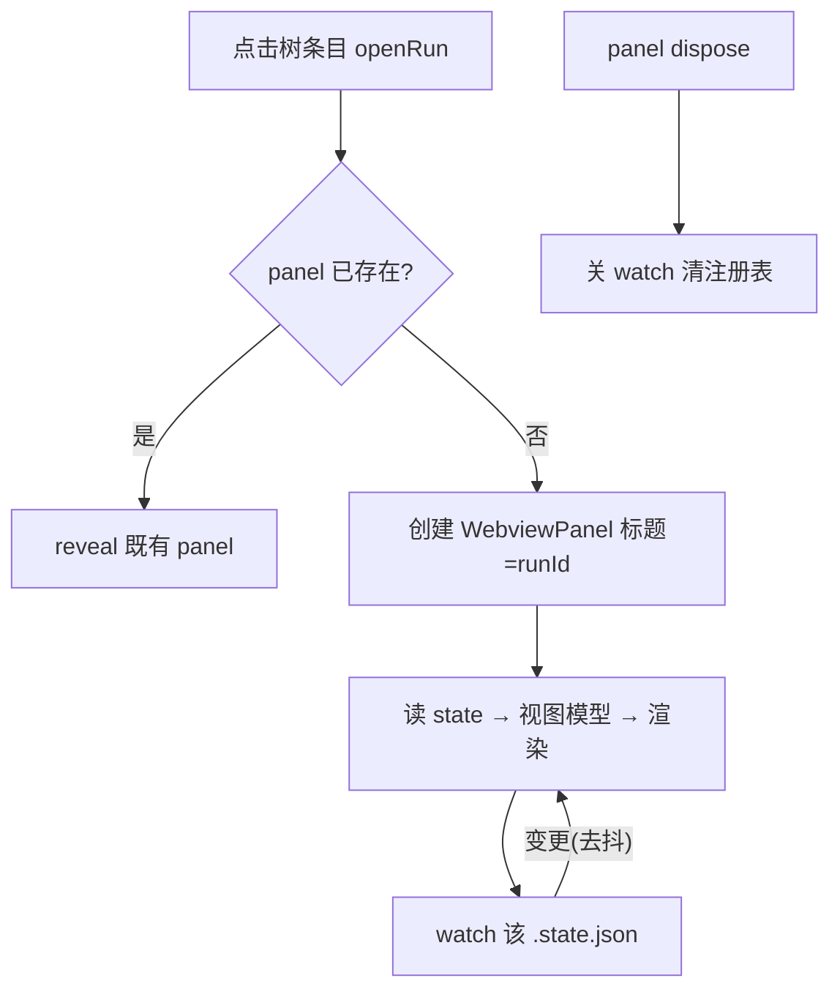

# Part 02 · 右侧流水信息视图初始设计

> 隶属：plan.md（R1，split 模式）· 上游契约：spec FR-INFO-1（初始设计，coding 阶段可动态调整）、FR-ICON-1（图表完全复用）
> 本分册即用户要求的「根据流水结构先设计」交付物：信息架构与字段级清单为初版设计，密度/顺序/徽标样式在 coding 阶段可调；**不可变项**：六分区覆盖、SVG 来源与保真规则、全局运行中口径。

## 1. 版面总览（六分区 → 区块映射）

WebviewPanel 单列纵向布局，自上而下：

| # | 区块 | 数据来源（state 分区） | 内容 |
|---|---|---|---|
| B1 | 流水头部 | A 标识 + B 环境（dirs/git 摘要） | 节点链 SVG + 标题行 + 元信息栅格 |
| B2 | 进度与门 | C 进度（currentStage/stages/gate） | 当前位置清单 + 全阶段链胶囊 + 开启门卡片 |
| B3 | 产物 | E 产物（artifacts） | 按 stage 分组的产物文件表 |
| B4 | 子流程 | D 编排（subflows） | 子流程注册表（无则整块省略） |
| B5 | 环境与旋钮 | B 环境（git/dirs/atomTasks） | 环境明细 + 旋钮表 |
| B6 | 日志提示 | F 使用日志（.usage.jsonl 路径） | 单行路径提示（只提示，不解析） |

省略规则：区块内容为空（如无 subflows/artifacts/atomTasks）时整块省略，不用「无」占位。

## 2. 字段级清单

**B1 流水头部**：`title`（主标题，--ink）；徽标行 `type` / `workflow?` / `schemaVersion` / `ephemeral?`；元信息栅格 `runId`、`startedAt`、`projectRoot`、`runDir`、`statePath`、git 摘要（单仓 `branch@mainBranch`；multi `multiRepo + repos[].name`）。右侧衬 72×72 节点链 SVG（透明度压低作水印，结构颜色不改）。

**B2 进度与门**：
- 当前位置清单：`currentStage[]` → `stage:phase` 行 + 门开启状态点（`stages[stage].gate` 存在且无 `decision` → `--warn` 点 + 「门开启」；空数组 → 「待收束」整行，配 live-star 图标）。
- 全阶段链：`stages` 对象按键序（= 工作流预设链序）展开为胶囊序列 `stage1 → stage2 → …`；胶囊前景色映射五状态：`pending`→`--ink-3`、`running`→`--cyan`、`waiting-human`→`--warn`、`done`→`--ok`、`failed`→`--danger`（全部取 docs :root 既有变量，L38–53，不新造色值）；当前位置胶囊加 `--cyan` 边框。胶囊下方缩进列出各阶段最后触碰时刻 `stages[s].at`。
- 门卡片（仅开启门）：`gate.phase`、`gate.openedAt`、options 逐项 `name + desc`（**只读展示**，Non-goal：不提供 dispatch 按钮）、`presentedAt?`、`lastInteractedAt?` 时间线。

**B3 产物**：`artifacts[stage][]` → 每条目：相位行（`phase` + `recordedAt`）+ 文件表（`path` 等宽字体、`bytes` 人类可读化）。

**B4 子流程**：`subflows[]` 表：`id`、`title`、`workflow`、`atStage`、`status`、`startedAt`。

**B5 环境与旋钮**：git（单仓 `branch`/`mainBranch`/`worktreePath?`；multi `container` + `repos[]`：role/name/branch）；`dirs.tasksDir?`；`atomTasks` 键值表（`<task>.<key> → value`）。

**B6 日志提示**：`<runDir>/.usage.jsonl` 路径单行 + 「F 区使用日志，插件不解析」说明。

## 3. 视觉基线（全部取自 docs/index.html 既有资产）

- 色板：`:root` 变量区 L38–53 原值快照（`--bg-0 #070B14`、`--panel #0B1322`、`--line #1C2A45`、`--ink/-2/-3`、`--cyan`、`--ok/--warn/--danger`、`--r-sm/md/lg`）；深色单形态（docs 无浅色覆盖，R4），不随 VS Code 主题切换。
- 字体：`--font-display`/`--font-body`/`--font-mono` 同名快照；webview 内不加载 docs 的 Google Fonts 外链，按变量声明的本机族回退渲染（字体栈本身即 docs 声明，结构未改）。
- 图表保真双层规则（DEC-4）：
  - **Webview 内联层**：SVG 标记自 docs 对应行**原文内联**，随页注入同值 CSS 变量与 `.host-ic`/`.live-star` 规则（`--ink #E6F1FF`、`--cyan #00FFCC`、`.host-ic{fill:currentColor;…}` L560/569）——渲染结果与 docs 像素一致，零改写。
  - **图标文件层**（VS Code 以图片加载，CSS/变量无解析上下文）：元素树原文保留，仅根级补最小颜色表达使 `currentColor` 解析到与 docs 相同的计算值（见 §4 表「文件层适配」列）；计算色一致，形状/层级零改动。
- AC-2 比对方法：插件内每个 SVG 与 `docs/index.html` 对应行区间并排（元素树 diff + 计算色 diff），比对清单随代码落 `plugin/docs-icon-provenance.md`（coding 阶段产物）。

## 4. 图表复用映射表（快照来源=行号；本表为唯一合法来源清单，禁手绘新图）

| 插件槽位 | 来源（docs/index.html） | 文档渲染色（计算值） | 保真层 | 文件层适配 |
|---|---|---|---|---|
| 活动栏容器图标 `activity.svg` | 节点链 L807–819 | `var(--ink)`→#E6F1FF | 图标文件 | 根 `style="color:#E6F1FF"`（替换 var 引用，同值） |
| 流水条目 `run-claude.svg` | host-ic·Claude L1170 | `.host` 色→#9FB3D1（opacity .78） | 图标文件 | 根 `fill="currentColor"` + `style="color:#9FB3D1"`（补 CSS 类等价表达） |
| 待收束条目 `run-completable.svg` | live-star L1193 | `.live-star`→var(--cyan) #00FFCC | 图标文件 | 根 `fill="#00FFCC"`（补类规则等价表达） |
| Webview B1 水印（节点链） | L807–819 | 同上 #E6F1FF | Webview 内联 | 无需适配（原文+同值变量） |
| Webview 宿主/修饰（终端/窗口/格点） | host-ic L1166/L1174/L1178 | #9FB3D1 系 | Webview 内联 | 无需适配（原文+`.host-ic` 规则） |

不纳入复用：`archWires`（L955，JS 运行时绘制非静态资产）；docs 各 HTML/CSS 拟物区块（mini-win/claude-win 等，非 SVG 图表）。

## 5. 交互与生命周期

- 每 runId 至多一个 panel；panel 标题 `runId`，`description` 截断 title；切换 run 不复用彼此 panel。
- 状态恢复：`retainContextWhenHidden:false`，重显时重读 state 全量重渲染（视图模型为纯函数，无中间态丢失）。
- coding 阶段可调清单（spec 预留）：区块顺序/密度、徽标与胶囊样式、元信息栅格列数、tooltip 内容、自动滚动到当前位置；调**整不改变**：六分区区块覆盖、映射表来源行号、只读语义。
