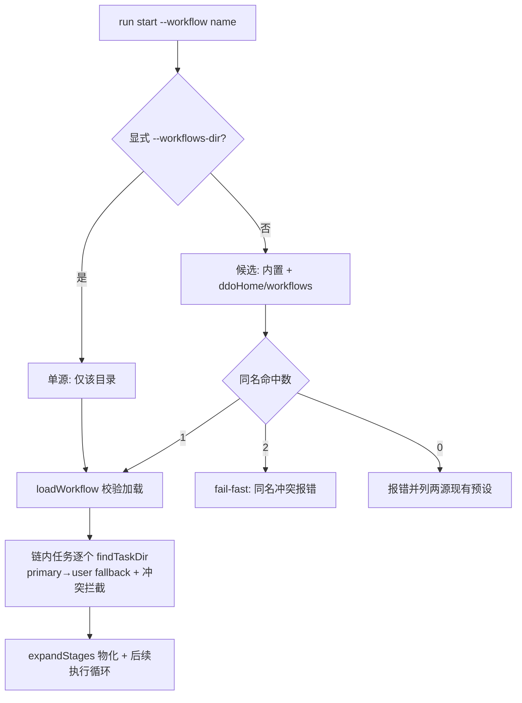

# ~/.ddo 本地注册源缺省合并发现 技术 Plan

> revision: 1 · 模式：split（1 分册，引擎 output 契约要求 plans/ 非空）· 工作目录：worktree `feat/ddo-local-sources` · 上游：spec 已批准版（含 BQ-1 决议）

## 执行摘要

为 `list` / `guide` / `run start` 增加用户本地注册源的缺省合并解析：新增 `tools/lib/sources.js`，在未显式指定 `--workflows-dir`/`--tasks-dir` 且解析落到内置缺省目录时，将 `ddoHome()/workflows`（预设）与 `ddoHome()/atom-tasks`（任务）与内置目录加性合并；预设与任务的同名冲突一律 fail-fast，不遮蔽内置；state schema 不变（用户源运行期解析、不落盘）。本 run 验收以测试夹具为主（本机 `~/.ddo` 注册样例实测缺失，spec Assumption 已证伪）。关键结论：采用运行期名称级解析（方案 C），改动收敛在少数读取咽喉。

## 范围与非目标

| 事项 | 说明 | AI 索引 |
|---|---|---|
| 范围 | `list workflows` 缺省合并列出（含 source 标注）；guide 模式选项自动含本地预设；`run start` 预设与任务解析合并；冲突 fail-fast；未部署环境行为等价 | FR-1~FR-6 |
| 非目标 | 不动 `list tasks` 合并；不做 profiles 引擎感知（BQ-1 决议）；不做注册管理命令；不改 state schema；不触碰 skillRoot 部署副本（`~/.cc-switch` 符号链接目标非本仓库） | NG-1 |
| 约束 | 项目红线：不改 `.gitignore`/git exclude；引擎既有 fail-fast（不产生半截 run）语义保持；spec 全部解释与假设条款沿用 | CONS-1 |

## 现有设计与复用基线

| 能力 | 文件路径 | 符号 | 证据类型 | 采用方式 | 适用边界 | AI 索引 |
|---|---|---|---|---|---|---|
| DDO_HOME 优先的 ~/.ddo 解析 | tools/lib/index-registry.js | `ddoHome()` | Repository Fact | 复用现有实现 | sources.js 用户注册目录根 | BASE-1 |
| 预设加载与校验 | tools/lib/workflow.js | `loadWorkflow` | Repository Fact | 复用现有实现 | 单源校验不动，合并层只做选源 | BASE-2 |
| 任务目录三级取值 | tools/cli.js | `tasksDirFor` | Repository Fact | 扩展现有实现 | 结果仍单一主目录，fallback 在读取层 | BASE-3 |
| exec/validate 任务目录咽喉 | tools/cli.js | `phaseContext` | Repository Fact | 扩展现有实现 | join 改经 sources 解析函数 | BASE-4 |
| 任务存在性校验与 config 读取 | tools/lib/workflow.js、assemble.js、subflow.js、cli.js | `expandStages`/`phaseType`/`nextPhase`/`buildGate`/`standardOptions`/`applyConfigOverrides`/`prefillAtomTasks`/`outputDecls` | Repository Fact | 扩展现有实现 | `path.join(tasksDir,task,'config.json')` 改经解析函数 | BASE-5 |
| 预设清单扫描 | tools/cli.js | `listWorkflows` | Repository Fact | 扩展现有实现 | 缺省分支改双源合并 | BASE-6 |
| guide 数据面 | tools/cli.js | `runGuide` | Repository Fact | 复用现有实现 | 经 listWorkflows 自动获得本地选项 | BASE-7 |
| 测试沙箱惯例 | tools/tests/*.test.js | `sandbox()`/`cli()` | Repository Fact | 复用现有实现 | DDO_HOME 指沙箱，注册夹具写其下 | BASE-8 |
| 本机注册样例 | ~/.ddo/ | （无 workflows/atom-tasks/profiles，仅 history+index.json） | Repository Fact | 不适用 | spec Assumption 证伪：验收用夹具 | BASE-9 |

## 整体架构与流程

参与方：CLI 入口（list/guide/run start/subflow start）→ 新增 `lib/sources.js` 合并解析层 → 既有 `loadWorkflow`/任务读取函数。边界：sources.js 不写任何文件、不触 state；profiles 目录完全不感知（DEC-7）。

异常流程：任务两源同名 → findTaskDir 抛错（启动期与运行期一致）；user 源目录不存在/为空 → 解析结果与现状逐字段一致（AC-5 等价不变量）。

## 技术选型与方案对比

| 方案 | 来源 | 仓库适配性 | 代价与风险 | 状态 | 结论 | AI 索引 |
|---|---|---|---|---|---|---|
| A. state 落多目录数组 | 初始 Plan | 差：违反「state schema 不变」用户初判约束 | 下游全部命令取值契约重签，迁移面大 | rejected | 弃 | ALT-A |
| B. 物化符号链接合并目录 | 初始 Plan | 差：平台差异、污染 runDir 与归档 zip | rollback 连带风险、权限问题 | rejected | 弃 | ALT-B |
| C. 运行期名称级解析 | 初始 Plan | 好：零 schema 变更、改动收敛在读取咽喉 | 需保证各读取点全覆盖（BASE-5 清单管控） | accepted | 取 | ALT-C |

## 数据模型设计

### 实体与字段

无数据库实体。新增模块级派生值：`userWorkflowsDir = path.join(ddoHome(),'workflows')`、`userTasksDir = path.join(ddoHome(),'atom-tasks')`（每次调用现算，不缓存，尊重 DDO_HOME 变更）。state 字段零变更。

### schema 与 DDL（如适用）

不适用：无数据库与 state schema 变更（DEC-4；用户初判约束兑现）。

### 状态与不变量

等价性不变量：user 源不存在或为空 ⟹ 所有命令输出与现状逐字段一致。无遮蔽不变量：任何同名（builtin vs user）在解析点被拦截，不存在「后者静默胜出」路径。D11（state 自包含）不受影响——解析层只服务加载期与任务文件读取期。

### 迁移、兼容与回滚

无数据迁移。兼容：旧 state（dirs.tasksDir 指向内置或缺省）在新解析下行为不变。回滚：还原代码即可，run 状态自包含无需处理。

## API 接口设计

| 接口/入口 | 请求 | 响应 | 错误与幂等 | 复用标准 | 实现职责 | AI 索引 |
|---|---|---|---|---|---|---|
| `list workflows`（无 flag） | 无参 | `workflows[]` 两源按 name 排序合并，行含既有字段 + `source:"builtin"|"user"` | 两源同名 → exit 1，消息列冲突名与两路径；幂等只读 | 复用现有扫描容错（坏 JSON 跳过） | 双源合并 + 冲突拦截 + source 标注 | API-1 |
| `list workflows --workflows-dir` | 目录 | 现状单源输出 | 现状不变 | 复用 | 不引入 user 源 | API-2 |
| `guide` | 无参 | mode 选项自动含本地预设（含 startup followUps 现算） | 无新增错误路径 | 复用 listWorkflows | 零结构改动 | API-3 |
| `run start --workflow <name>` | 预设名 + 既有参数 | 既有输出结构（不加字段） | 冲突/不存在按 DEC-1 报错；不产生半截 run（复用 fail-fast） | 复用 loadWorkflow 校验 | loadWorkflowMerged 选源 | API-4 |
| `subflow start` | 既有参数 | 既有输出 | 同上 | 复用 | 预设加载改走 loadWorkflowMerged（DEC-6） | API-5 |
| `findTaskDir(primary, task)`（内部） | 主目录+任务名 | 任务物理目录或 null | 双源同名 → 抛错（DEC-3） | — | 名称级 fallback 解析 | API-6 |

## 算法设计

预设解析 `loadWorkflowMerged(explicitDir, name)`：候选 = explicitDir ? [explicitDir] : [WORKFLOWS_DIR, userWorkflowsDir()]；逐源探 `<name>.json`；n=1 → 复用 loadWorkflow；n=0 → 报错并列两源并集清单；n>1 → 冲突报错。任务解析 `findTaskDir(primary, task)`：primary 命中 → 返回；primary===ATOM_TASKS_DIR 且 user 命中 → 返回 user 路径；均无 → null（调用方按既有「原子任务不存在」报错）；返回前始终做双源同名冲突校验。复杂度 O(源数×existsSync)，无状态。边界：DDO_HOME 未设 → os.homedir()；符号链接与大小写按 fs 语义，不做归一化。

## 文件变更计划

| 文件/目录 | 变更职责 | 复用或依赖 | AI 索引 |
|---|---|---|---|
| tools/lib/sources.js（新增） | DEC-1 全部函数（userWorkflowsDir/userTasksDir/findTaskDir/readTaskConfig/loadWorkflowMerged） | index-registry 的 ddoHome、workflow 的 loadWorkflow | FC-1 |
| tools/cli.js | listWorkflows 缺省分支合并+冲突+source；runStart 预设加载与旋钮预填改经 sources；outputDecls/phaseContext 改经 findTaskDir | sources.js | FC-2 |
| tools/lib/workflow.js | expandStages/phaseType/nextPhase/standardOptions/buildGate 的 config 读取改经解析函数（签名不变） | sources.js | FC-3 |
| tools/lib/assemble.js | applyConfigOverrides config 读取改经解析函数 | sources.js | FC-4 |
| tools/lib/subflow.js | subflowStart 预设加载改 loadWorkflowMerged；prefillAtomTasks 改经解析函数 | sources.js | FC-5 |
| tools/tests/sources.test.js（新增） | 合并/冲突/等价性/密闭性测试 | 沙箱惯例 BASE-8 | FC-6 |
| tools/tests/list.test.js、start.test.js、guide.test.js | 增补合并列出、本地预设按名启动、guide 含本地选项 | 既有用例风格 | FC-7 |
| SKILL.md | 「自定义」段补一句：`~/.ddo` 本地注册预设缺省可发现 | — | FC-8 |

## 兼容、稳定性与回滚

| 关注点 | 适用性 | 设计/理由 | 回滚信号 | AI 索引 |
|---|---|---|---|---|
| 未部署 ~/.ddo 等价性 | 适用 | user 源缺席时解析路径与现状同构（AC-5） | 空环境基线测试失败 | CR-1 |
| 既有测试密闭性 | 适用 | 合并仅在解析落内置缺省时激活；显式 flag 通道不合并（DEC-2） | 既有测试套件回归失败 | CR-2 |
| 冲突语义 | 适用 | 解析点统一拦截，启动/运行期一致（DEC-3） | 冲突用例未按预期 exit 1 | CR-3 |
| 回滚 | 适用 | 纯代码还原，无状态迁移 | 功能回退决策 | CR-4 |

## Verification Anchor

| 需验证契约 | 可观察结果 | 证据位置 | AI 索引 |
|---|---|---|---|
| FR-2+FR-3（AC-1） | 沙箱 DDO_HOME 注册 `ones-d` 样例（混引内置任务），无 `--workflows-dir` 启动成功并走一轮 exec/validate/next | tools/tests/sources.test.js | VA-1 |
| FR-1（AC-2） | 缺省 list 输出含 user 预设与 `source:"user"` | tools/tests/list.test.js 增补 | VA-2 |
| FR-4（AC-3） | 内置预设仍在、`source:"builtin"`、basic 启动行为不变 | 同上 + 既有回归 | VA-3 |
| FR-5（AC-4） | 预设同名：list 与 run start 均 exit 1；任务同名：run start/exec exit 1，消息含两路径 | tools/tests/sources.test.js | VA-4 |
| FR-6（AC-5） | 空注册环境输出与现状基线逐字段一致；显式 flag 不合并 | tools/tests/sources.test.js | VA-5 |
| 真机 AC-1 | 本机注册缺失（BASE-9）：需用户重建 ones 注册后人工验收，或以夹具达成为准 | run 验收记录 | VA-6 |

## 开放问题与 Spec 对应

| 问题 | 确定答案或阻塞原因 | 解决位置 | AI 索引 |
|---|---|---|---|
| PD-1 sources.js 内部结构 | DEC-1：函数清单与错误消息契约（含两处物理路径） | FC-1 | OQ-1 |
| PD-2 显式参数与合并优先级 | DEC-2：显式=密闭通道不合并；合并仅缺省分支激活 | CR-2 | OQ-2 |
| PD-3 改动点与测试方案 | FC-2~FC-7 + Verification Anchor | 全文件变更计划 | OQ-3 |
| spec「state 预计不变」 | DEC-4 兑现：零字段变更 | 数据模型设计 | OQ-4 |
| spec Assumption（注册样例可用） | 已证伪（BASE-9）：验收改夹具，真机验收待用户重建注册 | VA-6 | OQ-5 |
| subflow 是否同路径合并 | DEC-6（agent 解释，一致性外延）：是，提请门审确认 | API-5 | OQ-6 |

## 风险与下游交接

- 风险：BASE-5 读取点清单遗漏 → 某命令仍读单目录（缓解：分册调用点清单逐项核对 + 全命令烟测）。
- 风险：引擎 output 契约（plan 相位 dirs:["plans"] 必须非空）与 schema single 模式规则（「不创建 plans/」）存在张力——本次按引擎侧权威以 split 模式交付；建议后续 run 修正契约一致性（skill-consistency 测试未覆盖此处）。
- 下游读取：Tasking/Coding 从本 plan.md 出发，按 Parts Manifest 读 current 分册；分册含实现注记（调用点行号清单、错误文案草案、测试组织）。
- 事实失效处理：spec/plan 修订或引擎结构与基线不符时停止并报告，不得自行改已批准契约。

### Parts Manifest

| # | 文档 | 职责 | 字符数 | 状态 | AI 索引 |
|---|---|---|---|---|---|
| 1 | plans/01-merge-resolution-impl-notes.md | 实现注记：调用点行号清单、错误文案草案、测试组织 | ~2600 | current | PM-1 |

## 用户确认

- ✅ **同意**：批准当前 revision，进入 Coding 编排。
- ❌ **修改：<反馈>**：反馈应用到新 revision 并重评估，展示变化摘要后重新送审。
- ❓ **提问：<问题>**：只答疑，不改文档、revision 与确认状态。
- 📦 **归档**：列出可用模板名（atom-tasks/plan/references/）不产出文档。
- 📦 **归档：<模板名>**：按模板名生成 tech-design 归档文档（不代表批准）。
