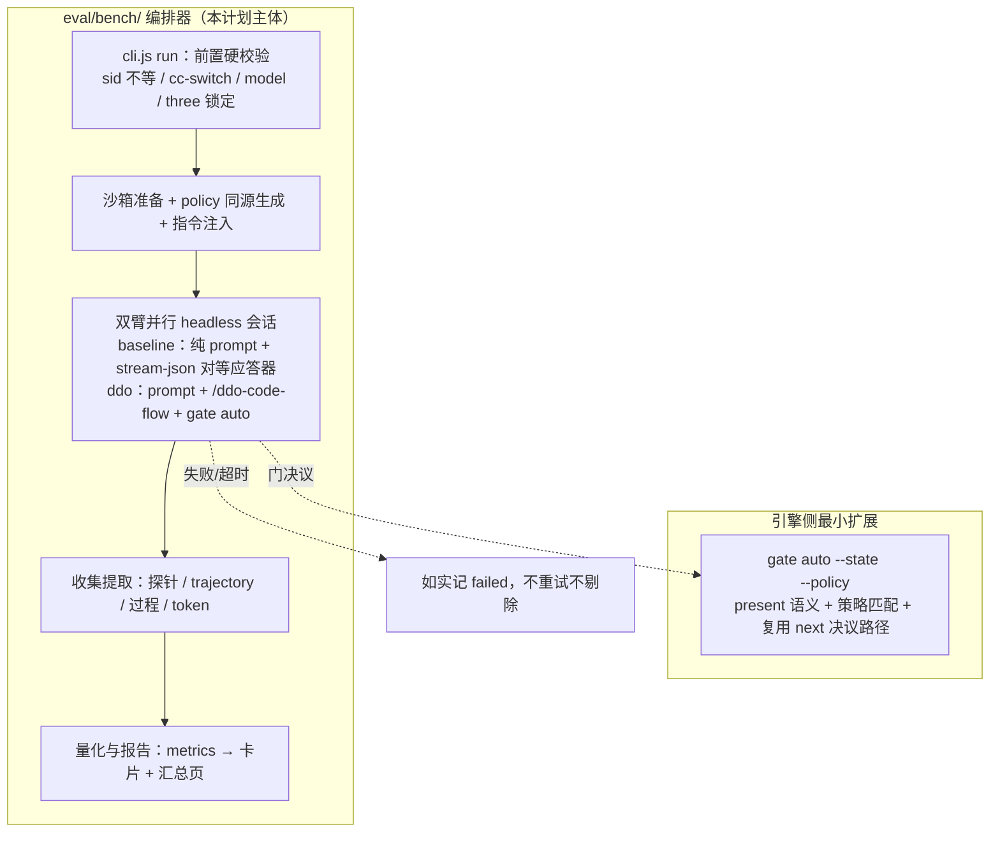

# model-quick-eval 评测流水线 技术 Plan

- **revision**: 2（2026-11-25。rev2 变更：新增 DEC-9 运行期动态装配——启动时可选评测维度/题目/报告形式；报告形式注册表扩入公众号/小红书平台模板。rev1 → rev2 仅加性，缺省行为与全部 FR/AC 不变）
- **模式**: split（本文件为稳定入口与唯一确认入口，细节由 plans/01–04 分册承载）
- **上游**: spec.md revision 2（已批准，BQ-1 决议：混合形态）
- **生效目录**: `/Users/djhhh/work_area/Ddo-Code-Flow`（无 worktree）

## 执行摘要

为 Ddo-Code-Flow 实现 `eval/bench/model-quick-eval` 快速评测流水线：输入 `model_id` + 2–3 道题 + 两个 session ID，自动跑 A/B 双分支（纯 prompt vs prompt + Ddo-Code-Flow auto 模式），提取结果层、过程层、成本层数据，产出对比卡片与汇总报告。按 BQ-1 决议采用混合形态：引擎仅新增通用 `gate auto` 命令（自动呈现 + 按冻结策略决议，先改 STATE-SPEC 再实现），评测编排逻辑全部落在 `eval/bench/`（Node CLI 编排器 + 题包 + Playwright 探针 + 量化提取 + 报告模板）。本轮必须跑通三道核心题（页面/调研依赖/回归陷阱各一）。外部依赖均为只读契约：cc-switch SQLite 日志（token 不进工作流内部）、Claude Code headless 会话、unpkg CDN（three@0.160.0 锁定）。所有报告强制含诚实边界与小样本声明，负增益/无差异如实呈现，无加权总分。rev2 增补：启动时动态装配运行配置（`--profile`：评测维度、题目、报告形式均可选；缺省全维度 + 基础报告形态），报告形式注册表含公众号长图与小红书竖版卡模板（仅产出本地物料，不自动发布）。关键结论：引擎侧改动收敛为一个加性命令；风险集中在外部契约（session id 固定、stream-json 多轮）与 cc-switch 数据口径，均已配双路径或显式回退。

## 范围与非目标

| 事项 | 说明 | AI 索引 |
|---|---|---|
| In: 引擎 `gate auto` 命令 | STATE-SPEC 增补 + 实现 + 单测；通用能力，评测无关语义 | FR-10、FR-15 |
| In: eval/bench/ 编排器 | 五步流水线：沙箱准备 → A/B 并行 → 收集提取 → 判定量比 → 报告 | FR-1 |
| In: 题库与三道核心题 | 题包 schema、`q_threejs-orbit-scene` / `q_export-command` / `q_regression-trap` 入库并跑通 | FR-5、FR-6、FR-7 |
| In: 三层提取与报告 | Playwright 探针（A1–F1）、过程层 5 信号 + 对称性、cc-switch token 聚合、卡片 + 汇总页模板 | FR-6–FR-12 |
| In: 规则库 | `prompt-rules.md`（出题层修正 + prompt.diff 模板）、`rubric.md`（评分细则） | FR-13 |
| In: 运行期动态装配（rev2） | 启动 profile：评测维度（结果/过程/成本/对称性）、题目、报告形式均可选；缺省全维度 + 基础三形态（缺省行为不变，FR/AC 仍按全量验收） | FR-1、DEC-9 |
| In: 平台报告模板（rev2） | 公众号长图（HTML/PNG）与小红书竖版卡（3:4 PNG）模板入报告形式注册表；声明段为一切形式固定元素 | FR-12、DEC-9 |
| Non-goal: 全面测评 | 不做跨模型结论、不加权总分、不合成性价比分数 | FR-11、FR-12 |
| Non-goal: 引擎侵入扩展 | 除 `gate auto` 外不改引擎；不用引擎 subflow 承载评测编排 | FR-15 |
| Non-goal: 既有 eval 四区改动 | `eval/runs`、`verify`、`showcases`、`design` 零改动；不修改 `.gitignore` | AC-14 边界 |
| Non-goal: 其余题目跑通 | 另两道页面题与题 3 可选题仅登记题库结构（spec INT-2） | AC-5 |
| Non-goal: 平台自动发布 | 平台模板只产出本地物料（HTML/PNG），不接入公众号/小红书 API，不自动上传 | DEC-9 |

## 现有设计与复用基线

| 能力 | 文件路径 | 符号 | 证据类型 | 采用方式 | 适用边界 | AI 索引 |
|---|---|---|---|---|---|---|
| 门选项单源派生与呈现有效性 | tools/lib/gate.js | `openGates` / `presentPayload` / `isPresentationValid` / `dynamicOptions` | Repository Fact | 扩展现有实现 | 静态 ∪ present 钩子动态选项；I-G1 | DEC-2 |
| 决议写入路径与审计 | tools/cli.js、tools/lib/journal.js | next handler（decision 校验与 `gate.decision/closedAt` 写入）、`appendAudit` | Repository Fact | 复用现有实现 | 推进型决议；in-phase 被 next 拒绝 | DEC-2 |
| E 区产物登记 / F 区使用日志 | tools/STATE-SPEC.md | §3.5 / §3.7（11 事件枚举） | Repository Fact | 复用现有实现 | 登记只在 next；日志不驱动控制流 | FR-8 |
| per-task present 钩子 | tools/lib/gate.js | `loadPresentHook`（`atom-tasks/<task>/<task>.js` 导出 `present(ctx)`） | Repository Fact | 复用现有实现 | 动态选项恒 in-phase（如 回答BQ-N） | DEC-2 |
| 命令注册与四通道输出 | tools/cli.js | REGISTRY（13 命令）、stdout JSON / stderr / exit 0·1·2 | Repository Fact | 扩展现有实现 | 注册表即文档源 | DEC-2 |
| state 封闭键集与写白名单 | tools/STATE-SPEC.md、tools/lib/state.js | §3.6 / §4.4 `WRITER_ALLOWLIST` | Repository Fact | 复用现有实现 | 扩展先入规范再入实现 | DEC-2 |
| 沙箱与隔离规范 | eval/README.md | runs/ 命名、沙箱即 projectRoot、`DDO_HOME` 覆写 | Repository Fact | 复用现有实现 | 既有 eval 四区零改动 | DEC-3 |
| 门自动决议先例设计 | eval/design/03-automation-pipeline.md | §3 无头执行 / §4 门决议策略器 | Repository Fact | 复用现有实现 | 方案稿·待评审：仅概念参照，不改稿 | DEC-1、DEC-2 |
| 测试约定 | tools/tests/*.test.js | node:test（119 用例；gate/present/next.test.js） | Repository Fact | 复用现有实现 | 引擎行为变更必须带单测 | VA-A |
| subflow 机制 | tools/lib/subflow.js | `subflowStart` / `subflowClose`（depth [2,3]） | Repository Fact | 不适用 | BQ-1 决议：编排不进引擎 subflow | DEC-1 |
| 用户源合并解析 | tools/lib/sources.js | `findTaskDir`（DDO_HOME 感知） | Repository Fact | 复用现有实现 | 覆写后内置源仍解析，两臂一致 | DEC-3 |

## 整体架构与流程

- 分层对齐 eval/design/03 行业借鉴：执行层（双臂会话）/ 采集层（probes + collect）/ 判定层（metrics）/ 呈现层（report 单向渲染）。
- 异常流程：臂超时或非零退出 → kill 会话并记 `failed`；至少一题两臂完整才算该题可比；门策略未命中 → 引擎硬错（不自由生成）。
- 详细五步流程与异常分支见 Part 02 §6；对等澄清通道序列见 Part 02 §5。

## 技术选型与方案对比

| 方案 | 来源 | 仓库适配性 | 代价与风险 | 状态 | 结论 | AI 索引 |
|---|---|---|---|---|---|---|
| (a) 引擎原生子流程承载评测 | 初始 Plan | 需扩展引擎任务机制，评测语义入引擎 | 引擎与评测耦合，维护面大 | rejected | 弃 | DEC-1 |
| (b) 纯外置编排（不改引擎，外部推决议） | 初始 Plan | 门决议绕过门协议（headless 会话内被拦，只能抢跑 state，竞态无留痕） | 与 §7「工作流必须支持 auto 模式」不符 | rejected | 弃 | DEC-1 |
| (c) 混合：通用 `gate auto` + eval/bench 编排 | 用户修改（BQ-1） | 引擎只获得评测无关通用能力；编排自由度全保留 | 引擎 +1 命令（加性） | accepted | 采用 | DEC-1、DEC-2 |
| gate auto 策略驱动（文件匹配，非生成） | 初始 Plan | 复用 I-G1 与单源选项；不新增 state 顶层键 | 策略未命中需硬错设计 | accepted | 采用 | DEC-2 |
| 每题每臂独立沙箱 + 每轮 DDO_HOME 覆写 | 初始 Plan | 延续 eval 沙箱规范，全局零污染 | 沙箱数量 = 题数 × 2 | accepted | 采用 | DEC-3 |
| headless 双臂 + 同源 clarify 两通道 | 初始 Plan | 对等澄清通道（AC-3）的直接实现 | session id 固定与 stream-json 为外部契约假设 | accepted | 采用（首日验证） | DEC-4 |
| `node:sqlite` 只读聚合 token | 初始 Plan | 零原生依赖（Node ≥22.5，本机 v26.3） | cc-switch 路径/漏记需口径标注 | accepted | 采用 | DEC-5 |
| Playwright 承载探针与拼图 | 初始 Plan | 需求指定；eval/bench 独立 package.json 隔离 | devDependency + 浏览器二进制（用户级缓存） | accepted | 采用 | DEC-6、DEC-7 |
| 题包 schema（clarify.json 同源） | 初始 Plan | 核心集/轮换共用；两臂应答唯一来源 | 需人工复核冻结流程配套 | accepted | 采用 | DEC-8 |
| 运行期 profile 动态装配 + 报告形式注册表（含公众号/小红书模板） | 用户修改（rev2） | metrics→render 单向数据流天然支持多形态；缺省全量，FR/AC 验收不受影响 | 模板维护面增加；平台物料仍强制声明段 | accepted | 采用 | DEC-9 |

## 数据模型设计

### 实体与字段

题包（`bank/<题>/`）：`meta.json`（name、line=ui/design/execute、core、three_lock、signals）、`prompt.raw.md`（冻结原文）、`prompt.final.md`、`prompt.diff`、`clarify.json`（条目：id/关键词[]/应答）、`acceptance/`（隐藏验收）、`fixture/`（沙箱模板）。gate auto 策略：`rules[{id, match{stage,phase}, prefer[], inPhase{}}]` + `defaults{prefer[]}`。轮次元数据（`runs/<轮次Id>/round.json`）：model、题单、baseline_sid/ddo_sid、每题每臂起止时刻、环境指纹、注入指令留痕。运行 profile（rev2，`--profile <file>` 或缺省全量）：`{dimensions{result,process,cost,symmetry}, tasks[], reports[]}`，`reports` ⊆ 形式注册表 `{card, sheet, summary, wechat, xiaohongshu}`。提取中间产物（`metrics/`）：`probe.json`（达标项/总项 + 逐项判定）、`process.json`（六行信号 + 对称性表）、`token.json`（组/题/阶段聚合 + 口径声明）、`result.json`（非页面题验收量化）。流水线声明（`model-quick-eval.subflow`，JSON）：输入、五步、产物契约。

### schema 与 DDL（如适用）

无数据库变更；cc-switch `proxy_request_logs` 为外部只读表（字段：session_id/provider_id/input_tokens/output_tokens/total_cost_usd/created_at，缓存列 PRAGMA 自适应）。文件型 JSON schema 的字段表与示例见 Part 01 §3.2（策略）、Part 03 §1（题包）、Part 03 §3–§5（metrics 各文件字段即报告模板占位符）。

### 状态与不变量

引擎不变量保持：I-G1（gate auto 先写 `presentedAt` 再决议）、I-J1（日志不驱动控制流）、I-5、§3.6 顶层键封闭（不新增键，写白名单 ⊆ 既有命令并集）。评测侧不变量：控变量（同模型 checkpoint/同沙箱模板/同工具集，唯一变量 = 是否调用 Ddo-Code-Flow）；`baseline_sid ≠ ddo_sid` 启动硬校验；两臂应答均须追溯到同一 `clarify.json` 条目（对称性自检恒输出一致/不一致+原因）；策略未命中即硬错，禁止自由生成（FR-4 红线）。

### 迁移、兼容与回滚

state 零迁移（加性命令，v1/v2 state 均可被读写）；命令面 13→14 为加性，既有调用方零影响；manual 门流程零改动（不调用 gate auto 即关闭，AC-10）。回滚：gate auto 决议路径无法安全复用时收缩为「present + 输出选中项，调用方执行既有 dispatch」（语义等价，Part 01 §3.4）；CDN 不可达切本地镜像 importmap（两臂同改，Part 04 §6）。

## API 接口设计

| 接口/入口 | 请求 | 响应 | 错误与幂等 | 复用标准 | 实现职责 | AI 索引 |
|---|---|---|---|---|---|---|
| `node tools/cli.js gate auto --state 
 [--policy <f>]` | state 路径 + 策略文件（或 `DDO_GATE_AUTO_POLICY`） | stdout JSON：每门处理结果（选中选项/动作/命中规则 id）；in-phase 时返回行为契约文本 | 未命中 exit 1 列出选项名；缺策略 exit 2；重调幂等（已关门位跳过） | 引擎四通道；openGates 同源；next 决议写入路径 | 自动呈现 + 策略决议 + 留痕（Part 01 §3.1） | DEC-2 |
| `node eval/bench/cli.js run --model <id> --tasks <q…> --baseline-sid <s> --ddo-sid <s> [--profile <f>][--ccswitch-db][--arm-timeout][--dry-run][--keep-sandboxes]` | 模型、题单、两 sid、可选参数；`--profile` 装配 dimensions/tasks/reports（与 `--tasks` 同时给出须一致，冲突 exit 2；reports ⊆ 注册表、dimensions 键非法 exit 2；缺省全量） | stdout JSON：每题每臂状态、metrics/report 路径（按 profile 报告形式集）；stderr 进度 | 前置校验失败 exit 1（不进入执行）；臂失败记 failed 继续他题；重跑生成新轮次目录（天然幂等） | 引擎四通道惯例 | 五步编排（Part 02 §1/§6）；装配校验见 Part 02 §1 | FR-1、AC-1、DEC-9 |
| `node eval/bench/cli.js clean --run <轮次Id>` | 轮次目录名 | 删除确认 JSON | 不存在 exit 1；显式调用不自动触发 | — | 沙箱清理（Part 02 §2） | FR-14 |

## 算法设计

仅非平凡项（输入/不变量/步骤/复杂度/边界详见分册）：策略匹配（精确 stage/phase → defaults；prefer 序内首个存在者；in-phase 按名精确匹配；无命中硬错——Part 01 §3.2）；A5 球面均匀度（8 点单位化两两点积 acos 最小角 ≥35°，依赖 A4 先判关联降级，O(n²)=28 对——Part 03 §3）；两帧差分（相邻帧逐像素差占比 >0.1% 判动画运行——Part 03 §3）；阶段时间窗映射（ddo 臂 `.usage.jsonl` activated/decision 事件时间轴切分 created_at 区间为 spec/实现/验证 token 窗——Part 03 §5.2）；声称 vs 实际（transcript 声明类话语词典 ↔ 实际测试工具调用比对，产出负面计数，词典可配置——Part 03 §5.1）。

## 文件变更计划

| 文件/目录 | 变更职责 | 复用或依赖 | AI 索引 |
|---|---|---|---|
| tools/STATE-SPEC.md | §3.0/§4.2/§4.4 增补 gate auto（先规范后实现） | 现行 §4.2 矩阵 | DEC-2 |
| tools/cli.js、tools/lib/gate.js | REGISTRY 注册第 14 命令 + `applyPolicy` 纯函数 | openGates / next 决议路径 | DEC-2 |
| tools/tests/gate-auto.test.js | 门自动决议全分支单测 | node:test 既有风格 | VA-A |
| eval/bench/cli.js、model-quick-eval.subflow、package.json | 编排器入口 / 流水线声明 / devDependencies(playwright) | 引擎四通道惯例 | FR-1、DEC-1 |
| eval/bench/lib/{sandbox,driver,policy}.js | 沙箱准备与清理 / 双臂 headless 驱动 / clarify 同源策略生成 | eval 沙箱规范；外部 headless 契约 | DEC-3、DEC-4 |
| eval/bench/lib/collect/{trajectory,process,token,result}.js | transcript 时间轴 / 过程层 / token 聚合 / 非页面题结果归一 | F 区日志、E 区登记、node:sqlite | FR-8、FR-9 |
| eval/bench/probes/threejs-orbit.probe.js | 页面题 A1–F1 探针与四组截图 | Playwright、three@0.160.0 锁定 | FR-6 |
| eval/bench/lib/report/render.js、reports/templates/* | metrics → 各报告形式单向渲染（形式注册表：card/sheet/summary/wechat/xiaohongshu） | 模板固定声明段 | FR-11、FR-12 |
| eval/bench/lib/profile.js、reports/templates/{wechat-longform.html.tmpl,xiaohongshu-card.html.tmpl} | 运行 profile 装配与校验；公众号长图与小红书竖版卡模板 | metrics 单向渲染；chromium 导出 PNG | DEC-9 |
| eval/bench/bank/**、rubric.md、prompt-rules.md | 三道核心题题包 + 轮换登记 + 规则库 | 需求 §4 冻结原文 | FR-5、FR-13 |

## 兼容、稳定性与回滚

| 关注点 | 适用性 | 设计/理由 | 回滚信号 | AI 索引 |
|---|---|---|---|---|
| 引擎命令面兼容 | 全部既有调用方 | 13→14 加性；--help 由注册表渲染自动纳入 | 既有 119 用例任何失败 | DEC-2 |
| state 兼容 | v1/v2 state | 零迁移：不新增顶层键，写白名单 ⊆ 并集 | assertState 或 STRICT 守卫报错 | DEC-2 |
| manual 门流程 | 人工使用场景 | 不调用 gate auto 即关闭；present/interact/next 零改动 | gate/present/next 既有用例失败 | AC-10 |
| 评测公平性 | 每次 A/B | 控变量不变量 + 同源 clarify + sid 硬校验 | 对称性自检输出不一致且无原因解释 | FR-2、FR-3 |
| token 口径 | 每份报告 | 漏记行单列不代入合计；缓存口径自适应标注 | cc-switch 表结构不匹配（PRAGMA 探测失败） | FR-9 |
| runs/ 体积 | 仓库 | 显式 clean + 收尾提醒，不依赖 .gitignore（红线） | 仓库体积异常增长 | FR-14 |

## Verification Anchor

| 需验证契约 | 可观察结果 | 证据位置 | AI 索引 |
|---|---|---|---|
| VA-A gate auto 全分支（命中推进/命中 in-phase/未命中硬错/呈现留痕/manual 不受影响） | 新用例全绿 + 既有 119 用例全绿 | tools/tests/gate-auto.test.js 与 tools/tests/*.test.js 输出 | DEC-2 |
| VA-B 编排 dry-run 五步链路 + 报告渲染 + 对称性自检 | `cli.js run --dry-run` exit 0，产物集齐全（metrics×4 + 卡片 + 汇总） | 轮次目录 metrics/ 与 report/ | FR-1、AC-3 |
| VA-C 探针 A1–F1 判定正确性 | 满分参考实现全达标；缺陷变体逐项判失败符合预期 | 探针黄金样例断言输出 | FR-6 |
| VA-D 真实轮全链（≥1 模型完整跑通） | 可展示对比卡片 + 汇总页（含声明段） | eval/bench/reports/<轮次Id>/ | AC-15 |

## 开放问题与 Spec 对应

| 问题 | 确定答案或阻塞原因 | 解决位置 | AI 索引 |
|---|---|---|---|
| PD-1 auto 模式实现位置 | 引擎侧通用 `gate auto`（策略驱动、可记录、可关闭） | Part 01 §3 | PD-1 |
| PD-2 实现语言与入口 | Node 内建模块优先；`eval/bench/cli.js`；运行时零依赖 | Part 02 §1/§7 | PD-2 |
| PD-3 探针组织与 fixture | probes/ Playwright 脚本 + 题包 fixture/ 静态模板复制 | Part 03 §2–§3 | PD-3 |
| PD-4 cc-switch 定位与缓存适配 | flag > env > 默认探测；缓存列 PRAGMA 自适应 | Part 03 §5.2 | PD-4 |
| headless 固定 session id 可用性 | 假设：`--session-id` 可用；回退 transcript 文件名探测；均失败则阻塞上报（token 混合红线） | Part 02 §3、Part 04 §6 | ASM |
| stream-json 多轮应答可用性 | 假设：可行；回退单轮 + 显式假设并在对称性记录标注通道差异 | Part 02 §5、Part 04 §6 | ASM |

## 风险与下游交接

- 风险与缓解（六项详表 Part 04 §6）：sid 捕获双路径；stream-json 回退降级并如实标注；cc-switch 路径显式化与漏记单列；CDN 本地镜像（版本仍锁 0.160.0）；话语匹配词典可配置 + 抽检校准；runs/ 显式清理。
- 下游交接：tasking/coding 从本文件出发，按 Parts Manifest 只读 `current` 分册；编码某部件前先读其落点分册对应节；分册只到文件职责 + 契约粒度，具体实现是 coding 职责。
- 事实失效处理：仓库事实变动或外部契约验证失败时停止并报告，不得自行修改已批准契约；变更走 plan:02 `修改` 产生新 revision（旧分册标 stale，manifest 重写）。

## 追踪总览（FR/AC → 分册）

| 上游条目 | 落点 |
|---|---|
| FR-10（引擎半边）、FR-15、AC-10、AC-16 | Part 01 |
| FR-1–FR-4、AC-1–AC-4 | Part 02 |
| FR-5–FR-9、FR-13、AC-5–AC-9、AC-13 | Part 03 |
| FR-11、FR-12、FR-14、AC-11、AC-12、AC-14、AC-15 | Part 04 |

## Parts Manifest

| # | 文档 | 职责 | 字符数 | 状态 | AI 索引 |
|---|---|---|---|---|---|
| 01 | plans/01-engine-auto-gate.md | 复用基线全表、混合形态决策、gate auto 引擎设计与 STATE-SPEC 增补 | 5.0k | current | DEC-1、DEC-2 |
| 02 | plans/02-orchestrator-sandbox.md | 编排器 CLI（含 rev2 profile 装配）、沙箱隔离、双臂驱动、对等澄清通道、异常流程 | 4.9k | current | DEC-3、DEC-4、DEC-9 |
| 03 | plans/03-bank-probes-metrics.md | 题包 schema、三题入库、fixture、探针、过程/成本层提取 | 5.5k | current | DEC-5–DEC-8 |
| 04 | plans/04-report-delivery.md | 报告形式注册表（含平台模板）、rubric/prompt-rules、目录落位、DoD 映射、验证锚点与风险 | 4.3k | current | DEC-7、DEC-9、VA-D |

## 读取协议

- 下游按 Manifest 加载 `current` 分册；本 hub 为骨架与决策索引，与分册细节冲突时以分册为准并回 hub 修订。
- 归档指令的可用模板仅 `ddo.md`（atom-tasks/plan/references/ 现存唯一模板；本 revision 未生成归档产物）。

## 用户确认

- ✅ **同意**：批准当前 revision（含全部 current 分册），进入后续编排。
- ❌ **修改：<反馈>**：反馈应用到新 revision 并重新评估，展示变化摘要后再次送审。
- ❓ **提问：<问题>**：只读答疑，不改文档、revision 与确认状态。
- 📦 **归档**：仅列出可用模板名（ddo.md），不产出文档。
- 📦 **归档：<模板名>**：按名精确解析产出 tech-design.md（记录模板名与 revision；不代表批准）。
