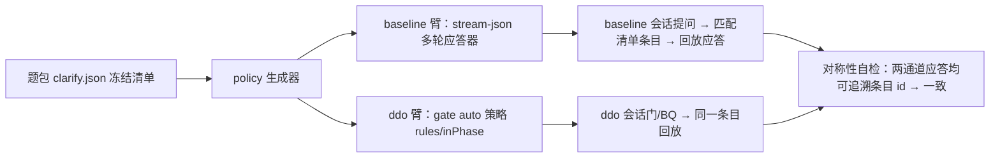
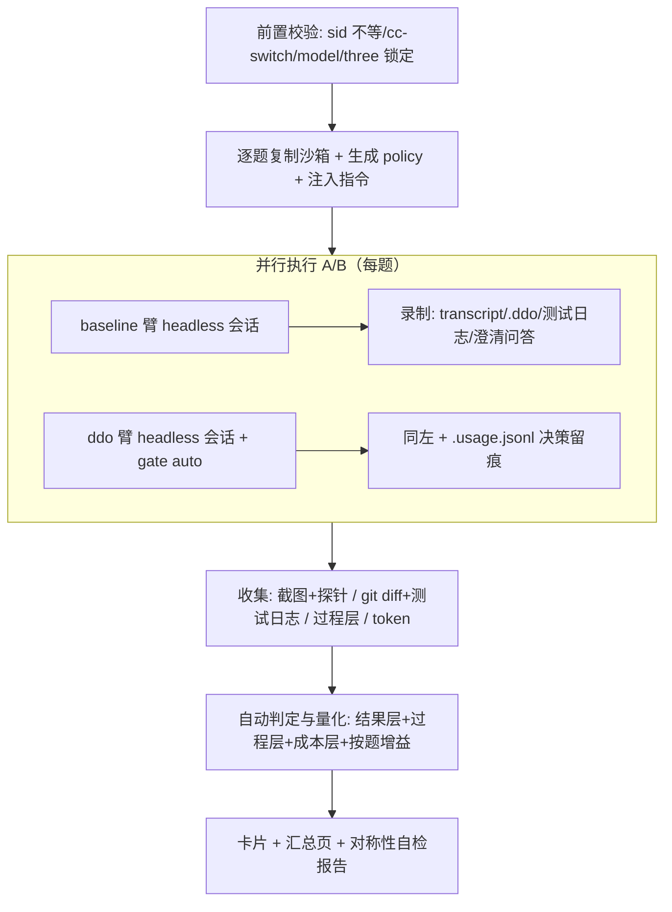

# Part 02 · 编排器、沙箱与双臂驱动

> 服务 FR-1、FR-2、FR-3、FR-4、AC-1、AC-2、AC-3、AC-4。全部新代码位于 `eval/bench/`（FR-15）。

## 1. 编排器 CLI 契约（AC-1）

```
node eval/bench/cli.js run \
  --model <model_id> \
  --tasks q_threejs-orbit-scene,q_regression-trap[,q3…] \
  --baseline-sid <sid> --ddo-sid <sid> \
  [--profile <profile.json>] \
  [--ccswitch-db <sqlite 路径>] [--arm-timeout <分钟>] [--keep-sandboxes] [--dry-run]
```

- `--profile`（rev2，动态装配）：JSON `{ dimensions{result,process,cost,symmetry}, tasks[], reports[] }`——评测哪些维度、哪些题、产出哪些报告形式；各项可省略，缺省 = 全维度 + 全部题（由 `--tasks` 定）+ 基础三形态（card/sheet/summary）。装配校验（`lib/profile.js`）：`reports` ⊆ 形式注册表 `{card, sheet, summary, wechat, xiaohongshu}`、`dimensions` 键合法、`profile.tasks` 与 `--tasks` 同时给出须一致——违者 exit 2；关闭某维度仅跳过对应提取与报告行，A/B 执行与留痕不变。缺省行为与 rev1 完全一致（FR/AC 按全量验收）。
- `--dry-run`：不启动真实会话，以注入桩（stub 会话产出预置产物）走通五步链路，验证编排、提取与报告模板（自验与 CI 用；AC-15 真实轮另跑）。
- 启动前置校验（失败即 exit 1，不进入执行）：`baseline_sid ≠ ddo_sid`（硬校验）；两 sid 对应的会话存在且可用；cc-switch 库可只读打开且 `proxy_request_logs` 表存在；`--model` 可用；页面题 three 版本锁定检查（题包 meta 与 prompt 一致性）。
- 输出对齐引擎四通道惯例：stdout JSON（轮次摘要：每题每臂状态、产物路径、报告路径）、stderr 人话进度、exit 0/1/2。

## 2. DEC-3 沙箱布局与隔离

```text
eval/bench/runs/<YYYYMMDD-HHmm-model>/
  round.json               # 轮次元数据：model、题单、两 sid、时间戳、环境指纹
  <题名>/
    baseline/              # 沙箱 A：projectRoot（内含 .ddo/、任务产物、git 仓库）
    ddo/                   # 沙箱 B：同模板复制，ddo 臂
    metrics/               # 提取层中间产物（probe.json、process.json、token.json、result.json）
    report/                # 该题卡片与截图资产
```

- 沙箱即 projectRoot（沿用 eval/README 规范）：`run start --project <沙箱>` 状态自含。
- 每轮 `DDO_HOME=<轮次临时目录>` 覆写：全局 `~/.ddo` index/history 零污染；内置任务源不受影响（Part 01 基线表「用户源合并解析」行）。
- 页面题沙箱 = 空白工作区（产物仅 index.html + 会话产物）；`q_export-command` / `q_regression-trap` 沙箱 = 从题包 `fixture/` 模板复制（Part 03 §2）。
- 收尾：默认保留沙箱供人工复核，`--keep-sandboxes` 缺省即保留；清理由独立 `cli.js clean --run <轮次Id>` 显式执行（不自动删）。

## 3. DEC-4 双臂驱动与控变量（AC-2）

| 控变量项 | 落实方式 |
|---|---|
| 同模型 checkpoint | 两臂 `--model <model_id>` 同参（temperature 等不显式设定，取宿主缺省，两臂一致） |
| 同沙箱依赖/工具集 | 同一 fixture 模板的两份物理复制；页面题同空白工作区 |
| 可用工具集 | 两臂同一 sandbox 级 `.claude/settings.json`（预放行 node/git/文件读写），仅 prompt 指令不同 |
| 唯一变量 | ddo 臂 prompt 追加：显式调用 `/ddo-code-flow` 执行任务 + 「评测 auto 模式」指令（见 §4） |
| 会话隔离 | 两臂分别以 `baseline_sid` / `ddo_sid` 启动独立 headless 会话（token 分组前提） |

headless 会话为外部契约（ASM，编码首日验证）：

- 首选 `claude -p --session-id <sid> --output-format stream-json`（固定 session id 直接满足分组）；
- 回退：不固定 id，启动后从 `~/.claude/projects/<munged-沙箱路径>/` 最新 `*.jsonl`（transcript 文件名即 session id）读取实际 sid，回填 `round.json` 并以其为聚合键；
- 若两者均不可行 → 阻塞上报（token 混合红线，不得继续）。

## 4. ddo 臂指令（auto 模式接合点）

ddo 臂系统提示追加固定段落（编排器生成，入 round.json 留痕）：

1. 「使用 /ddo-code-flow 完成本任务」；
2. 「评测 auto 模式已开启：凡到达人工审核门，不向用户问询，执行 `gate auto --state <statePath> --policy <策略路径>`；若返回 in-phase 行为契约（如 回答BQ-N 写回），按契约完成写回后再次 gate auto，直至门关闭」；
3. 策略文件由编排器从题包 `clarify.json` 生成（§5），路径注入。

该段落只描述流程动作，不含任何题目解题信息（AC-4 抽查对象之一：指令文本 + 策略文件 + 应答记录）。

## 5. 对等澄清通道（AC-3）



- baseline 臂以 `--input-format stream-json --output-format stream-json` 多轮驱动（ASM，同 §3 验证策略；回退方案见 Part 04 §5 风险表）：模型在输出中提出澄清问题时，应答器按「条目关键词 → 条目应答文本」匹配回放，未命中则回放固定中性文本「请按你的假设继续并显式记录该假设」（该回退本身入对称性记录）。
- ddo 臂应答全部经 gate auto 策略命中（Part 01 §3.2），条目 id 写入日志 note。
- 自检产物：`metrics/process.json` 的 `clarify_symmetry` 节——两臂每次应答的 `{来源通道, 条目 id 或 回退标记, 文本}` 对齐表，恒定输出「一致/不一致+原因」。

## 6. 主流程（需求 §8 五步的落地）



- 并行度：两臂并行、题间串行（同模型会话资源与 token 时间窗清晰；墙钟预算 `--arm-timeout` 缺省 30 分钟/臂）。
- 失败语义：臂超时/非零退出 → kill 会话、该臂该题记 `failed`（如实入报告，不重试、不剔除——FR-12）；一轮中至少一题两臂完整才算该题可比。
- ddo 臂子目标下沉（如会话内自行 subflow）不干预：引擎既有 subflow 机制在沙箱内正常运作，提取层照读其子 state（深度上限按引擎现状）。

## 7. 文件变更计划（编排器）

| 文件 | 职责/契约 |
|---|---|
| `eval/bench/cli.js` | 编排器入口：参数解析、前置校验、五步调度、四通道输出 |
| `eval/bench/lib/sandbox.js` | 沙箱准备/清理/环境指纹（DDO_HOME 覆写、settings 注入、fixture 复制） |
| `eval/bench/lib/driver.js` | 双臂会话驱动：headless 启动、sid 捕获、stream-json 应答器、超时与失败记录 |
| `eval/bench/lib/policy.js` | clarify.json → gate auto 策略文件（ddo 臂）+ 应答器查表（baseline 臂），同源生成 |
| `eval/bench/lib/profile.js` | 运行 profile 装配与校验（rev2）：维度/题目/报告形式；缺省全量；报告形式注册表单一来源 |
| `eval/bench/model-quick-eval.subflow` | 流水线声明文件（§10 目录要求的 `.subflow`）：输入、五步、产物契约的机器可读描述（JSON），供编排器与文档双读 |
| `eval/bench/package.json` | 编排器独立依赖清单（playwright 为 devDependency；运行时零依赖——node:sqlite/node:fs 等内建） |
