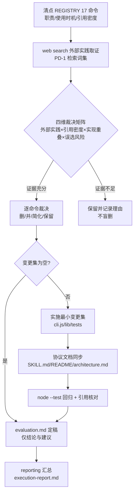

# 工具链设计合理性评估 Plan

> 基于 spec（r2 已确认）生成：对 ddo-tools 现有 17 个 CLI 子命令做证据驱动的过度设计/冗余评估，并落地精简改动。revision r2（应用用户反馈：外部参照增加行业引擎标准做法维度）。

## 执行摘要

本 plan 定义评估方法与实施契约：以「外部实践（web search，双参照系：agent 工具设计实践 + 行业流程引擎 CLI 标准做法）× 引用密度 × 实现重叠 × 误选风险」四维裁决矩阵逐命令评估 tools/cli.js REGISTRY 中的 17 个子命令，回答 spec 三问（是否设计过度 / 是否太多 / 是否冗余），结论落入评估证据文档 evaluation.md；变更集非空时按最小变更集策略实施（删/并/简化 + 测试与协议文档同步）。运行安全网：本 run 调用的 CLI 来自 `~/.cc-switch/skills` 独立部署副本（已确认与仓库存在版本差、非符号链接仓库），worktree 内改动不影响本 run 执行循环，AC-6 由结构隔离保障。文档模式 single，revision r2。

## 范围与非目标

| 事项 | 说明 | AI 索引 |
|---|---|---|
| 评估对象 | tools/cli.js REGISTRY 全部 17 命令：list tasks / list workflows / run start / run finish / rollback / exec / validate / next / resume / status / gate present / gate interact / subflow start / subflow list / subflow close / deps check / guide | FR-1 |
| 外部参照调研 | web search 双参照系：① agent 工具设计实践（工具数量、职责划分、命名与防误选）；② 行业流程/编排引擎 CLI 标准做法（成熟引擎的命令面结构、子命令分组、命名惯例） | FR-2 |
| 三问结论 | 逐命令裁决 + 总体结论，每条挂外部条款与仓库事实双证据 | FR-3 |
| 代码检查 | cli.js 命令实现 + 相关 lib 模块的结构/重复/职责边界问题定位 | FR-4 |
| 评估报告 | runDir/evaluation.md（证据文档）+ reporting 阶段 execution-report.md 汇总结论 | FR-5 |
| 精简实施 | 按变更集改 cli.js/lib/tests，同步 SKILL.md、README.md、docs/architecture.md 引用 | FR-6 |
| 非目标 | atom-tasks/*、workflows/* 不动；不负责 ~/.cc-switch 部署副本同步；无证据支撑的额外重构不做 | spec Non-goals |

## 现有设计与复用基线

| 能力 | 文件路径 | 符号 | 证据类型 | 采用方式 | 适用边界 | AI 索引 |
|---|---|---|---|---|---|---|
| 命令注册表（17 条，注册处即文档源，--help 纯渲染） | tools/cli.js | `REGISTRY` | Repository Fact | 扩展现有实现 | 精简=删/并条目，help 与必填校验自动跟随 | DEC-1 |
| 执行循环核心（取指令/校验/推进） | tools/cli.js | `runExec` `runValidate` `runNext` | Repository Fact | 复用现有实现 | 本 run 与 SKILL.md 执行循环依赖，默认保留集 | DEC-4 |
| 状态视图共用（status 与 resume --run-id 同构） | tools/cli.js | `statusView` | Repository Fact | 复用现有实现 | 合并候选的既有技术基础 | DEC-2 |
| guide 内嵌 resume 只读发现层 | tools/cli.js | `runGuide`→`runResume` | Repository Fact | 复用现有实现 | 信息面重叠的直接证据 | DEC-2 |
| 门交互（呈现留痕/交互过期/决议拦截） | lib/gate.js + cli.js | `openGates` `presentPayload` `gatePresent` `gateInteract` | Repository Fact | 复用现有实现 | 本 run 依赖，默认保留集 | DEC-4 |
| 子流程域（创建/清单/收口） | lib/subflow.js + cli.js | `subflowStart/List/Close` | Repository Fact | 评估对象 | `subflow list` 为薄包装，合并候选 | DEC-2 |
| 依赖检查（测试工作流专用） | lib/deps.js + cli.js | `depsCheck` | Repository Fact | 评估对象 | 低频域命令，裁决对象 | DEC-2 |
| 冷启动数据面 | cli.js | `listTasks` `listWorkflows` | Repository Fact | 评估对象 | guide 已内嵌其消费 | DEC-2 |
| 生命周期与归档 | lib/history.js lib/zip.js lib/index-registry.js | `runStart` `runFinish` | Repository Fact | 复用现有实现 | index/history 格式不动 | — |
| 两层解耦契约（引擎层边界） | docs/architecture.md | §解耦契约 | Repository Fact | 复用现有实现 | 命令面变更须同步该契约表 | DEC-5 |
| 测试面（node:test，tmpdir 沙箱隔离） | tools/tests/*.test.js（17 文件） | `node --test tools/tests/*.test.js` | Repository Fact | 扩展现有实现 | 变更集须同步迁移/删除对应用例 | DEC-3 |
| 部署隔离（运行副本 ≠ 仓库） | ~/.claude/skills/Ddo-Code-Flow → ~/.cc-switch/skills/ | 符号链接指向独立副本，与主检出 cli.js 有版本差 | Repository Fact | 不适用 | 本 run 运行时安全网，不受改动影响 | DEC-6 |

## 整体架构与流程

异常流：实施中任一测试失败或证据被推翻 → 修正循环（不带病推进）；外部条款与仓库事实冲突 → 按风险1权重规则裁决并留痕。

## 技术选型与方案对比

| 方案 | 来源 | 仓库适配性 | 代价与风险 | 状态 | 结论 | AI 索引 |
|---|---|---|---|---|---|---|
| 四维裁决矩阵（外部实践×引用密度×实现重叠×误选风险，双证据挂接；外部实践含双参照系） | 初始 Plan + 用户修改（r2） | 与注册表/引用密度可核验数据面天然适配，结论可复核；引擎惯例参照与本 CLI 定位（编排引擎内核）同构，比通用 agent 工具条款更贴近 | 矩阵构建成本；外部条款需筛选 | accepted | 评估结构定版 | DEC-1 DEC-8 |
| 双参照系外部调研（agent 工具设计线 + 行业引擎 CLI 惯例线） | 用户修改（r2） | 引擎线与本 CLI「编排引擎内核」定位同构，通用线覆盖 agent 误选维度，互补 | 检索量约翻倍 | accepted | 外部参照结构定版 | DEC-8 |
| 单维引用密度裁决 | 初始 Plan | 易误杀低频但必要命令（rollback 仅 3 处引用但属安全机制） | 误判风险高 | rejected | 不采用 | DEC-1 |
| 无结构对照评述 | 初始 Plan | 结论不可核验，违背 AC-3 | 低 | rejected | 不采用 | DEC-1 |
| 最小变更集实施（仅动有双证据支撑的命令） | 初始 Plan | 可控可回退，与本 run 隔离安全网叠加 | 可能留下次轮清理项 | accepted | 实施策略定版 | DEC-2 |
| 一次性全量重构命令面 | 初始 Plan | 波及 17 命令全部引用链，回归面不可控 | 高 | rejected | 不采用 | DEC-2 |

## 数据模型设计

### 实体与字段

无新增持久实体：`.state.json` 结构不变（命令面是过程接口，非持久数据）；评估产物 evaluation.md 为 runDir 内文档，不进引擎数据面。若命令合并，吸收方沿用现有输出字段，不造平行字段。

### schema 与 DDL（如适用）

不适用：无数据库与持久 schema 变更；atom-tasks/_schema/task-config.schema.json 不在改动范围。

### 状态与不变量

- `lib/state.js` 的 state 结构断言不变；四通道契约（stdout=JSON / stderr=人话 / exit 0·1·2 / state 现读不缓存）不变。
- REGISTRY 与 `--help` 渲染一致性由「注册表即文档源」机制自动保持；删/并命令后不得残留死条目。
- 执行循环必需命令（exec / validate / next / gate present / gate interact / run start / run finish / rollback）构成默认保留集，仅当双证据均强时才可动，且不得破坏本 run 协议。

### 迁移、兼容与回滚

命令删除对既有 state 无迁移需求（state 不引用命令名）；history/index 格式不动。回滚 = git 层面 revert 本分支对应提交，无数据回滚。

## API 接口设计

| 接口/入口 | 请求 | 响应 | 错误与幂等 | 复用标准 | 实现职责 | AI 索引 |
|---|---|---|---|---|---|---|
| 不变契约（全部命令） | 现有 flag 集 | stdout JSON（exec 裸文本例外） | exit 0·1·2 语义不变 | 四通道 + 注册表即文档源 | 命令面演进不得破坏通道契约 | DEC-5 |
| 合并类条目 | 被并命令全部合法用例由吸收方覆盖 | 吸收方输出为信息超集 | 被并命令名移除后调用 → exit 2 未知命令（可接受，主版本演进） | 参数映射表须进 evaluation.md | 吸收方实现复用被并逻辑（如 statusView） | DEC-2 |
| 删除类条目 | 仅当零引用或引用全部迁移 | — | 同上 | SKILL.md/README/architecture.md/atom-tasks/workflows 全文 grep 核对 | 删除 REGISTRY 条目 + 实现 + 测试 | DEC-2 |
| 简化类条目 | 命令签名不变 | 行为等价 | 等价重构，测试不降级 | 现有测试为等价性基准 | 如 exec/validate 位置校验去重（共享 helper） | DEC-7 |

CLI 命令面即对外 API。具体变更以裁决矩阵结论为准，上表定义变更条目的元契约（合并/删除/简化三类各自的义务与验收口径）。

## 算法设计

**裁决矩阵**（非平凡评估逻辑）：

- 输入：命令 × 四维证据。外部实践维度 = web search 双参照系条款（每条含来源 URL）：① agent 工具设计实践（Anthropic/OpenAI 官方工程指南、MCP 工具设计等）；② 行业流程/编排引擎 CLI 标准做法（成熟编排引擎的命令面：命令数量、生命周期动词、观测/恢复类命令划分、分组惯例）；引用密度 = SKILL.md/README/atom-tasks 引用计数（已测得基线：如 next=14/9/—、gate present=2/3/17 等，coding 期重测）；实现重叠 = 符号与逻辑共用度（如 statusView、runGuide→runResume）；误选风险 = 名称相近度 + 职责边界模糊度（如 status/resume/guide 三者信息面重叠）。
- 不变量：每个「删/并」结论至少挂 1 条外部实践条款 + 1 条仓库事实；仅简化类可单证据。执行循环必需命令受默认保留集约束。
- 步骤：清点 → 逐维取证 → 逐命令裁决 → 生成变更集 → 变更集内条目按「合并优先于删除、行为等价优先于行为变更」排序实施。
- 边界：证据不足 → 「保留并记录理由」，不猜测。

**吸收方判定**：信息超集者吸收（如 A 输出覆盖 B 全部字段且新增成本可忽略）；名称保留引用密度高者。冲突时以保留集优先。

## 文件变更计划

| 文件/目录 | 变更职责 | 复用或依赖 | AI 索引 |
|---|---|---|---|
| tools/cli.js | 按变更集删/并/简化命令实现与 REGISTRY 条目；exec/validate 位置校验去重 | lib/* 现有导出 | DEC-2 DEC-7 |
| tools/lib/* | 仅合并所需微调（如 statusView 出口），无结构性重构 | 现有模块边界 | DEC-2 |
| tools/tests/*.test.js | 用例随命令迁移至吸收方文件或移除；node:test 沙箱约定不变 | tmpdir 沙箱模式 | DEC-3 |
| SKILL.md | 执行循环协议中的命令引用同步（repo 版；本 run 遵循部署副本，互不影响） | 引擎契约表 | DEC-5 |
| README.md、docs/architecture.md | 命令清单与解耦契约表同步 | docs/architecture.md §解耦契约 | DEC-5 |
| runDir/evaluation.md | 评估证据文档：清单/外部来源/矩阵/三问结论/变更集 | AC-1~AC-4 载体 | FR-5 |
| atom-tasks/*、workflows/* | 不动 | spec Non-goals | — |

## 兼容、稳定性与回滚

| 关注点 | 适用性 | 设计/理由 | 回滚信号 | AI 索引 |
|---|---|---|---|---|
| 本 run 运行隔离 | 适用 | 运行 CLI 与 SKILL.md 均来自 ~/.cc-switch 独立副本，worktree 改动结构上不可波及 | 不需要（结构隔离） | DEC-6 |
| 协议文档一致性 | 适用 | 每个变更条目附引用同步清单；收尾对已删/并被并命令名全文 grep，命中即补迁移 | 悬空引用 | DEC-5 |
| 测试回归 | 适用 | node --test tools/tests/*.test.js 全绿为 coding 放行条件 | 任一失败 | DEC-3 |
| 等价性（简化类） | 适用 | 签名与输出不变，以既有测试为基准，不降级断言 | 行为差异 | DEC-7 |
| 部署同步 | 不适用 | ~/.cc-switch 副本同步属用户部署流程，本 run 不触碰 | — | DEC-6 |

## Verification Anchor

| 需验证契约 | 可观察结果 | 证据位置 | AI 索引 |
|---|---|---|---|
| 测试全绿 | node --test tools/tests/*.test.js 退出码 0 | 终端输出 | AC-6 |
| 引用无悬空 | 已删/被并命令名在 SKILL.md/README.md/docs/architecture.md/atom-tasks/workflows 无命中 | grep 结果 | FR-6 |
| 清单完整 | evaluation.md 覆盖 17 命令逐行（职责+使用时机+引用密度） | runDir/evaluation.md | AC-1 |
| 外部参照可溯 | 每条外部条款含来源 URL，覆盖双参照系（agent 工具设计 + 行业引擎 CLI 惯例）并与命令对照 | evaluation.md §外部参照 | AC-2 |
| 三问结论可核验 | 每结论挂双证据链；问题点定位到 cli.js 行级/符号级 | evaluation.md §矩阵 §代码检查 | AC-3 AC-4 |
| 流水线继续可用 | 本 run 后续 exec/validate/next/gate present/run finish 全部正常 | 本 run 执行记录 | AC-6 |

## 开放问题与 Spec 对应

| 问题 | 确定答案或阻塞原因 | 解决位置 | AI 索引 |
|---|---|---|---|
| PD-1 检索词与来源资格 | 已定：① agent 工具设计线——agent tool design / tool count / tool selection errors / MCP tool authoring / Anthropic & OpenAI 官方工程指南优先；② 行业引擎线——workflow engine CLI / orchestration engine CLI design / 成熟引擎（如 Airflow、Temporal、GitHub Actions 类）命令面文档；官方文档与规范优先，社区文章次之；每条留 URL | coding 执行 | PD-1 |
| PD-2 代码检查深度 | 已定：四维矩阵逐命令；代码检查覆盖 cli.js 全部 17 命令实现 + 被引用 lib 模块 | coding 执行 | PD-2 |
| PD-3 实施安全网 | 已定：部署隔离 + 最小变更集 + 测试同步三重（DEC-2/3/6） | 本 plan | PD-3 |
| spec FR-1~FR-6 落点 | FR-1→§范围/evaluation.md；FR-2→§算法；FR-3→矩阵；FR-4→代码检查；FR-5→evaluation.md+execution-report.md；FR-6→§文件变更 | 本 plan 全文 | FR-1~6 |

## 风险与下游交接

- **风险1｜外部条款与流程引擎特化冲突**：本 CLI 是状态机驱动器而非通用 agent 工具集，通用「少工具」条款可能忽视安全拦截机制的必要性。缓解：r2 起双参照系中的行业引擎线与本 CLI 定位同构，优先以引擎惯例裁决引擎类命令（生命周期/观测/恢复），agent 工具线裁决「agent 直接调用面」的误选风险；外部证据仅为四维之一，与仓库事实同权，默认保留集兜底。
- **风险2｜删除命令破坏 SKILL.md 协议**：缓解 = 引用同步清单 + 收尾 grep 核对（§兼容回滚）。
- **风险3｜评估文档稀释报告**：evaluation.md 分节定版（清单/外部参照/矩阵/代码检查/三问结论/变更集），reporting 只引结论与关键证据。
- **下游交接**：coding 读本 plan §算法设计与 §文件变更，先建 evaluation.md 骨架再动代码；reporting 读 evaluation.md + state 决策历史。事实失效（REGISTRY 与本 plan 清单不符、测试入口变化）→ 停止并报告，不自行改契约。
- **本 run 协议提示**：repo 内 SKILL.md 修改不改变本 run 遵循的部署副本协议，两份文档在合并部署前允许暂时分叉。

## 用户确认

- ✅ **同意**：批准本 plan，进入 coding。
- ❌ **修改：<反馈>**：按反馈修订，展示变化后重新确认。
- ❓ **提问：<问题>**：仅答疑，不改变确认状态。
- 📁 **归档**：列出可用模板（当前：ddo.md）。
- 📁 **归档：<模板名>**：按名生成 tech-design 产物（如 归档：ddo.md）。
