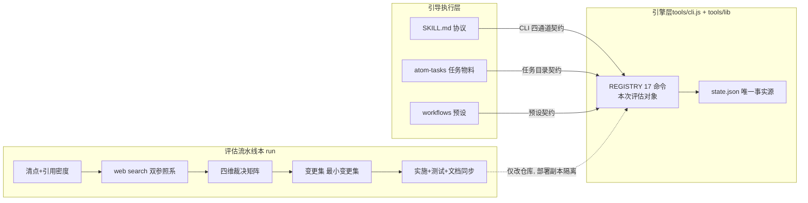
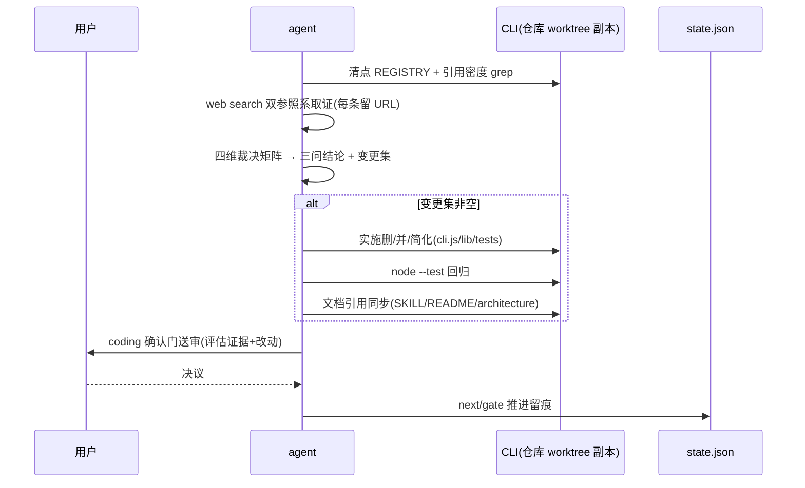

# 技术方案设计（归档产物）

> 归档属性：模板名 `ddo.md`；来源 Plan revision **r2**；`drivesDownstream=false`（不驱动下游，仅归档）；`staleWhenPlanRevisionChanges=true`（Plan revision 变更后本文标记 stale 需重新归档）。归档不代表 Plan 批准，planning 确认门状态不变。
> 整理依据：本 run plan.md（r2）+ spec.md（已确认）+ 仓库代码事实；无则标注 N/A，不脑补，一切以现存 plan 为准。

---

## 一、需求描述

### 1.1 需求背景与预期效果

- 业务现状：ddo-tools（`tools/cli.js` + `tools/lib/*`）作为确定性执行内核，命令注册表 REGISTRY 累积 17 个子命令（跨 8+ 设计轮次登记），存在疑似过度设计、数量过多与职责冗余；用户动机是 agent 执行中可能因检查/判断错误而误用相近工具。
- 本次完善方向：以证据驱动评估（web search 双参照系 + 代码事实）回答三问（是否设计过度 / 是否太多 / 是否冗余），并按最小变更集落地精简改动。
- 预期效果（可观察结果）：AC-1 命令清单可逐项核验；AC-2 外部参照含来源可溯；AC-3 三问结论附双证据；AC-4 代码问题点定位到行/符号；AC-5 改进建议逐条指明目标命令；AC-6 精简后流水线核心动作仍可用。
- 需求/PRD 链接：N/A（指向本 runDir 内 `requirement.md` / `spec.md`）。

---

## 二、技术方案详情

### 2.1 整体架构

- 核心分层：引导执行层（做什么/问什么/呈现什么）与引擎层（如何确定地执行与约束），只经契约交互（docs/architecture.md §解耦契约）。本次改动全部落引擎层命令面 + 引导层文档引用同步。
- 关键事实源：`.state.json` 是运行态唯一事实源；REGISTRY 是命令面唯一事实源（注册表即文档源，`--help` 纯渲染）。
- 路由架构要点（HTTP 路由 N/A，等价为命令面策略）：**不新增任何命令**；精简仅以「删 / 并 / 行为等价简化」三种条目作用于现有 REGISTRY 条目。

### 2.2 技术选型与方案对比

| 决策点 | 方案 A | 方案 B | 选型结论 |
|---|---|---|---|
| 评估结构 | 四维裁决矩阵（外部实践×引用密度×实现重叠×误选风险，双证据挂接） | 单维引用密度裁决 / 无结构评述 | 矩阵 accepted，余 rejected（DEC-1） |
| 外部参照 | 双参照系：agent 工具设计线 + 行业引擎 CLI 惯例线（r2 用户新增） | 单一 agent 工具设计线 | 双参照系 accepted（DEC-8） |
| 实施策略 | 最小变更集（仅动双证据支撑项） | 一次性全量重构命令面 | 最小变更集 accepted（DEC-2） |
| 简化类基准 | 行为等价重构（签名/输出不变，测试不降级） | 顺带行为优化 | 等价重构 accepted（DEC-7） |
| 运行安全 | 依赖部署隔离（~/.cc-switch 副本 ≠ 仓库） | 在运行副本上热改 | 部署隔离 accepted（DEC-6） |

- License 风险：N/A（零外部依赖，node:test 内置）。

### 2.3 业务详细流程

#### 正常流程

- 逐子流程语义：清点→取证→矩阵→变更集（DEC-1/DEC-8）；实施按「合并优先于删除、等价优先于行为变更」排序（DEC-2）；简化类以既有测试为等价基准（DEC-7）；全程本 run 走部署副本 CLI，不受 worktree 改动影响（DEC-6）。

#### 异常路径清单

| 异常类型 | 处理策略 |
|---|---|
| 外部证据不足 | 该命令「保留并记录理由」，不盲删（DEC-1 不变量） |
| 测试回归失败 | 修正循环，不带病推进（DEC-3） |
| 文档引用悬空 | 按引用同步清单补迁移，收尾 grep 核对（DEC-5） |
| 外部条款与引擎特化冲突 | 引擎类命令以行业引擎线优先，通用线裁决 agent 直接调用面；与仓库事实同权（DEC-8/风险1） |
| 事实失效（REGISTRY 与 plan 清单不符） | 停止并报告，不改契约 |

### 2.4 接口设计（高权重）

> HTTP 路由 N/A；等价接口面 = CLI 子命令（四通道契约：stdout=JSON / stderr=人话 / exit 0·1·2 / state 现读不缓存）。具体变更条目以裁决矩阵结论为准（本 plan 未预决定任何具体合并/删除），此处固化变更元契约：

#### 2.4.1 命令面变更元契约（新增——契约定义，非具体命令）

**API**：`node tools/cli.js <命令> [flags]`

**用途**：定义删/并/简化三类变更条目的义务与验收口径。

**请求参数表（变更条目须声明的字段）：**

| 参数 | 位置 | 类型 | 必填 | 枚举/取值 | 说明 |
|---|---|---|---|---|---|
| 类型 | evaluation.md 变更集 | 枚举 | 是 | 合并/删除/简化 | 条目类别 |
| 被动命令 | 同上 | 字符串 | 是 | REGISTRY 现有名 | 被并/被删/被简化的命令 |
| 吸收方 | 同上 | 字符串 | 合并类必填 | REGISTRY 现有名 | 信息超集者吸收 |
| 参数映射 | 同上 | 表 | 合并类必填 | — | 被并命令用例 → 吸收方用例 |
| 双证据 | 同上 | 列表 | 删/并必填 | ≥1 外部条款 + ≥1 仓库事实 | 均含来源/位置 |
| 文档同步 | 同上 | 列表 | 是 | SKILL/README/architecture/atom-tasks | 引用迁移清单 |

**响应参数表：**

| 参数 | 类型 | 枚举/取值 | 说明 |
|---|---|---|---|
| REGISTRY 条目 | 数组 | 变更后命令集 | 注册表即文档源，--help 自动跟随 |
| exit code | 数值 | 0/1/2 | 语义不变（AC-6 契约） |

**示例：** N/A（示例随 coding 期 evaluation.md 变更集条目生成，本阶段不预演具体结论）。

### 2.5 算法设计

- 裁决矩阵（非平凡评估逻辑）：输入 = 命令 × 四维证据；不变量 = 每个「删/并」结论至少挂 1 条外部条款 + 1 条仓库事实，执行循环必需命令受默认保留集约束（DEC-4）；步骤 = 清点 → 逐维取证 → 逐命令裁决 → 变更集生成与排序；边界 = 证据不足 → 保留并记录。吸收方判定：信息超集者吸收，名称保留引用密度高者，冲突时保留集优先。复杂度：O(命令数 × 取证维度)，常数级（17 命令）。
- 等价简化（DEC-7）：exec/validate 位置校验去重为共享 helper，行为等价。

### 2.6 数据结构设计

#### 数据模型

- 不改表结构声明：`.state.json` 结构不变；index（`~/.ddo`）/history（runs.jsonl、zip）格式不变；命令面是过程接口，无持久化迁移。
- 审计操作枚举表：N/A（引擎无审计表；决策留痕在 state.gate.interactions 与本 run 文档）。

#### 关键数据契约

- 四通道契约与「注册表即文档源」不变（docs/architecture.md §CLI 四通道）；state 结构断言（`lib/state.js` assertState）不变。

#### 缓存 / 锁设计

| 锁/键 | 用途 |
|---|---|
| N/A | 无并发场景（单 agent 串行驱动） |

#### 配置项

| 配置 | 默认/范围 | 说明 |
|---|---|---|
| 现有 --config 旋钮机制 | 不变 | `run start --config <task>.<key>=<JSON>` 语义保持，本次无新增旋钮 |

### 2.7 错误码设计

| 错误码 | 含义 | 触发条件 | 前端/调用方处理 |
|---|---|---|---|
| exit 0 | 成功 | 命令正常完成（validate 校验失败时输出 JSON 仍可 exit 1） | agent 按 stdout JSON 继续 |
| exit 1 | 硬失败 | 执行失败/被拦截（gate 未关、子流程未收口等） | agent 按 stderr 指引修正后重试 |
| exit 2 | 用法错误 | 参数非法/未知命令（含被删命令调用） | agent 修正用法；被删命令命中即迁移指引场景 |

> 对账点：退出码常量位于 `tools/cli.js` main 流程（`process.exitCode` 赋值处）；本次变更不改语义（AC-6）。
