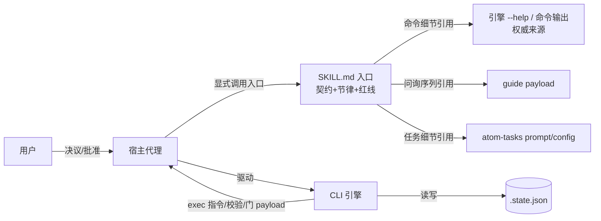

# Plan：引擎与 SKILL.md 引用关系修复

**revision**: R1 · **模式**: single · **工作目录**: /Users/djhhh/work_area/Ddo-Code-Flow-fix-engine-skill-md-refs

## 执行摘要

目标是把 SKILL.md 收敛为纯入口（调用契约、执行循环节律、安全红线），命令与协议细节改由引擎 `--help` 及各命令输出权威承载，并删除 docs/ 结构文档层。方案：重写 SKILL.md 为精简版；对引擎仅做 help 文案的最小增强（rollback 归档语义、subflow 阻塞语义、入口声明一行），不改任何命令行为；新增一个轻量一致性测试防漂移；删除 docs/ 目录（仅 architecture.md，无活跃引用）。同时修复现存不一致：SKILL.md 中 `exec/validate --task "<stageId>"` 用法与引擎实际的 `--task <name> --phase <id>` 不符（本次会话实测踩中 exit 2）。本文档为 single 模式完整 Plan。

## 范围与非目标

| 事项 | 说明 | AI 索引 |
|---|---|---|
| SKILL.md 轻量化重写 | 仅保留 frontmatter、简介、调用契约、执行位置要点、启动分流契约、执行循环节律、结束收口要点、不可越界红线、引用关系小节 | FR-SLIM-1 |
| 引用关系定义 | 以 SKILL.md 新增「引用关系」小节 + 引擎 help 首行声明双向落位：SKILL.md 入口，命令细节以引擎输出为权威 | FR-REF-1 |
| 引擎 help 最小增强 | 仅 cli.js 内 help 文案：rollback 归档语义、subflow 阻塞语义、总览入口声明；无任何行为变更 | FR-REF-1、FR-REF-2 |
| 修复现存不一致 | exec/validate 用法错误、subflow/gate 协议描述与引擎命令面核对修正 | FR-REF-2 |
| 删除 docs/ 目录 | `git rm -r docs/`（仅 architecture.md）；确认无残留死链 | FR-DOC-1 |
| 一致性测试 | 新增 tools/tests/skill-consistency.test.js：SKILL.md 中 CLI 用法片段与真实用法匹配、引用的命令存在于命令面 | PD-3 |
| 非目标 | 不改命令行为/state schema/atom-tasks 指令主体；不动 `.ddo/` 历史归档；不同步部署副本；不调 SKILL.md 版本号（仓库无统一版本机制，避免新漂移） | — |

## 现有设计与复用基线

| 能力 | 文件路径 | 符号 | 证据类型 | 采用方式 | 适用边界 | AI 索引 |
|---|---|---|---|---|---|---|
| CLI 总览与逐命令 help 注册表 | tools/cli.js | COMMANDS 注册（`--help` 文案，cli.js:1074-1215 区域） | Repository Fact | 扩展现有实现 | 仅增补 desc 文案，不改 flag 解析与行为 | DEC-2 |
| guide 启动问询 payload | tools/cli.js | `guide` 命令输出（五问+followUps+参数映射） | Repository Fact | 复用现有实现 | 问询序列权威来源，SKILL.md 只引用 | DEC-1 |
| atom-tasks 任务指令 | atom-tasks/*/prompt.md、config.json | git-worktree、cleanup-worktree、closeout-worktree 等 | Repository Fact | 复用现有实现 | 前置/收尾任务细节由任务文件承载 | DEC-1 |
| SKILL.md 入口契约 | SKILL.md | frontmatter + 调用契约/红线章节 | Repository Fact | 扩展现有实现 | 保留骨架语义，压缩自述细节 | DEC-1 |
| 测试框架与运行方式 | tools/tests/*.test.js | node 原生 test 风格 | Repository Fact | 扩展现有实现 | 新增一致性测试沿用现有组织方式 | DEC-4 |
| docs/architecture.md | docs/architecture.md | 两层契约文档 | Repository Fact | 不适用 | 按用户决定删除，结构逻辑暂不保留 | FR-DOC-1 |

## 整体架构与流程

参与方：用户（决议）、宿主代理会话（读 SKILL.md 入口、执行工作）、CLI 引擎（确定性命令面）、atom-tasks 物料（任务指令）、`.state.json`（唯一事实源）。改动后引用关系：

异常流程要点：命令失败（退出码 1/2）按 stderr 提示修正后重试，不假定成功；门交互后未重新 present 的决议被结构拦截（引擎既有行为，不变）。

## 技术选型与方案对比

| 方案 | 来源 | 仓库适配性 | 代价与风险 | 状态 | 结论 | AI 索引 |
|---|---|---|---|---|---|---|
| A：SKILL.md 内嵌全部协议细节（现状） | 初始 Plan | 与引擎输出重复自述 | 已产生实际漂移（exec 用法错误）；维护双份 | rejected | 漂移根源，放弃 | FR-REF-2 |
| B：docs/ 结构文档层承载关系定义 | 初始 Plan | 已有 architecture.md | 用户已明确暂不保留该层 | rejected | 删除 docs/（BQ-2） | FR-DOC-1 |
| C：SKILL.md 入口 + 引擎输出权威 | 用户 BQ-3 答案 | help 注册表已能承载大部分细节，仅需少量增补 | 过度删减可能丢协议信息→以一致性测试与冷启动走查兜底 | accepted | 采纳（DEC-1/DEC-2） | FR-REF-1 |
| D：机器一致性校验测试 | 初始 Plan（PD-3） | 测试目录组织现成 | 极小维护成本 | accepted | 采纳：防再漂移（DEC-4） | FR-REF-2 |

### 关键决策

- **DEC-1（SKILL.md 形态）**：重写为入口文档，判据=无重复自述（BQ-1）。保留：frontmatter、简介、调用契约、执行位置要点、启动分流契约、执行循环节律（含正确 exec/validate 用法）、结束要点、不可越界、新增「引用关系」小节。移除：产物生命周期细则（指向 run start/finish --help）、guide 问询复述（指向 guide 输出）、worktree/自定义前置细节（指向 atom-tasks/git-worktree/prompt.md 与 list tasks）、子流程细则（指向 subflow --help 与 status）、交付链收尾细则（指向 closeout-worktree 任务指令）。影响：SKILL.md、README 个别描述句。回退：git revert。
- **DEC-2（引擎侧增强边界）**：仅改 help 文案三处——rollback desc 补「产物归档至 `<runDir>/_del/rollback-<n>/`」；subflow start/close desc 补「存在 active 子流程时父 next/run finish 被拦截」；总览 help 首部补一行「SKILL.md 是调用入口；命令与参数细节以本 help 及各命令 --help 为权威」。不动 flag、校验与行为。依据：FR-REF-1 载体定义；风险：文案变更需与 README 命令表核对同步。回退：还原文案。
- **DEC-3（docs/ 删除）**：`git rm -r docs/`。已核实活跃代码/文档零引用（仅 `.ddo/` 历史归档提及，属历史材料不动）。回退：git revert。
- **DEC-4（一致性测试）**：新增 tools/tests/skill-consistency.test.js，断言：(1) SKILL.md 不含 `--task "<stageId>"` 形态且 exec/validate 示例含 `--phase` 用法；(2) SKILL.md 中引用的每个 `cli.js` 子命令/域都存在于 `cli.js --help` 命令面。依据 PD-3；防止 FR-REF-2 复发。
- **Q：spec 开放问题的确定答案**——PD-1→DEC-1；PD-2→DEC-2（仅三处文案）；PD-3→DEC-4（采纳）。

## 数据模型设计

### 实体与字段
不适用：本次不引入实体。`.state.json` schema、atom-task config 结构均不变。

### schema 与 DDL（如适用）
不适用：无数据库/存储变更。

### 状态与不变量
不变量保持：`.state.json` 仍是唯一事实源、只经 CLI 更新；help 文案变更不影响状态机语义。

### 迁移、兼容与回滚
无迁移。已存在的 run 状态与 SKILL.md/help 文案互不依赖版本耦合；回滚=git revert 单提交还原。

## API 接口设计

| 接口/入口 | 请求 | 响应 | 错误与幂等 | 复用标准 | 实现职责 | AI 索引 |
|---|---|---|---|---|---|---|
| `cli.js --help` | 无 | 总览文案 + 首行入口权威声明 | 退出码约定不变 | 现有 COMMANDS 注册 | 增一行声明 | DEC-2 |
| `rollback --help` | 无 | desc 含产物归档路径语义 | 同上 | 同上 | desc 增补 | DEC-2 |
| `subflow start/close --help` | 无 | desc 含父流程阻塞语义 | 同上 | 同上 | desc 增补 | DEC-2 |
| 其余命令 help | 无 | 不变 | 不变 | 不变 | 无改动 | — |
| SKILL.md 内命令示例 | — | — | — | 与各命令 --help 语法一致 | 修正 exec/validate 示例为 `--task <name> --phase <id>` | FR-REF-2 |

说明：CLI 即对外 API；本次仅文案级变更，用法、flag、退出码（0/1/2）、stdout JSON 约定全部不变。

## 算法设计

不适用：无非平凡算法/状态机变更。一致性测试为直线断言（读 SKILL.md + 运行 `cli.js --help` 比对），无复杂度关切。

## 文件变更计划

| 文件/目录 | 变更职责 | 复用或依赖 | AI 索引 |
|---|---|---|---|
| SKILL.md | 重写为精简入口版（含「引用关系」小节、修正 exec/validate 示例） | 引用 guide/help/atom-tasks | DEC-1、FR-SLIM-1 |
| tools/cli.js | help 文案三处增补（总览一行、rollback、subflow×2） | 现有 COMMANDS 注册 | DEC-2 |
| tools/tests/skill-consistency.test.js | 新增：SKILL.md↔命令面一致性断言 | 现有测试组织 | DEC-4 |
| docs/ | 整目录删除（architecture.md） | 无依赖 | DEC-3 |
| README.md | 核对命令表与 SKILL.md 描述句，仅必要同步（预计无或极小改动） | 引用 SKILL.md 的既有句子 | DEC-1/DEC-2 |

## 兼容、稳定性与回滚

| 关注点 | 适用性 | 设计/理由 | 回滚信号 | AI 索引 |
|---|---|---|---|---|
| 命令行为兼容 | 适用 | 仅文案变更，flag 解析与行为零改动，全量测试须通过 | 测试失败/行为差异 | DEC-2 |
| 流程能力不回退 | 适用 | 被移除细节均有权威去处（help/guide/atom-tasks），冷启动走查兜底 | AC-3 走查失败 | AC-3 |
| 死链 | 适用 | docs/ 删除前已核实零活跃引用；删除后全库 grep 复核 | 残留引用 | AC-4 |
| 回滚 | 适用 | 单分支原子提交，git revert 即整体还原 | 用户要求回退 | — |

## Verification Anchor

| 需验证契约 | 可观察结果 | 证据位置 | AI 索引 |
|---|---|---|---|
| SKILL.md 无重复自述且保留清单成立 | 章节/行数对比；grep 无 guide 问询复述、无生命周期细则段 | SKILL.md、git diff | AC-1 |
| 引用关系成立且两边一致 | SKILL.md「引用关系」小节存在；`--help` 含权威声明；exec/validate 示例可原样执行成功 | SKILL.md、cli.js --help 输出 | AC-2 |
| 冷启动行为等价 | 按 SKILL.md 走 guide→问询→run start→exec/validate/next（本 run 即活体走查） | 本 run 记录 | AC-3 |
| docs/ 移除无死链 | `ls docs/` 不存在；全库 grep 无活跃引用 | git status、grep 输出 | AC-4 |
| 一致性测试通过 | `node --test tools/tests/` 全绿（含新测试） | 测试运行输出 | DEC-4 |

## 开放问题与 Spec 对应

| 问题 | 确定答案或阻塞原因 | 解决位置 | AI 索引 |
|---|---|---|---|
| PD-1 移除哪些段落 | DEC-1 保留/移除清单 | SKILL.md | PD-1 |
| PD-2 help 需增强什么 | DEC-2 三处文案 | tools/cli.js | PD-2 |
| PD-3 是否机器校验 | DEC-4 采纳，轻量测试 | tools/tests/skill-consistency.test.js | PD-3 |
| spec 全部 FR/AC | 均有落点（见各行 AI 索引），无阻塞 | 各文件 | FR-*、AC-* |

## 风险与下游交接

- 风险：过度删减丢协议信息 → 缓解：DEC-1 明确保留清单，每条移除项指定权威去处；AC-3 冷启动走查。
- 风险：help 文案与 README 命令表失同步 → 缓解：文件计划含 README 核对行。
- 风险：一致性测试过拟合（断言脆弱）→ 缓解：断言仅覆盖稳定契约（命令存在性、用法语法），不匹配具体文案。
- Tasking/Coding 读取范围：本 plan.md（single 模式无分册）；Coding 依据「文件变更计划」逐文件实施，先 SKILL.md 后 cli.js 再测试，最后删 docs/；实施中若发现本 plan 的仓库事实失效（如 cli.js 结构与所引行号区域不符），停止并报告，不改已批准契约。
- 事实失效处理：报告用户，回到 plan 修改流程。

## 用户确认

- ✅ **同意**：批准当前 plan，进入后续编排。
- ❌ **修改：<反馈>**：按反馈修订 plan，展示变化后重新确认。
- ❓ **提问：<问题>**：仅答疑，不改 plan 与确认状态。
- 📥 **归档**：列出可用模板名（ddo.md）。
- 📥 **归档：<模板名>**：按模板生成 tech-design 产物。
