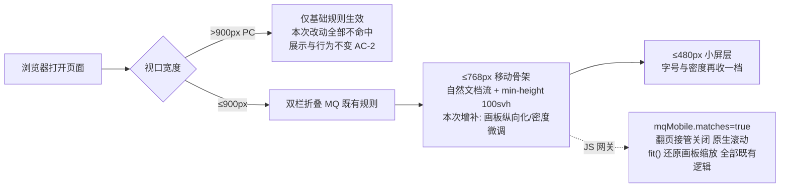

# docs/index.html 移动端适配 Plan

**revision**: r1 · **模式**: single（草稿约 9.6k 字符，≤ 12000 阈值，全文在本文件）

## 执行摘要

为 docs/index.html（1979 行单文件介绍页）补齐移动端适配：页面已有三档窄屏媒体查询骨架（≤900 双栏折叠 / ≤768 自然文档流 / ≤720 微调），本次在其上做**整体设计的移动端异化排版**，核心是把「工作原理」架构画板从 950px 横向滚动画布异化为纵向分层卡片流；其余模块做间距、字号与密度微调，并增加 ≤480px 小屏微调层。技术路线为**纯 CSS 移动端重排**：全部改动收敛在 `max-width` 媒体查询内，目标零 DOM 改动、零 JS 改动，从机制上保证 PC 端展示与行为完全不变（FR-DESKTOP-1）。spec 的四个 PD 全部在本 plan 给出唯一确定答案（DEC-1～DEC-4）。

## 范围与非目标

| 事项 | 说明 | AI 索引 |
|---|---|---|
| 适配对象 | 仅 docs/index.html 一个文件（docs 目录唯一 HTML） | FR 映射见 spec |
| 移动端骨架增强 | ≤768px 既有骨架上增补异化排版规则；新增 ≤480px 小屏微调层 | DEC-1 |
| 画板纵向化 | #how 架构画板（.board）移动端从横向滚动改为纵向分层卡片流 | DEC-3 |
| PC 端零影响 | 不改任何全局 CSS 规则、不改 DOM 结构、不改 JS；改动仅在 max-width MQ 内 | FR-DESKTOP-1 |
| 非目标 | 不重做视觉风格、不改文案、不建独立移动版、不动 docs 下其他文件 | spec Non-goals |
| 非目标 | 不处理 769–900px 平板形态（既有行为保留）；不改桌面 scroll-snap 翻页 | DEC-1 边界 |

## 现有设计与复用基线

| 能力 | 文件路径 | 符号 | 证据类型 | 采用方式 | 适用边界 | AI 索引 |
|---|---|---|---|---|---|---|
| 移动端骨架 MQ | docs/index.html | `@media (max-width: 768px)`（L699–724） | Repository Fact | 扩展现有实现 | 自然文档流、svh、dotnav/stage-rail 隐藏已就绪，本次只增补 | RF-1 |
| 双栏折叠 MQ | docs/index.html | `@media (max-width: 900px)`（L725–734） | Repository Fact | 复用现有实现 | hero/why/wf/sop 双栏折叠已实现，无需重做 | RF-2 |
| 窄屏微调 MQ | docs/index.html | `@media (max-width: 720px)`（L735–744） | Repository Fact | 扩展现有实现 | cols-3/cols-2 单列化已实现 | RF-3 |
| JS 移动端网关 | docs/index.html | `mqMobile = matchMedia('(max-width: 768px)')`（L1163） | Repository Fact | 复用现有实现 | 桌面 wheel/keyboard/touch 翻页已按它分流；本次目标零 JS 改动 | RF-4 |
| 画板连线绘制 | docs/index.html | `draw()` / `EDGES[]`（L1277–1426） | Repository Fact | 复用现有实现 | 按卡片真实渲染位置绘制正交连线；移动端仅隐藏不重算 | RF-5 |
| 画板自适应缩放 | docs/index.html | `fit()` / `window.__ddoFitBoard`（L1430–1502） | Repository Fact | 复用现有实现 | 已含移动端分支（还原 transform、交还 CSS）；不改 | RF-6 |
| 视口与动效降级 | docs/index.html | viewport meta（L4）、`100svh @supports`（L706）、`prefers-reduced-motion`（L689） | Repository Fact | 复用现有实现 | 均已存在，不动 | RF-7 |
| 终端窗族组件 | docs/index.html | `.mini-win` / `.claude-win` / `.tree-panel`（L407–623） | Repository Fact | 复用现有实现 | 仅移动端密度/高度微调 | RF-8 |

## 整体架构与流程

本 plan 无新增架构参与方，改动是「同一页面在窄屏下的另一套排版应用路径」：

异常路径：若用户横屏/旋转触发 resize，既有 `redraw`/`schedule`（RF-5/RF-6）与 MQ 自动重算覆盖，无新增逻辑。

## 技术选型与方案对比

| 方案 | 来源 | 仓库适配性 | 代价与风险 | 状态 | 结论 | AI 索引 |
|---|---|---|---|---|---|---|
| A. 纯 CSS 同 DOM 重排（MQ 内 grid 单列化 + order + 隐藏连线） | 初始 Plan | 与既有三档 MQ 骨架同构；PC 零影响由 MQ 机制天然保证 | 需仔细核对每个网格容器的窄屏形态；风险低 | accepted | 采纳：全部改动收敛于 max-width MQ | DEC-3 |
| B. 移动端独立 DOM（克隆 board-mobile） | 初始 Plan | 可行但内容双份 | 维护漂移、文件膨胀；虽 PC 不显示但违背单文件简洁性 | rejected | 否决：CSS 重排已可达成同等效果 | DEC-3 |
| C. JS 运行时重排（matchMedia 切类名重建布局） | 初始 Plan | 与 mqMobile 网关一致 | 引入时序/重绘风险；连线坐标需联动重算 | rejected | 否决：无必要复杂度 | DEC-3 |
| D. 引入响应式框架重写页面 | 初始 Plan | 违背「不重做」约束 | PC 回归风险最大、依赖膨胀 | rejected | 否决 | DEC-3 |

## 数据模型设计

### 实体与字段
不适用：纯静态展示页改动，无数据实体。

### schema 与 DDL（如适用）
不适用：无数据库变更。

### 状态与不变量
页面级不变量：`.state.json` 等演示内容为静态文案，不涉及状态；唯一须维持的不变量是 **PC 端（>900px）计算样式与改动前逐条一致**——由「改动仅存在于 max-width MQ 内」这一结构约束保证。

### 迁移、兼容与回滚
无数据迁移。兼容策略：新增 CSS 仅使用 grid / order / display / 字号与间距等广泛支持特性（不用容器查询、`:has`）；回滚 = 单文件 `git revert`（见「兼容、稳定性与回滚」）。

## API 接口设计

| 接口/入口 | 请求 | 响应 | 错误与幂等 | 复用标准 | 实现职责 | AI 索引 |
|---|---|---|---|---|---|---|
| （无对外接口） | 不适用 | 不适用 | 不适用 | 不适用 | 纯静态页，页面内既有 GitHub 活跃度 fetch 不在本次范围 | — |

## 算法设计

不引入新算法。唯一非平凡交互点为画板连线（RF-5）：决策是**移动端不重算、仅隐藏**——`draw()` 在窄屏仍按 offset 链测量绘制（坐标系自洽），但 `svg.board-wires` 与 `.wire-lbl` 在 ≤768 MQ 内 `display:none`；卡片间关系由徽章序号 ①–⑧ 与分层标题承载。无输入输出/复杂度变化。

## 文件变更计划

| 文件/目录 | 变更职责 | 复用或依赖 | AI 索引 |
|---|---|---|---|
| docs/index.html（唯一变更文件） | ① ≤768 MQ 增补：`.board` 族纵向化（`board-inner min-width:0`、`def-grid/run-grid/loop-row/out-grid → 1fr`、loopB 内卡片 `order` 调整为 gate→next→finish 阅读序、隐藏 `board-wires/.wire-lbl/board-hint`、`.board` 去 `overflow-x`）；hero 区间距与 `.hero-stats` 2×2 化；`.cw-head` 允许换行与 `.cw-stage` 缩密；`.tree-panel` 高度改弹性上限。② 新增 `@media (max-width: 480px)`：hero-wordmark/长 mono 命令字号与换行、cw-head 密度再收一档。③ 不改 DOM、不改 JS、不改任何 MQ 外规则 | 复用 RF-1～RF-8 既有骨架与组件 | FC-1 |

## 兼容、稳定性与回滚

| 关注点 | 适用性 | 设计/理由 | 回滚信号 | AI 索引 |
|---|---|---|---|---|
| PC 端零回归 | 适用（硬约束） | 改动 100% 位于 max-width MQ 内；零 DOM/JS 改动；桌面计算样式不可能命中 | 桌面 1024/1440 宽度下与 main 版本有任何视觉或交互差异 | CM-1 |
| 窄屏溢出被掩盖 | 适用 | `body{overflow-x:hidden}`（L79）会裁掉横向溢出而非暴露；验证须逐模块查 `scrollWidth` 与视觉裁切 | 任一模块出现内容裁切或模块内意外横滚 | CM-2 |
| 小屏（320px）极端宽度 | 适用 | ≤480 层对 wordmark、安装命令、cw-head 收密度 | 320px 下出现横向裁切 | CM-3 |
| 旧移动浏览器 | 适用 | 仅用 grid/order 等成熟特性；100svh 已有 @supports 兜底 | — | CM-4 |
| 回滚 | 适用 | 单文件提交，`git revert` 整体回滚 | CM-1/CM-2 信号出现即回滚重查 | CM-5 |

## Verification Anchor

| 需验证契约 | 可观察结果 | 证据位置 | AI 索引 |
|---|---|---|---|
| AC-1 窄屏完整可读 | 375/390/360/320 宽度下逐模块无横向溢出、无裁切遮挡（含逐模块 scrollWidth 检查） | coding 产物 + execution-report 记录（截图/描述） | VA-1 |
| AC-2 PC 零回归 | 1024/1440 宽度下与 main 版本逐模块对比一致；`git diff` 确认无 MQ 外改动 | execution-report 记录 | VA-2 |
| AC-3 SOP 移动端可用 | 375 宽进入 #sop 自动播放、终端与目录树文字可读无溢出 | execution-report 记录 | VA-3 |
| AC-4 画板异化排版 | 375 宽下 #how 呈纵向分层卡片流：无横向滚动、无连线与滑动提示、卡片阅读序为 ①–⑧ | execution-report 记录 | VA-4 |

## 开放问题与 Spec 对应

| 问题 | 确定答案或阻塞原因 | 解决位置 | AI 索引 |
|---|---|---|---|
| PD-1 断点阈值 | 沿用既有 900/768/720 三档边界（与 JS mqMobile=768 一致，不引入新骨架边界）；仅新增 ≤480 微调层 | 文件变更计划 ② | DEC-1 |
| PD-2 scroll-snap 处理 | 沿用既有既成方案：≤768 解除锁屏翻页、自然文档流 + `min-height:100svh`（@supports 兜底），不改动 | 无需代码变更 | DEC-2 |
| PD-3 异化排版整体方案 | 方案 A（纯 CSS 同 DOM 重排）：画板纵向化为核心 + hero/ SOP/小屏密度微调；各模块明细见文件变更计划 | 文件变更计划 ①② | DEC-3 |
| PD-4 验证手段 | 浏览器设备模拟：移动 320/360/375/390，桌面 1024/1440；证据记入 execution-report | Verification Anchor | DEC-4 |

## 风险与下游交接

- **风险与缓解**：① 溢出被 `overflow-x:hidden` 掩盖 → 逐模块 scrollWidth + 视觉双查（CM-2）；② loopB 纵向阅读序（DOM 序为 finish,next,gate）→ MQ 内用 `order` 调整，序号徽章保持 ①–⑧ 语义（CM-2/FC-1）；③ 小屏极端宽度 → ≤480 层（CM-3）；④ PC 回归 → 结构性隔离 + diff 审查 + 双宽度对比（CM-1）。
- **Tasking/Coding 读取范围**：本 plan 全文（single 模式）；实现仅允许改 docs/index.html；所有 CSS 改动必须落在既有/新增的 `max-width` 媒体查询块内；禁止改 DOM、JS、文案与 MQ 外规则。
- **事实失效处理**：若实现时发现 MQ 骨架行号/结构与 RF-1～RF-8 描述不符（如主线已重构该文件），停止并报告，不自行改契约。

## 用户确认

- ✅ **同意**：批准本 plan（r1），进入后续编排。
- ❌ **修改：<反馈>**：按反馈更新受影响条目，生成新 revision 后重新送审。
- ❓ **提问：<问题>**：只读答疑，不修改本 plan 与确认状态。
- 🗄 **归档**：列出可用模板名（当前：`ddo.md`），不产出文档。
- 🗄 **归档：<模板名>**：按名精确匹配生成 tech-design 产物（记录模板名与 r1）。
