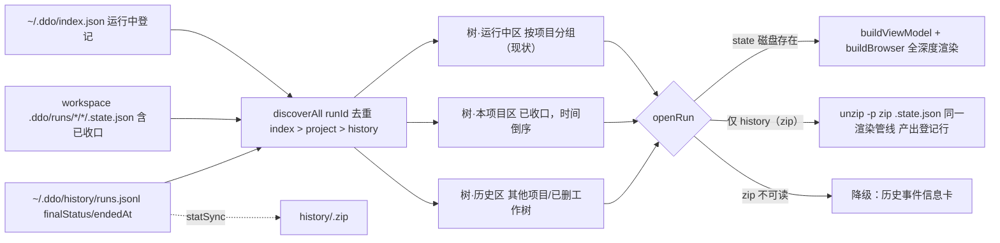

# Ddo-Code-Flow 插件数据面整体关联 技术 Plan

> revision 1｜模式 split（完整草稿 > 12000 code point）｜spec：@plugins 运行目录关联修复 Spec rev 2（已批准 2026-11-15）｜生效目录：`/Users/djhhh/work_area/Ddo-Code-Flow`

---

## 执行摘要

本计划将插件 run 数据面从单源（`~/.ddo/index.json`，仅运行中 run）整体重构为**三源聚合**：index（运行中登记）＋ project（工作区 `.ddo/runs/` 全量，含已收口）＋ history（`~/.ddo/history/runs.jsonl` 事件与 zip 归档），按 runId 全局去重后在树视图以**三区**（运行中/本项目/历史）呈现；详情面板对已收口 run 全深度渲染、对仅存历史 run 经 zip 流式只读预览 state。引擎侧（`tools/`）零改动，插件保持只读、零依赖、无构建。状态文件体系整体盘点（FR-DIR-1 排查结论）见 Part 01，数据面与视图详细设计见 Part 02。

---

## 范围与非目标

| 事项 | 说明 | AI 索引 |
|---|---|---|
| 范围·数据面 | `runDiscovery.js` 三源聚合 `discoverAll`，RunSummary v2 扩展 | FR-DIR-2 |
| 范围·视图 | 三区树 + 已收口/历史 run 详情 + finalStatus 徽章 | FR-DIR-3 |
| 范围·盘点 | 状态文件体系整体盘点结论（Part 01，即排查交付物） | FR-DIR-1、AC-2 |
| 非目标·控制能力 | 不做启动/推进/收口等控制操作，保持只读 | spec Non-goal |
| 非目标·引擎改动 | 不重构 STATE-SPEC 定义的文件结构与写入行为 | spec Non-goal、DEC-5 |
| 非目标·zip 产物浏览 | zip 内产物逐文件流式浏览列为后续增强 | C2-b rejected |

## 现有设计与复用基线

| 能力 | 文件路径 | 符号 | 证据类型 | 采用方式 | 适用边界 | AI 索引 |
|---|---|---|---|---|---|---|
| 惰性 state 加载 + 最小校验 | `plugin/src/runDiscovery.js` | `tryLoadState` / `minimalValid` | Repository Fact | 复用现有实现 | project 源沿用同一校验口径 | R-1 |
| RunSummary 组装 / 位置解析 | `plugin/src/runDiscovery.js` | `summarize` / `positionOf` | Repository Fact | 扩展现有实现 | 增加 source/finalStatus/endedAt/archiveZip | R-2 |
| 索引发现 | `plugin/src/runDiscovery.js` | `discover` | Repository Fact | 复用现有实现 | 三源之一，行为不变（AC-3 基线） | R-3 |
| 六分区视图模型 | `plugin/src/stateView.js` | `buildViewModel` | Repository Fact | 复用现有实现 | 已收口 state 直接可渲染 | R-4 |
| 产出浏览器（限额内联） | `plugin/src/artifactView.js` | `buildBrowser` / `collectArtifacts` | Repository Fact | 扩展现有实现 | 新增 archiveOnly 登记模式 | R-5 |
| spawnSync 只读子命令（3s 超时） | `plugin/src/artifactView.js` | `git()` | Repository Fact | 复用现有实现 | `unzip -p` 沿用同模式 | R-6 |
| 树分组渲染 / panel 注册表 | `plugin/src/extension.js` | `RunsProvider` / `ensurePanel` | Repository Fact | 扩展现有实现 | 根层三区；运行中区保留现状 | R-7 |
| watcher 去抖（300ms） | `plugin/src/extension.js` | `indexWatcher` | Repository Fact | 扩展现有实现 | 新增 project/history 监听 | R-8 |
| history/zip 写入契约 | `tools/lib/history.js` | `append` / `archiveRunZip` | Repository Fact | 不适用（只读对齐） | 插件只解析、不复制实现 | R-9 |

## 整体架构与流程

三源只读聚合，去重后分三区呈现；详情面板按 state 可得性分流（磁盘直读 / zip 预览 / 历史事件降级卡）：

## 技术选型与方案对比

| 方案 | 来源 | 仓库适配性 | 代价与风险 | 状态 | 结论 | AI 索引 |
|---|---|---|---|---|---|---|
| 三源聚合数据面（index+project+history） | 初始发现 | 全信息源纳入，运行中能力零丢失 | 改动集中在 runDiscovery/extension | accepted | 采纳（DEC-1） | C1-a |
| 仅 project 扫描 | 初始发现 | 丢失跨项目存活流水 | 违反 AC-3 回归边界 | rejected | 否决 | C1-b |
| index+history（无 project 扫描） | 初始发现 | 本项目已收口 run 有磁盘 state 却绕行 zip | 舍近求远 | rejected | 否决 | C1-c |
| 历史仅存 run：unzip -p 流式 state 预览 | 初始发现 | 零解压落盘、只读、成本低 | 依赖系统 unzip（macOS 自带） | accepted | 采纳（DEC-3） | C2-a |
| zip 产物逐文件流式浏览 | 初始发现 | 收益边际 | 复杂度高 | rejected | 列后续增强 | C2-b |
| 树架构：单视图三区 | 初始发现 | 存活流水核心场景不被历史淹没 | 改动面小 | accepted | 采纳（DEC-2） | C3-a |
| 树架构：全局统一按项目分组 | 初始发现 | 49 条历史混入存活视图 | 定位被淹没 | rejected | 否决 | C3-b |
| project 源：插件直扫 .ddo/runs | 初始发现 | 目录布局是 STATE-SPEC 固化契约，规模有界 | 数十个 state 读取，毫秒级 | accepted | 采纳（C4） | C4-a |
| project 源：复用引擎命令 | 初始发现 | 引擎无「列出已收口 run」命令 | 引入 skillRoot 运行时耦合 | rejected | 否决 | C4-b |

## 数据模型设计

### 实体与字段

统一实体为 **RunSummary v2**（扩展现有 `summarize` 返回）：现有字段 `runId` `title` `type` `project` `projectRoot` `startedAt` `positions` `completable` `statePath` 不变；新增 `source`（'index'|'project'|'history'）、`finalStatus?`（'done'|'aborted'|'failed'，来自 runs.jsonl）、`endedAt?`、`archiveZip?`。发现结果 `{running[], project[], history[], staleCount, indexError}`。History 事件模型（只读解析）：`{runId, title, git, startedAt, endedAt, finalStatus, statePath}`。完整字段表见 Part 02。

### schema 与 DDL（如适用）

本设计不引入数据库或自有持久化 schema；数据契约是对既有文件结构的只读消费——index.json（`tools/lib/index-registry.js` 契约）、`.state.json`（STATE-SPEC schema v2 六分区）、runs.jsonl（`tools/lib/history.js` append 契约）、zip（archiveRunZip 产物布局），逐文件结构见 Part 01 盘点总表。

### 状态与不变量

不变量：输出按 runId 全局唯一；三组（running/project/history）互斥；源优先级 index > project > history；全程只读。「待收束」与「已收口」的判别唯一依据是 history 事件 `finalStatus`（state/index 不可区分，见 Part 01 关键鉴别事实）；`currentStage` 非空必属运行中区。

### 迁移、兼容与回滚

无数据迁移。`discover()` 保留兼容导出，`extension.js` 改用 `discoverAll`；`buildBrowser(state, opts)` 第二参可选向后兼容。回滚：装配阶段关闭 project/history 源即回到 v0.2.17 行为；引擎侧零改动无需回退。回滚信号见「兼容、稳定性与回滚」。

## API 接口设计

| 接口/入口 | 请求 | 响应 | 错误与幂等 | 复用标准 | 实现职责 | AI 索引 |
|---|---|---|---|---|---|---|
| `runDiscovery.discoverAll` | `{indexPath, projectRoots[]}` | `{running[], project[], history[], staleCount, indexError}` | 单源失败→空组不抛出；幂等只读 | 扩展 discover 数据面风格 | 三源聚合发现 | A-1 |
| `runDiscovery.readProjectRuns` | `projectRoot` | `RunSummary[]`（source:'project'） | 无 .ddo → []；损坏 state 跳过 | 复用 `tryLoadState`/`minimalValid` | 项目 runDir 扫描 | A-2 |
| `runDiscovery.readHistoryEvents` | `indexPath`（推导 history 目录） | `{events[], corruptCount}` | ENOENT/损坏行 → 跳过计数 | 对齐 `tools/lib/history.js` append 契约 | runs.jsonl 只读解析 | A-3 |
| `runDiscovery.loadStateFromZip` | `archiveZip` 绝对路径 | state 对象或 null | spawnSync 失败→null 降级信息卡；幂等 | 沿用 `artifactView.js` git() spawnSync 模式 | zip 内 .state.json 流式读取 | A-4 |
| `artifactView.buildBrowser` | `(state, {archiveOnly?})` | `{files, git}` | 现状 note 降级语义不变 | 扩展现有签名（第二参可选） | 产出浏览器模型（archive 登记模式） | A-5 |
| `stateView.buildHeader`（扩展） | `(state, statePath)` | header ＋ source/finalStatus/endedAt | 无 | 扩展现有 | 徽章数据 | A-6 |

## 算法设计

`discoverAll` 三源装配：① index 源（现 `discover` 不动，标 source）→ ② project 源（workspace 根枚举 `.ddo/runs/*/*/.state.json`，校验通过且 runId 未见；位置非空并入 running，空入 project 组）→ ③ history 源（runs.jsonl 逐行，runId 未见入 history 组；对全部组回填 finalStatus/endedAt；statSync 标 archiveZip）→ ④ 三组各 startedAt 倒序，history 上限 50。复杂度 O(索引条目＋项目 run 数＋历史条数)，实测规模毫秒级。边界：多根 workspace、无 .ddo 根、损坏行、任一源静默降级。逐步细则见 Part 02「discoverAll 装配算法」。

## 文件变更计划

| 文件/目录 | 变更职责 | 复用或依赖 | AI 索引 |
|---|---|---|---|
| `plugin/src/runDiscovery.js` | 三源聚合：新增 discoverAll/readProjectRuns/readHistoryEvents/loadStateFromZip；扩展 summarize | 复用 tryLoadState/minimalValid/positionOf；discover 保留 | F-1 |
| `plugin/src/extension.js` | RunsProvider 三区渲染；ensurePanel archive 补载；新增 project/history watcher | 复用 panel 注册表与去抖 | F-2 |
| `plugin/src/stateView.js` | buildHeader 增 source/finalStatus/endedAt | 扩展现有纯函数 | F-3 |
| `plugin/src/webviewHtml.js` | done/aborted/failed 徽章渲染（docs 调色语义键） | 复用 STATUS_COLOR_KEY 体系 | F-4 |
| `plugin/src/artifactView.js` | buildBrowser/collectArtifacts 支持 archiveOnly | 扩展现有限额体系 | F-5 |
| `plugin/README.md` | 三源数据面/三区视图/盘点结论说明 | — | F-6 |
| `plugin/package.json` | version 0.2.17 → 0.3.0 | — | F-7 |

## 兼容、稳定性与回滚

| 关注点 | 适用性 | 设计/理由 | 回滚信号 | AI 索引 |
|---|---|---|---|---|
| 运行中能力回归 | 适用 | 运行中区=现状树逻辑原样保留（AC-3） | 运行中 run 展示/面板与 v0.2.17 不一致 | S-1 |
| 新源读取失败 | 适用 | 静默降级空组，不影响其余源（indexError 语义沿用） | 三区长期缺失且通道报错 | S-2 |
| 外部依赖 unzip | 适用 | macOS 自带；失败降级历史事件信息卡，不阻塞 | 历史仅存 run 面板持续降级 | S-3 |
| 性能 | 适用 | KB 级 JSON 读取；zip 仅开面板时读一次；watcher 去抖 300ms | 树刷新可感知卡顿 | S-4 |
| 版本与配置面 | 适用 | 配置零新增（history 目录由 indexPath 推导）；版本升 0.3.0 | — | S-5 |

## Verification Anchor

| 需验证契约 | 可观察结果 | 证据位置 | AI 索引 |
|---|---|---|---|
| V1 三源聚合正确性 | 本 run（20261115-043937-a4fb）在 running；已收口 20261115-010356-6057 在 project 组且 finalStatus='done'；history 组含其他项目条目；runId 无重复 | 临时命令行冒烟输出（不入仓库） | VA-1 |
| V2 界面行为 | 三区树正确；已收口 run 六分区+产出浏览；zip-only 历史 run state 预览与降级链路；运行中 run 与 v0.2.17 一致 | Extension Development Host（F5）手动核验 | VA-2 |
| V3 边界降级 | 无 .ddo 工作区 / runs.jsonl 损坏行 / index 缺失 → 静默降级不抛错 | 同 V1 冒烟（构造边界目录） | VA-3 |

## 开放问题与 Spec 对应

| 问题 | 确定答案或阻塞原因 | 解决位置 | AI 索引 |
|---|---|---|---|
| PD-1 各状态文件源读取方式 | 插件直扫/直读（C4-a），不复用引擎命令（C4-b rejected） | 本文档 C4、Part 02 | Q-1 |
| PD-2 多来源信息架构 | 单视图三区（C3-a），归属规则见 Part 02 | 本文档 C3、Part 02 三区表 | Q-2 |
| PD-3 性能与惰性加载 | 树仅读 KB 级 JSON；zip 惰性至开面板；上限 50 | Part 02 性能与边界 | Q-3 |
| spec BQ 遗留 | 无——BQ-1/BQ-2 已由用户修订解决（spec 对齐变化摘要） | spec rev 2 | Q-4 |

## 风险与下游交接

- **风险与缓解**：① 三区树改动触及 RunsProvider 主路径（缓解：运行中区逻辑原样迁移，V2 回归核验）；② history 回填错配 runId（缓解：runId 全局唯一由引擎 genRunId 保证，冒烟断言无重复）；③ zip 依赖系统 unzip（缓解：降级信息卡，S-3）。
- **下游读取范围**：Coding/Verification 以本文件为契约源，按 Parts Manifest 加载两个 current 分册；详细字段与算法以 Part 02 为准，文件结构语义以 Part 01 为准。
- **事实失效处理**：若编码期发现 STATE-SPEC 字段或目录布局与 Part 01 盘点不符，停止并报告，不得自行改已批准契约；需修订 plan 时走「修改」产生新 revision。

## Parts Manifest

| # | 文档 | 职责 | 字符数 | 状态 | AI 索引 |
|---|---|---|---|---|---|
| 01 | `plans/01-state-files-inventory.md` | 状态文件体系整体盘点（FR-DIR-1 排查结论） | 3431 | current | P-1 |
| 02 | `plans/02-datasource-view-design.md` | 数据面与视图详细设计（RunSummary v2/算法/三区/面板/watcher） | 3173 | current | P-2 |

读取协议：入口（本文件）为唯一确认入口；分册按上表加载，均为 current。旧 revision 分册在后续修订中标记 stale 不得被下游读取。

## 用户确认

- ✅ **同意**：批准当前 revision，进入 Coding。
- ❌ **修改：<反馈>**：反馈应用到新 revision 并重评估，展示变化摘要后重新送审。
- ❓ **提问：<问题>**：只答疑，不改文档、revision 与确认状态。
- 📥 **归档**：列出可用模板名（当前可用：`ddo`）。
- 📥 **归档：<模板名>**：按模板生成 tech-design 归档文档；不代表批准。
