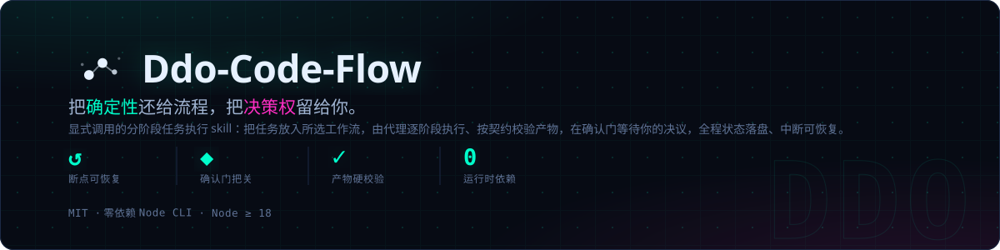
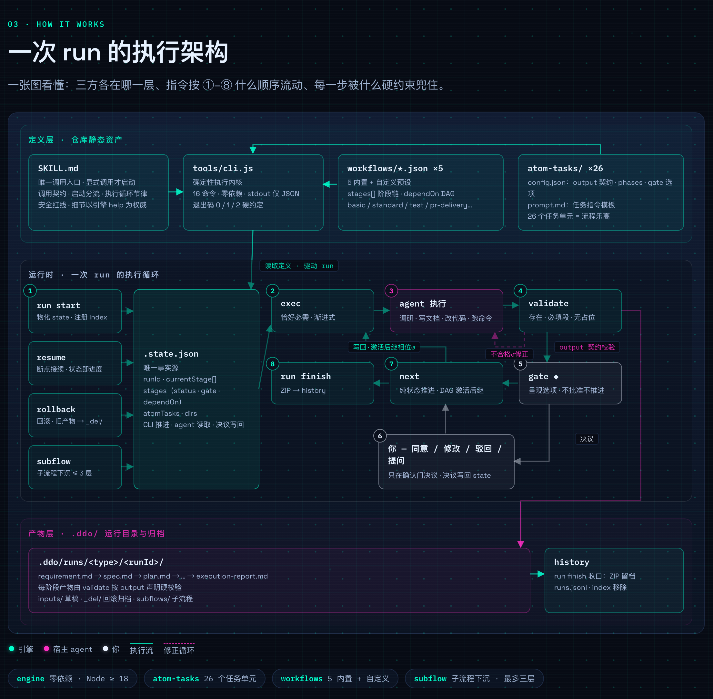

<h1 align="center">Ddo-Code-Flow</h1>

<p align="center">
  
</p>

<p align="center">
  <a href="LICENSE"></a>
  
  
</p>

<p align="center">简体中文 · <a href="docs/README.en.md">English</a></p>

> **Ddo-Code-Flow** 是一个**显式调用的分阶段任务执行 skill**：把用户交付的任务放入选定工作流，由代理依次完成，在人工审核点等待用户决议，全程保存执行状态、支持中断恢复。
>
> 想先直观了解它如何运转？打开 **[项目介绍页](https://ddoai.cn)** —— 七屏交互式导览：为什么需要它、内置工作流、一次 run 的执行架构、SOP 终端实演与快速开始（源文件 [docs/index.html](docs/index.html)）。

---

## 目录

[这是什么](#这是什么) · [特性](#特性) · [安装](#安装) · [快速开始](#快速开始) · [调用契约](#调用契约) · [工作流](#工作流) · [工作原理](#工作原理) · [命令参考](#命令参考) · [目录与产物](#目录与产物) · [配置与扩展](#配置与扩展) · [仓库结构](#仓库结构) · [开发与测试](#开发与测试) · [参与贡献](#参与贡献) · [许可证](#许可证)

## 这是什么

直接让 AI 完成开发任务，容易出现「需求尚未对齐就开始实现」「方案没有审核」「过程缺少留档」「中断后无法接续」等问题。ddo-code-flow 把任务组织成**可审核、可恢复的流程**，并用一个零依赖的 Node CLI 检查执行位置、输出契约与确认门。

它不替代理写代码，而是**组织和约束代理的工作过程**：

- **CLI** 提供当前指令、校验产物、管理状态；
- **代理** 完成实际工作；
- **用户** 审核关键交付、作出决议。

最终生成哪些文档和代码，由所选工作流决定。本 README 面向使用者和维护者；[SKILL.md](SKILL.md) 是代理的执行入口。

## 特性

| 需要解决的问题 | 提供的机制 |
|---|---|
| 需求和方案缺少审核 | 工作流中的人工审核点；呈现与用户决议留痕 |
| 一次加载全部指令和历史 | 每个相位按当前状态组装指令、配置、上下文和输出契约 |
| 代理只口头声称完成 | 通过 `validate` 检查声明的产物；实际执行与验证证据仍由代理提供 |
| 重做时新旧产物混在一起 | 阶段回滚，失效产物移动到 `_del/`，重做生成新文件 |
| 会话中断后失去执行位置 | `.state.json` 保存状态，`resume` 从当前位置接续 |

这些机制不代替代理完成任务：代理仍须实际执行、校验产物并等待决议；`next` 只做状态推进，不做产物校验。

> **Dogfooding**：本仓库 v2 的需求与定版方案保存在 `.ddo/runs/feat/ddo-code-flow-v2/`，开发过程也使用了这套流程。

## 安装

**前置要求**

- 一个宿主 AI coding agent（Claude Code、Codex，或其他能加载 skill 指令并执行命令的工具）。
- Node.js ≥ 18。流水线内核是零依赖的 Node CLI，无需 `npm install`。

**作为 skill 安装**：把本仓库放入宿主的 skills 目录。Claude Code 通常使用 `~/.claude/skills/ddo-code-flow/` 或项目内 `.claude/skills/ddo-code-flow/`；其他宿主按其规范放置并显式加载。不能仅因宿主自动发现了 skill，就未经用户显式调用启动流程。

**clone 仓库用于开发与调试**

```bash
git clone https://github.com/Djhhhhhh/Ddo-Code-Flow.git
```

克隆后可在仓库根目录直接运行 CLI。手动调用 CLI 是调试方式，不等于允许代理在普通对话中自动启动 skill。

## 快速开始

### 推荐：裸调用（先选择恢复或新建）

```text
你      /ddo-code-flow
agent   希望恢复已有 run，还是新开 run？
你      新开 run
agent   （询问目标：本次要完成什么？）
你      修复导出函数的边界处理
agent   （询问 worktree、工作流、run 类型、存储方式等配置）
你      basic · fix · 正常存储
agent   （启动 run，固化原始需求，生成 spec，在人工审核点展示待审内容）
你      修改：验收标准里加上边界值说明
agent   （记录交互，修改相关内容，再次呈现审核选项）
你      同意
agent   （继续 plan、coding、reporting，最后收口）
```

### 带描述：直接新开运行（AI 自动调用 / subflow 场景）

```text
你      /ddo-code-flow 修复导出函数的边界处理
agent   （接收目标，询问 worktree、工作流、run 类型、存储方式等配置）
你      basic · fix · 正常存储
agent   （启动 run，固化原始需求，生成 spec，在人工审核点展示待审内容）
```

用户需要参与启动配置和人工审核，不需要手动记忆内部命令。确认配置前不会仅凭任务描述直接创建 run。

## 调用契约

**只接受显式调用，不按任务内容或关键词自动激活。** 普通对话中出现「使用工作流」「分阶段开发」等表达，不等于调用本 skill。

| 调用方式 | 启动行为 |
|---|---|
| `/ddo-code-flow`（推荐） | 先询问「恢复已有 run 还是新开 run」，再进入所选分支 |
| `/ddo-code-flow <需求或 bug 描述>` | 新开 run：已有目标，不询问恢复，继续询问其余启动配置；适合 AI 自动调用或 subflow 场景 |

显式调用后，无论任务多简单都必须进入流程，不以问答、小改动或单文件修复为由绕过。带描述调用不因存在旧 run 而改变新建意图；不带描述调用不因没有旧 run 而跳过首次选择。

## 工作流

内置工作流：

- **basic**：轻量开发链，requirement → spec → plan → coding → reporting。
- **standard**：完整开发链，增加测试计划、任务拆分、验证、复审和复盘。
- **test**：测试链路，test-scope → test-design → test-unit / test-api / test-e2e → test-reporting。
- **pr-delivery**：PR 交付收尾链，deliver-pr → closeout-worktree。
- **pr-delivery-issue**：交付链的 issue 关联变体，增加 link-issue。

实际预设清单和任务链以 `list workflows` 为准。也可选择自定义流程：列出任务，与代理确定阶段及依赖，再通过临时预设启动。

阶段链支持 DAG 依赖，状态推进有以下边界：

- `next` 推进所有当前位置，不是只推进刚完成的任务。
- 一轮出现多个普通执行位置时，必须全部执行并校验成功后再推进。
- 一次 `next --decision` 将同一个决议用于所有当前确认门，不支持逐门独立推进。
- 多门同时出现时，不能把某一个门的批准当成全部批准。

## 工作原理

skill 运行在宿主代理中，不是独立的开发代理。核心概念：

| 概念 | 含义 |
|---|---|
| 原子任务 | `atom-tasks/<name>/` 中的任务单元，含指令、相位与产物声明 |
| workflow 预设 | 声明阶段及 `dependOn` 依赖，启动时物化进 state |
| run | 一次运行，包含所选任务链、状态和流程产物 |
| 相位 | 任务中的步骤，当前位置以 `spec:01` 等形式表示 |
| 确认门 | 人工审核位置，获得用户明确决议后才能推进 |
| 子流程 | 任务执行中运行期下沉的嵌套流水，阻塞式、总深度最多三层 |

三方分工：

| 角色 | 职责 | 边界 |
|---|---|---|
| CLI | 提供指令、校验产物、检查位置与确认门、推进状态 | 不代替代理完成任务，不代替用户决议 |
| 代理 | 完成当前指令要求的工作，校验产物，呈现选项并执行合法命令 | 不手改 state，不自造选项，不替用户批准 |
| 用户 | 显式调用、选择配置、审核交付并作出决议 | 不需要手动操作内部状态文件 |

### 执行架构一图流

<p align="center">
  
</p>

三层结构：**定义层**（SKILL.md / tools/cli.js / workflows / atom-tasks 仓库静态资产）→ **运行时**（`.state.json` 驱动的 ①–⑧ 执行循环与确认门）→ **产物层**（`.ddo/runs/` 运行目录与 history 归档）。带连线交互与 SOP 终端实演的版本见[项目介绍页](https://ddoai.cn)。

### 普通执行循环

1. 读取完整 `currentStage`，每个当前步骤先通过 `exec` 获取本次指令。
2. 完成本轮所有普通执行位置的实际工作。
3. 分别 `validate`；任一未完成或未通过校验，不调用推进命令。
4. 没有人工审核时统一执行一次 `next`；有审核时按 gate payload 呈现内容，等待用户决议。
5. 每次状态改变后重新读取位置；全部完成后执行 `run finish`。

相位内修改、提问或回答问题不等于批准；交互先通过 `gate interact` 留痕，处理后重新 `gate present`。

### 子流程下沉

任务执行中发现需要补充调研等子目标时，可运行期创建子流程（`subflow start`）。子流程复用同一套执行循环；存在未收口的子流程时，父流程的 `next` 与 `run finish` 被拦截。多层下沉最多三层。

### 交付链的特殊收尾

`closeout-worktree` 是交付预设末段的专用收尾任务，进入时须为唯一当前位置，按 exec 指令自行完成产物入库、推进收口与 worktree 清理；外层不重复 validate、next、finish。

## 命令参考

代理统一使用 `node "<skillRoot>/tools/cli.js" <命令>` 的绝对入口。日常由 [SKILL.md](SKILL.md) 调用；以下供手动调试和维护参考。

| 命令 | 作用 |
|---|---|
| `guide` | 返回运行清单、完整启动问题、选项和参数映射 |
| `run start` | 按预设创建 state 并注册运行；支持 `--ephemeral` 临时存储 |
| `exec` | 返回当前相位的组装指令 |
| `validate` | 检查当前任务声明的产物、必填结构和输出 schema |
| `next` | 推进全部当前位置、激活后继阶段 |
| `subflow start` / `subflow close` | 创建 / 收口子流程 |
| `gate present` / `gate interact` | 呈现审核选项 / 记录相位内交互 |
| `rollback` | 重置指定阶段，旧产物移到 `_del/rollback-<n>/` |
| `run finish` | 结束运行并移出运行索引 |
| `status` / `resume` | 查看当前位置与可用命令 / 恢复运行 |
| `list tasks` / `list workflows` | 列出任务与相位 / 预设与阶段链 |
| `deps check` | 枚举任务依赖并本机检查 |

命令 stdout 通常为 JSON，`exec` 为裸文本指令；退出码 0 成功、1 失败或被拦截、2 用法错误。

## 目录与产物

| 位置 | 用途 |
|---|---|
| skillRoot | 任务、预设和 CLI；运行期只读 |
| projectRoot | 本次运行的项目位置（worktree 时为该工作树） |
| runDir | `.state.json` 与流程文档产物的统一存放位置 |
| DDO_HOME | 全局运行索引、临时材料和历史归档（默认 `~/.ddo`） |

- **正常模式**：运行材料位于 `<projectRoot>/.ddo/runs/<type>/<dirName>/`，随项目版控。
- **临时模式**：位于 `<DDO_HOME>/tmp/<type>/<runId>/`，`run finish` 后删除。
- 回滚时，被重置阶段的旧产物移动到 `<runDir>/_del/rollback-<n>/`。

## 配置与扩展

原子任务配置按三层取值（标量覆盖，rules 数组逐层拼接）：

```text
任务默认 < 用户级（<DDO_HOME>/atom-tasks.json） < run 级（state.atomTasks）
```

新增原子任务时，在 `atom-tasks/<name>/` 下创建 `prompt.md`（指令）、`config.json`（配置），可选 `*.js` 上下文钩子与 `*.output.schema.json` 输出契约。自定义工作流用 JSON 的 `stages` 数组声明任务与 `dependOn` 依赖。

## 仓库结构

```text
SKILL.md                         # 代理执行入口
README.md                        # 用户与维护者说明（中文）
docs/README.en.md                # 英文版说明
docs/index.html                  # 项目介绍页（七屏交互导览）
docs/header.svg                  # README 横幅
docs/architecture.png            # 执行架构截图
workflows/*.json                 # 内置工作流预设
atom-tasks/<name>/               # 任务指令、配置、上下文钩子与输出契约
tools/cli.js                     # Node CLI
tools/lib/                       # state、索引、归档、组装和 schema 校验
tools/tests/                     # node:test 沙箱隔离测试
.ddo/runs/                       # 正常模式运行材料
```

## 开发与测试

```bash
node --test tools/tests/*.test.js
```

测试在临时目录沙箱内隔离运行。CLI 测试不等于 skill 行为测试；入口修改后应在独立会话中核对调用契约、恢复、审核与推进行为。

## 参与贡献

欢迎 Issue 与 PR，模板位于 `.github/`。涉及流程语义的改动应先对齐需求与方案，再实现和验证；命令行为变化须同步 CLI 命令注册表、README 和 SKILL.md。

## 许可证

[MIT](LICENSE) © 2026 Djhhhhhh
