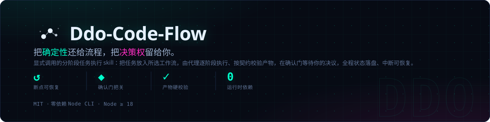
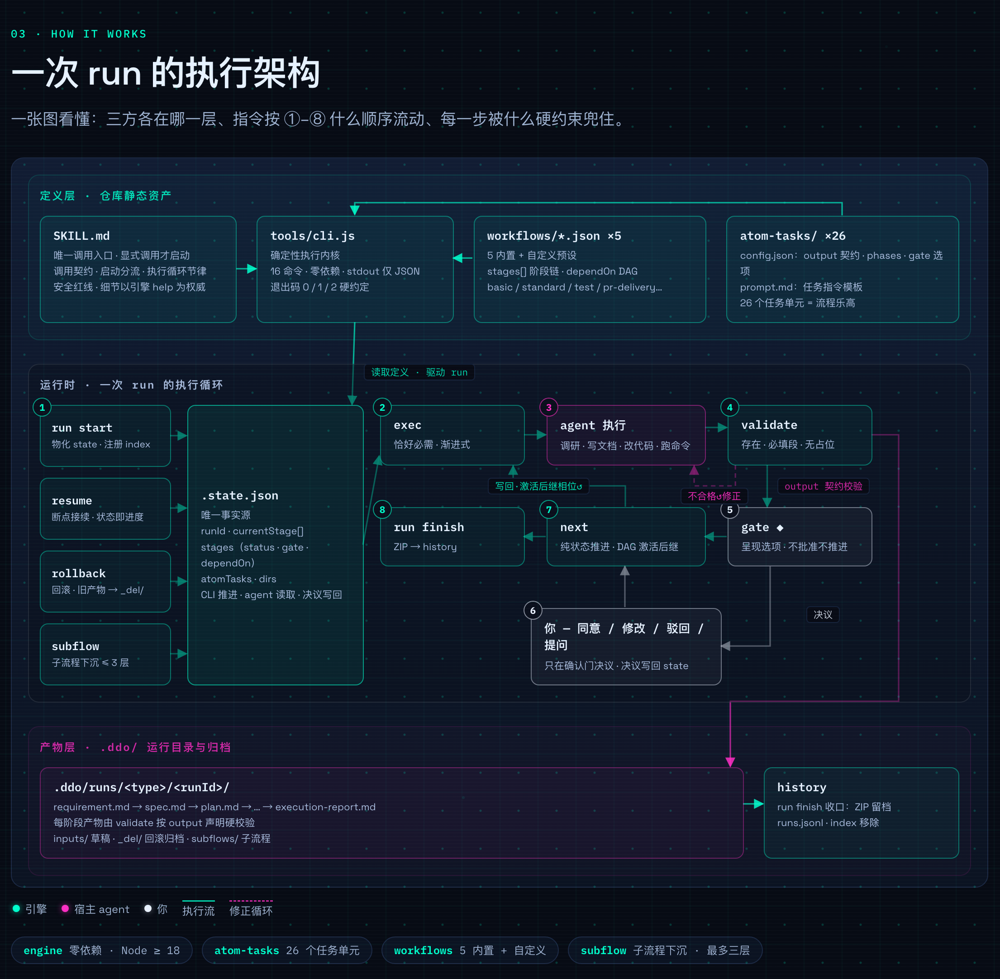

<h1 align="center">Ddo-Code-Flow</h1>

<p align="center">
  
</p>

<p align="center">
  <a href="LICENSE"></a>
  
  
</p>

<p align="center"><a href="README.md">简体中文</a> · English</p>

> **Ddo-Code-Flow** is an **explicitly-invoked, stage-gated task execution skill**: a task you hand over is placed into a workflow of your choice, executed step by step by an agent, and paused at human review gates for your decisions — with full execution state persisted so interrupted runs can resume.
>
> Want the visual tour first? Open the **[project intro page](https://ddoai.cn)** (in Chinese) — a seven-screen interactive walkthrough: why it exists, built-in workflows, the execution architecture of a run, a live terminal SOP replay, and quick start (source at [docs/index.html](index.html)).

---

## Contents

[What it is](#what-it-is) · [Features](#features) · [Installation](#installation) · [Quick start](#quick-start) · [Invocation contract](#invocation-contract) · [Workflows](#workflows) · [How it works](#how-it-works) · [Command reference](#command-reference) · [Directories and artifacts](#directories-and-artifacts) · [Configuration and extension](#configuration-and-extension) · [Repository layout](#repository-layout) · [Development and testing](#development-and-testing) · [Contributing](#contributing) · [License](#license)

## What it is

Letting an AI complete development tasks directly tends to produce familiar failures: implementation starts before requirements are aligned, designs ship without review, the process leaves no trail, and an interrupted session loses its place. ddo-code-flow organizes the task into a **reviewable, resumable process**, checked by a zero-dependency Node CLI that tracks execution position, output contracts, and confirmation gates.

It does not write code in the agent's stead — it **organizes and constrains how the agent works**:

- the **CLI** serves the current instruction, validates artifacts, and manages state;
- the **agent** does the actual work;
- the **user** reviews key deliverables and makes decisions.

Which documents and code a run ultimately produces is decided by the chosen workflow. This README is for users and maintainers; [SKILL.md](../SKILL.md) is the agent-facing execution entry.

## Features

| Problem it solves | Mechanism it provides |
|---|---|
| Requirements and designs skip review | Human review gates in the workflow; presented options and user decisions are recorded |
| Loading every instruction and all history up front | Each phase assembles its instruction, config, context, and output contract from current state |
| The agent merely claims it is done | `validate` checks the declared artifacts; actual execution and verification evidence still comes from the agent |
| Redo work mixes with stale outputs | Stage rollback moves invalidated artifacts to `_del/` and redo produces fresh files |
| An interrupted session loses its position | `.state.json` persists state; `resume` continues from the current position |

These mechanisms do not do the agent's job: the agent must still execute, validate artifacts, and await decisions; `next` only advances state — it does not validate deliverables.

> **Dogfooding**: the requirements and finalized design of this repository's v2 live in `.ddo/runs/feat/ddo-code-flow-v2/` — built with this very process.

## Installation

**Prerequisites**

- A host AI coding agent (Claude Code, Codex, or any tool that can load skill instructions and run commands).
- Node.js ≥ 18. The pipeline kernel is a zero-dependency Node CLI; no `npm install` needed.

**Install as a skill**: place this repository into the host's skills directory. Claude Code typically uses `~/.claude/skills/ddo-code-flow/` or an in-project `.claude/skills/ddo-code-flow/`; other hosts follow their own conventions and load it explicitly. The flow must never start just because the host auto-discovered the skill — only on your explicit invocation.

**Clone for development and debugging**

```bash
git clone https://github.com/Djhhhhhh/Ddo-Code-Flow.git
```

After cloning you can run the CLI from the repository root. Invoking the CLI by hand is a debugging aid, not permission for the agent to auto-start the skill in ordinary conversation.

## Quick start

### Recommended: bare invocation (choose resume or new)

```text
you     /ddo-code-flow
agent   Resume an existing run, or start a new one?
you     New run
agent   (asks for the goal: what should this run accomplish?)
you     Fix the edge handling of the export function
agent   (asks about worktree, workflow, run type, storage, etc.)
you     basic · fix · normal storage
agent   (starts the run, freezes the original requirement, drafts the spec, presents it at a review gate)
you     Revise: add edge-value notes to the acceptance criteria
agent   (records the interaction, applies the changes, presents the review options again)
you     Approve
agent   (proceeds through plan, coding, reporting, then closes out)
```

### With a description: straight into a new run (AI-initiated / subflow)

```text
you     /ddo-code-flow fix the edge handling of the export function
agent   (takes the goal, asks about worktree, workflow, run type, storage, etc.)
you     basic · fix · normal storage
agent   (starts the run, freezes the requirement, drafts the spec, presents it at a review gate)
```

You take part in startup configuration and human review; you never need to memorize internal commands. A run is never created from a task description alone before you confirm the configuration.

## Invocation contract

**Only explicit invocations count — the skill never activates from task content or keywords.** Phrases like "use a workflow" or "develop in stages" in ordinary conversation do not invoke this skill.

| Invocation | Startup behavior |
|---|---|
| `/ddo-code-flow` (recommended) | First asks "resume an existing run, or start a new one?", then follows the chosen branch |
| `/ddo-code-flow <requirement or bug description>` | Starts a new run: the goal is known, no resume question, remaining startup config still asked; suited for AI-initiated calls or subflows |

Once invoked explicitly, the process is entered no matter how small the task — never bypassed on the grounds of "just a Q&A", "a tiny change", or "a one-file fix". A call with a description keeps its new-run intent even if old runs exist; a bare call still offers the choice even when no old run exists.

## Workflows

Built-in workflows:

- **basic**: lightweight dev chain — requirement → spec → plan → coding → reporting.
- **standard**: full dev chain — adds test planning, task breakdown, verification, review, and retrospective.
- **test**: testing chain — test-scope → test-design → test-unit / test-api / test-e2e → test-reporting.
- **pr-delivery**: PR delivery closing chain — deliver-pr → closeout-worktree.
- **pr-delivery-issue**: the issue-linked variant of the delivery chain, adding link-issue.

The authoritative list of presets and stage chains is `list workflows`. Custom flows are also supported: list the tasks, agree on stages and dependencies with the agent, then start via a temporary preset.

Stage chains support DAG dependencies. Boundaries of state advancement:

- `next` advances *all* current positions — not just the task that finished.
- When a round has multiple active execution positions, every one must be executed and validated before advancing.
- A single `next --decision` applies one decision to all currently open gates; per-gate independent advancement is not supported.
- When several gates are open at once, approving one gate is never treated as approving them all.

## How it works

The skill runs inside the host agent — it is not a standalone development agent. Core concepts:

| Concept | Meaning |
|---|---|
| Atom task | A task unit in `atom-tasks/<name>/` with instructions, phases, and artifact declarations |
| Workflow preset | Declares stages and `dependOn` dependencies; materialized into state at startup |
| run | One execution: the chosen task chain, its state, and process artifacts |
| Phase | A step within a task; the current position reads like `spec:01` |
| Confirmation gate | A human review position that advances only after an explicit decision |
| Subflow | A nested pipeline sunk at runtime; blocking, total depth capped at three |

The three-party split:

| Role | Responsibility | Boundary |
|---|---|---|
| CLI | Serves instructions, validates artifacts, checks position and gates, advances state | Never does the agent's work, never decides for the user |
| Agent | Does the current instruction's work, validates artifacts, presents options, runs legal commands | Never hand-edits state, invents options, or approves for the user |
| User | Invokes explicitly, chooses configuration, reviews deliverables, decides | Never needs to touch internal state files |

### Execution architecture at a glance

<p align="center">
  
</p>

Three layers: the **definition layer** (static repo assets: SKILL.md / tools/cli.js / workflows / atom-tasks) → the **runtime** (the ①–⑧ execution loop and confirmation gates driven by `.state.json`) → the **artifact layer** (the `.ddo/runs/` run directory and history archive). See the [project intro page](https://ddoai.cn) for the wired interactive version with a terminal SOP replay.

### The ordinary execution loop

1. Read the full `currentStage`; for each current step, fetch this round's instruction via `exec`.
2. Complete the actual work of every ordinary execution position in this round.
3. Run `validate` on each; if any is unfinished or fails validation, no advancement command runs.
4. With no review pending, run `next` once; with a review pending, present the gate payload and await the user's decision.
5. Re-read the position after every state change; when everything completes, run `run finish`.

Revisions, questions, or answers inside a phase are not approvals; interactions are recorded via `gate interact` first, then `gate present` is called again.

### Subflow sinking

When a task discovers a sub-goal (say, supplementary research), a subflow can be created at runtime (`subflow start`). Subflows reuse the same execution loop; while any subflow is unclosed, the parent's `next` and `run finish` are intercepted. Nesting goes at most three levels deep.

### Special closeout of the delivery chain

`closeout-worktree` is the dedicated closing task at the end of delivery presets. It must be the sole current position when entered, and per its exec instruction it commits artifacts, advances to closeout, and cleans up the worktree itself; the outer loop does not repeat validate, next, or finish.

## Command reference

Agents always call `node "<skillRoot>/tools/cli.js" <command>` with an absolute path. Day-to-day use goes through [SKILL.md](../SKILL.md); the table below is for manual debugging and maintenance.

| Command | Purpose |
|---|---|
| `guide` | Running-run list, full startup questions, options, and parameter mapping |
| `run start` | Creates state from a preset and registers the run; supports `--ephemeral` temp storage |
| `exec` | Returns the assembled instruction for the current phase |
| `validate` | Checks declared artifacts: presence, required sections, output schema |
| `next` | Advances all current positions and activates successors |
| `subflow start` / `subflow close` | Creates / closes a subflow |
| `gate present` / `gate interact` | Presents review options / records in-phase interactions |
| `rollback` | Resets a stage; old artifacts move to `_del/rollback-<n>/` |
| `run finish` | Ends the run and removes it from the run index |
| `status` / `resume` | Shows current position and available commands / resumes a run |
| `list tasks` / `list workflows` | Lists tasks with phases / presets with stage chains |
| `deps check` | Enumerates task dependencies and checks them locally |

Command stdout is JSON in general (`exec` outputs plain text); exit codes: 0 success, 1 failure or interception, 2 usage error.

## Directories and artifacts

| Location | Purpose |
|---|---|
| skillRoot | Tasks, presets, and the CLI; read-only at runtime |
| projectRoot | The project of this run (the worktree, if one is used) |
| runDir | Home of `.state.json` and all process artifacts |
| DDO_HOME | Global run index, temp material, and history archive (default `~/.ddo`) |

- **Normal mode**: run material lives in `<projectRoot>/.ddo/runs/<type>/<dirName>/`, versioned with the project.
- **Ephemeral mode**: lives in `<DDO_HOME>/tmp/<type>/<runId>/`, deleted on `run finish`.
- On rollback, the reset stage's old artifacts move to `<runDir>/_del/rollback-<n>/`.

## Configuration and extension

Atom-task configuration resolves across three layers (scalars override; `rules` arrays concatenate):

```text
task defaults < user level (<DDO_HOME>/atom-tasks.json) < run level (state.atomTasks)
```

To add an atom task, create `prompt.md` (instructions) and `config.json` (config) under `atom-tasks/<name>/`; optional `*.js` context hooks and `*.output.schema.json` output contracts. Custom workflows declare tasks and `dependOn` dependencies in a JSON `stages` array.

## Repository layout

```text
SKILL.md                         # agent execution entry
README.md                        # user & maintainer guide (Chinese)
docs/README.en.md                # English edition
docs/index.html                  # interactive project intro page (Chinese)
docs/header.svg                  # README banner
docs/architecture.png            # execution architecture snapshot
workflows/*.json                 # built-in workflow presets
atom-tasks/<name>/               # task instructions, config, hooks, output contracts
tools/cli.js                     # the Node CLI
tools/lib/                       # state, index, archive, assembly, schema validation
tools/tests/                     # node:test sandboxed tests
.ddo/runs/                       # normal-mode run material
```

## Development and testing

```bash
node --test tools/tests/*.test.js
```

Tests run isolated in temporary-directory sandboxes. CLI tests are not skill-behavior tests; after changing the entry point, verify the invocation contract, resume, review, and advancement behavior in a fresh session.

## Contributing

Issues and PRs are welcome; templates live in `.github/`. Changes to process semantics should align requirements and design before implementation and verification; command-behavior changes must update the CLI command registry, the README, and SKILL.md together.

## License

[MIT](../LICENSE) © 2026 Djhhhhhh
